# Portwood Knowledgebase

<!-- Generated by npm run guide:build. Edit docs/knowledgebase/articles and guide.json. -->

Make your first document, build a template, send it for signature, and keep your team moving. Pick the task you want to finish; you do not need to read this guide from beginning to end.

**Current release:** 3.60.0. [Install in production](https://login.salesforce.com/packaging/installPackage.apexp?p0=04tVx000001BOsrIAG) · [Install in a sandbox](https://test.salesforce.com/packaging/installPackage.apexp?p0=04tVx000001BOsrIAG) · [Open the visual guide](https://portwood.dev/guide)

## Table of contents

- **Start here**
    - [Welcome to Portwood](#welcome)
    - [Install Portwood](#install-portwood)
    - [Make your first document](#first-document)
    - [Find your way around](#find-your-way)
    - [Choose a template format](#choose-format)

- **Build a template**
    - [Design with Canvas](#canvas-design)
    - [Bring a Word document](#upload-word)
    - [Bring a Google Doc or HTML file](#import-html)
    - [Fill an existing PDF form](#fillable-pdf)
    - [Make Excel and PowerPoint files](#office-formats)
    - [Get help from AI](#ai-authoring)

- **Add information and polish**
    - [Choose the information in a document](#choose-data)
    - [Make a table that grows](#repeating-tables)
    - [Format dates, amounts, and labels](#format-values)
    - [Show content only when it applies](#conditional-content)
    - [Add logos and pictures](#images-and-assets)
    - [Set paper, headers, and page backgrounds](#page-layout)
    - [Add charts, QR codes, and barcodes](#charts-and-codes)
    - [Use custom PDF fonts](#custom-fonts)

- **Make and share documents**
    - [Add Portwood to a record page](#add-to-record-page)
    - [Generate a document](#generate-document)
    - [Combine documents into one PDF](#document-packets)
    - [Create document and email buttons](#document-buttons)
    - [Give files useful names](#name-documents)
    - [Make documents for many records](#bulk-generation)
    - [Read job status and recover failures](#job-history)

- **Collect signatures**
    - [Send an uploaded PDF for signature](#sign-uploaded-pdf)
    - [Send a template for signature](#sign-template)
    - [What a signer sees](#signer-experience)
    - [Track, resend, or stop a request](#manage-signatures)
    - [Set up external signing](#setup-signatures)
    - [Brand the signing experience](#brands-and-emails)
    - [Create the Salesforce signing site](#site-salesforce)
    - [Use an Experience Cloud signing site](#site-experience-cloud)
    - [Configure signing email and verification](#site-email)
    - [Collect signer answers and write them back](#signer-inputs)

- **Automate the work**
    - [Make a document with Flow](#flow-generate)
    - [Schedule a bulk run with Flow](#flow-bulk)
    - [Create signing requests with Flow](#flow-signatures)
    - [Use prepared or custom data](#custom-data)
    - [Follow asynchronous jobs from Flow or Apex](#async-jobs)

- **Keep your team organized**
    - [Save changes and return to an earlier version](#template-versions)
    - [Organize and limit template choices](#organize-templates)
    - [Move a template between orgs](#move-templates)
    - [Give people the right access](#manage-access)
    - [Upgrade without losing your way](#upgrade-portwood)
    - [File and format limits](#limits)

- **Merge tags, from A to Z**
    - [Find the right merge tag](#merge-tags)
    - [Fields, dates, currency, and user tags](#tag-fields)
    - [Loops, row numbers, grouping, and scope](#tag-loops)
    - [Conditions and alternative content](#tag-conditions)
    - [Counts, sums, averages, minimums, and maximums](#tag-totals)
    - [Charts and every chart modifier](#tag-charts)
    - [Images, assets, codes, rich text, and backgrounds](#tag-media)
    - [Signature tags and variable signer blocks](#tag-signatures)
    - [Print classic approval history](#tag-approvals)
    - [Signing email tokens and custom buttons](#email-tokens)

- **Make the engine purr**
    - [Repeat table headers across PDF pages](#repeat-table-headers)
    - [Build rich headers and two-line page footers](#running-headers-footers)
    - [Build grouped reports without broken table markup](#grouped-reports)
    - [Tune a demanding document](#engine-tuning)

- **Build with Apex**
    - [Generate documents from your own Apex](#apex-generation)
    - [Build a custom Apex data provider](#apex-data-provider)
    - [Call Flow actions and signing APIs from Apex](#apex-actions)
    - [Use PDF, email, and cleanup helpers](#apex-utilities)
    - [All exported global Apex declarations](#apex-surface)
    - [Query configuration formats and aliases](#query-config)

- **Examples and help**
    - [Try the worked examples](#example-library)
    - [Find and fix a problem](#troubleshooting)
    - [Fix a document](#fix-document)
    - [Fix a signing problem](#fix-signing)
    - [Plain-language glossary](#glossary)
    - [Developer and advanced references](#developer-reference)

## Start here

Learn the basics and make your first document.

<a id="welcome"></a>

### Welcome to Portwood

Portwood turns information in Salesforce into a document you can download, save, email, or send for signature.

Think of a template as a reusable form. You design it once. Portwood fills in a new copy for each customer, deal, or other record.

| You bring                                  | Portwood makes                                 |
| ------------------------------------------ | ---------------------------------------------- |
| An Account and a customer-summary template | A customer summary with that Account's details |
| An Opportunity and a quote template        | A quote with the deal's information            |
| A contract and a list of people            | A signing request you can track                |
| A group of records                         | A document for each record                     |

#### Start with the path that fits you

- **I just need a document.** Go to [Generate a document](#generate-document).
- **I am setting up Portwood.** Start with [Install and give people access](#install-portwood).
- **I want to build something.** Follow [Make your first document](#first-document).
- **I already have a PDF to sign.** Follow [Send an uploaded PDF for signature](#sign-uploaded-pdf).
- **Something is wrong.** Open [Find and fix a problem](#troubleshooting).

#### Five words you will see

**Record:** one item in Salesforce, such as one Account or one Opportunity.

**Template:** the reusable design, wording, and settings for your document.

**Field:** one piece of information on a record, such as its name or phone number.

**Merge tag:** a marker such as `{Name}`. In the finished document, Portwood replaces it with the record's name.

**Version:** a saved copy of a template. You can return to an earlier copy if a change goes wrong.

You can make documents without writing code. Some advanced tasks need a Salesforce administrator or developer; those articles say so before you start.

The screenshots use a fresh installation and fictional businesses. Your Salesforce colors, navigation, permissions, and available fields may look different.

_Everyone · 3 min read · Reviewed for 3.60.0_

**Next:** [Make your first document](#first-document) · [Generate a document](#generate-document)

---

<a id="install-portwood"></a>
<a id="3-install--post-install-setup"></a>
<a id="3-install-post-install-setup"></a>
<a id="install-the-package"></a>
<a id="post-install-checklist"></a>
<a id="133-blobtopdf-release-update"></a>

### Install Portwood

Install Portwood once, then give each person the access they need.

**Before you start:** You need a Salesforce administrator who can install packages and assign permission sets. Try a sandbox before changing a live org.

#### 1. Install the package

Open the link for your environment:

- [Install Portwood 3.60.0 in production](https://login.salesforce.com/packaging/installPackage.apexp?p0=04tVx000001BOsrIAG)
- [Install Portwood 3.60.0 in a sandbox](https://test.salesforce.com/packaging/installPackage.apexp?p0=04tVx000001BOsrIAG)

Sign in to the intended org. Choose **Install for Admins Only**, then complete Salesforce's installation prompts. Wait for installation to finish before continuing.

#### 2. Give yourself Portwood Admin

1. Open Salesforce **Setup**.
2. Enter **Permission Sets** in Quick Find and open it.
3. Open **Portwood Admin**.
4. Choose **Manage Assignments → Add Assignments**.
5. Select your user and complete the assignment.

Give other people **Portwood User** when they need to generate documents or send signing requests. Give **Portwood Admin** to people who build and maintain templates.

Select the people who need the tool. Some Salesforce licenses cannot receive all of these permissions; assigning a set to an unsupported license can also prevent a later upgrade.

#### 3. Check PDF rendering

In Setup, open **Release Updates**. If your org offers **Use the Visualforce PDF Rendering Service for Blob.toPdf() Invocations**, open it and follow Salesforce's steps to enable it.

The update's availability and controls depend on your Salesforce release. A disabled **Enable Test Run** button is not proof that the update is active. If PDF output shows raw CSS or missing images, ask your Salesforce administrator to check the update and contact Salesforce Support if it cannot be enabled.

#### 4. Open Portwood

Open the **App Launcher**, search for **Portwood**, and select the app. You should see the **Template Library** and the choices **Bring an Existing Template** and **Start from a Blank Canvas**.

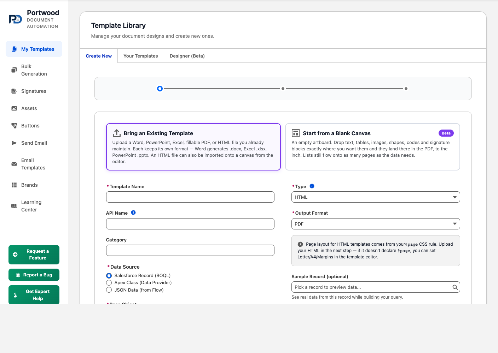

**You are ready when:** You can open Portwood and begin creating a template.

#### What needs its own setup?

- A **Generate** component on a record: [Add Portwood to a record page](#add-to-record-page).
- External signing: [Set up external signing](#setup-signatures).
- One-click button management: [Create document and email buttons](#document-buttons).
- AI authoring: [Get help from AI](#ai-authoring).

Installing the package does not automatically add components to your record pages.

_Salesforce administrators · 6 min read · Reviewed for 3.60.0_

**Next:** [Make your first document](#first-document) · [Give people the right access](#manage-access) · [Add Portwood to a record page](#add-to-record-page)

---

<a id="first-document"></a>
<a id="1-five-minute-quick-start"></a>
<a id="step-1-install"></a>
<a id="step-1--install"></a>
<a id="step-2--assign-yourself-the-admin-permission-set"></a>
<a id="step-2-assign-yourself-the-admin-permission-set"></a>
<a id="step-3-enable-the-pdf-rendering-release-update"></a>
<a id="step-3--enable-the-pdf-rendering-release-update"></a>
<a id="step-4-make-your-first-template"></a>
<a id="step-4--make-your-first-template"></a>
<a id="step-5--generate"></a>
<a id="step-5-generate"></a>

### Make your first document

Make a small Account summary. Start with a title and two fields; you can add tables and pictures after the first PDF works.

**Before you start:** You have **Portwood Admin**, Portwood is installed, and you have an Account with a name and phone number. The examples use **Northstar Bikes**; any test Account is fine.

#### 1. Make the template

1. Open **App Launcher → Portwood**.
2. Under **My Templates → Create New**, choose **Start from a Blank Canvas**.
3. Enter **My First Account Brief** in **Template Name**.
4. Set **Base Object** to **Account**. If suggestions appear, choose the standard Account.
5. Click **Create & Open Canvas**.

If the template list appears, use the template's **Show actions → Design** menu to open its Canvas.

#### 2. Choose a record to preview

1. Click **Data** on the left of the Canvas.
2. In **Preview with this record**, search for your Account and select it.
3. Check that **Account Name** and **Account Phone** are included in the field list.
4. Click **Done**.

This record is your practice example. Choosing it does not limit the template to that Account.

#### 3. Add the words

1. Click **Text** on the left, then click inside the white page. A text box appears.
2. In the box's content editor, enter:

    ```text
    Account brief
    Customer: {Name}
    Phone: {Phone}
    ```

3. Drag the box to where you want it. Make it wide and tall enough to show all three lines.
4. Click **Save**.

Keep the braces around `{Name}` and `{Phone}`. Those are the places Portwood fills in for you.

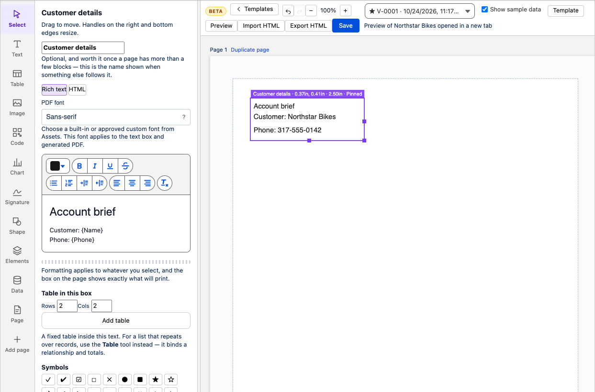

#### 4. See the result

1. Click **Preview** in the Canvas toolbar.
2. Open the generated PDF.
3. Check that your Account's name and phone number appear in place of the two tags.

**You are done when:** The PDF says **Customer: Northstar Bikes** (or your Account's name) and shows the phone number from that Account.


#### If your result is different

- **The field is blank:** Open the Account and check that it has a value. Then check that the field is included under **Data**.
- **Preview asks for a record:** Return to **Data** and select a record from the search results.
- **Text is cut off:** Select the box and make it taller or wider.
- **Your edit disappeared:** Click **Save** before leaving the Canvas.

Next, [generate from a record page](#generate-document) or [add a repeating list](#repeating-tables).

_Template builders · 8 min read · Reviewed for 3.60.0_

**Next:** [Design with Canvas](#canvas-design) · [Add Portwood to a record page](#add-to-record-page) · [Try the worked examples](#example-library)

---

<a id="find-your-way"></a>
<a id="13-admin-settings"></a>
<a id="13-admin--settings"></a>
<a id="131-the-command-hub"></a>

### Find your way around

Use the Portwood app to build and maintain documents. Use a Salesforce record to generate a document for that record.

#### In the Portwood app

| Place               | Go here to…                                                                     |
| ------------------- | ------------------------------------------------------------------------------- |
| **My Templates**    | Create, design, test, copy, and organize templates                              |
| **Bulk Generation** | Make documents for many records and review job history                          |
| **Signatures**      | Configure signing-site, email, verification, and reminder settings              |
| **Assets**          | Manage shared images and custom PDF fonts                                       |
| **Buttons**         | Configure record-page document buttons, if you have button-manager access       |
| **Send Email**      | Configure record-page document email buttons, if you have button-manager access |
| **Email Templates** | Edit the emails sent during signing                                             |
| **Brands**          | Create reusable company identities for signing                                  |
| **Learning Center** | Open this guide                                                                 |

**Signatures** in the left menu is the settings area. To send a request, open the relevant Salesforce record and use **Portwood Signature Sender**.

#### Inside My Templates

- **Create New** starts a template.
- **Your Templates** lists saved templates. Use **Search Templates** to find one.
- A row's **Show actions** menu includes **View**, **Edit**, **Design**, **Clone**, **Export**, and **Delete**.
- **Design** opens the appropriate editor. **Edit** opens the template's configuration.

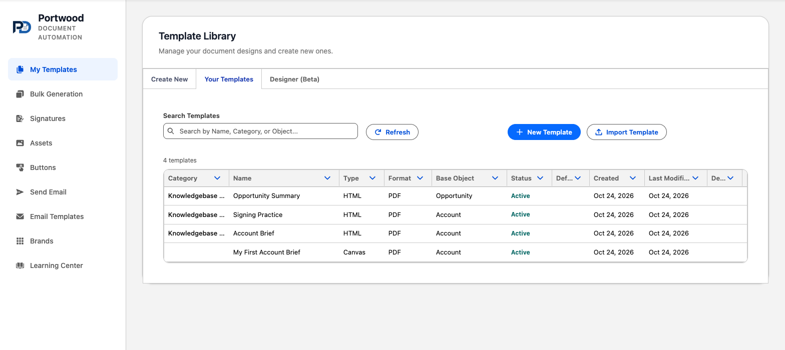

#### Two different save buttons

In **Canvas**, use **Save**. In the HTML designer or file editor, use **Save as New Version** to make a changed document body active.

A settings-only save does not publish a newly uploaded document. If you uploaded a replacement file, finish with **Save as New Version**.

_Everyone · 3 min read · Reviewed for 3.60.0_

**Next:** [Choose a template format](#choose-format) · [Save changes and return to an earlier version](#template-versions)

---

<a id="choose-format"></a>
<a id="2-what-portwood-does"></a>
<a id="51-creating-a-template"></a>
<a id="fillable-pdf-templates-pdf-to-pdf-testing"></a>
<a id="54-output-format-locking"></a>

### Choose a template format

Choose based on what you want to make and where you prefer to design it.

| I want to…                                           | Choose                                     | Finished file |
| ---------------------------------------------------- | ------------------------------------------ | ------------- |
| Place text and pictures visually on a page           | **Canvas** — Beta                          | PDF           |
| Keep editing my design in Microsoft Word             | **Word** (`.docx`)                         | PDF or Word   |
| Use Google Docs, exported HTML, or the HTML designer | **HTML** (`.html`, `.htm`, or an HTML ZIP) | PDF           |
| Fill an existing PDF form's fields                   | **PDF** — in testing                       | PDF           |
| Fill a spreadsheet                                   | **Excel** (`.xlsx` or `.xlsm`) — Alpha     | Excel         |
| Fill a slide deck                                    | **PowerPoint** (`.pptx`) — Alpha           | PowerPoint    |
| Get signatures on a PDF I already have               | **Upload PDF** in Signature Sender         | Signed PDF    |

#### Canvas or HTML?

Use **Canvas** for a certificate, form, or other page where positions matter. Move blocks on the page and size them with your mouse.

Use **HTML** or **Word** for letters, contracts, and documents where paragraphs should flow naturally. Both can also contain growing tables.

#### PDF or Word output?

Choose **PDF** when people should receive a finished document. Choose **Word** when they need to continue editing it.

A Word template can have a default output format. If **Lock Output Format** is off, supported generation tools can override that choice. Lock it when users should receive only the selected format.

#### What Beta, Alpha, and testing mean

These features are still developing. Test the actual output with your real layout and data before relying on it for everyday work. Complex spreadsheet formulas, unusual slides, and unusual PDF forms need particular care.

PowerPoint and Excel templates produce native Office files; they do not convert to PDF. Use a Word, HTML, or Canvas template when you need a PDF.

_Template builders · 4 min read · Reviewed for 3.60.0_

**Next:** [Design with Canvas](#canvas-design) · [Bring a Word document](#upload-word) · [Bring a Google Doc or HTML file](#import-html)

---

## Build a template

Choose a starting point and shape the document.

<a id="canvas-design"></a>
<a id="5-templates"></a>
<a id="513-canvas-templates-beta"></a>
<a id="show-sample-data"></a>
<a id="what-you-place-is-what-prints"></a>
<a id="tables-that-grow"></a>
<a id="charts"></a>
<a id="naming-a-block"></a>
<a id="element-linking--blocks-that-travel-together"></a>
<a id="element-linking-blocks-that-travel-together"></a>
<a id="variant-groups-conditional-alternatives-in-one-flow-slot"></a>
<a id="variant-groups--conditional-alternatives-in-one-flow-slot"></a>
<a id="import-and-export"></a>
<a id="multiple-pages"></a>
<a id="known-limits-beta"></a>

### Design with Canvas

Build a PDF by putting blocks on a page. Canvas is currently **Beta**.

**Before you start:** Create a Canvas template or open one from **Your Templates → Show actions → Design**.

#### Add and edit a block

1. Choose a tool on the left: **Text**, **Table**, **Image**, **Code**, **Chart**, **Signature**, or **Shape**.
2. Click the white page to place it.
3. Select the block to open its properties.
4. Edit its content. Drag it to move it; use its handles to resize it.
5. Give it a useful **Name**, such as **Customer details** or **Order totals**.

Use **Elements** to select a block hidden behind another block.


#### Add Salesforce information

Open **Data**, choose the fields and related lists you need, and select a preview record. Use the field controls to insert tags, or type a tag such as `{Name}` in a text box.

Turn on **Show sample data** to see values from the preview record while arranging the page. The display helps you size boxes; it does not replace a real **Preview** PDF. Long lists are shortened in the on-screen sample, and some formatting is approximate.

#### Keep a total below a growing table

1. Name the table **Line items**.
2. Select the totals block.
3. Set **Follows** to **Line items**.
4. Set the gap and any keep-together option you need.
5. Preview with a record that has enough rows to reach a second page.

The totals block follows the table as it grows. A block pinned to a fixed position stays there instead.

#### Show one of several alternatives

Use **Show only when** to give a block a condition. For alternatives that should occupy the same space, put the blocks in the same **variant group**. Test every condition, including when none of them matches.

#### Set up the page

Click **Page** to set paper size, orientation, and margins. Click **Add page** for another designed page. These Canvas page settings control its PDF.

#### Save and check

Click **Save**, then **Preview**. Review the first page, the last page, long values, empty lists, and page breaks.

**Import HTML** converts an existing HTML document into Canvas blocks. Keep a copy of the original and check the conversion carefully. **Export HTML** downloads a reusable HTML copy; it is different from exporting the whole template bundle.

_Template builders · 7 min read · Reviewed for 3.60.0_

**Next:** [Choose the information in a document](#choose-data) · [Make a table that grows](#repeating-tables) · [Set paper, headers, and page backgrounds](#page-layout)

---

<a id="upload-word"></a>
<a id="58-word-template-authoring-tips"></a>
<a id="581-aligning-columns-across-multiple-tables--the-phantom-width-trap"></a>
<a id="581-aligning-columns-across-multiple-tables-the-phantom-width-trap"></a>
<a id="582-autofit-settings--what-each-option-does-to-the-pdf"></a>
<a id="582-autofit-settings-what-each-option-does-to-the-pdf"></a>
<a id="583-inspecting-a-problematic-docx"></a>
<a id="584-other-word-authoring-gotchas-worth-remembering"></a>

### Bring a Word document

Turn a Word document you already maintain into a reusable template.

**Before you start:** Save a copy as `.docx`. Keep your original. Choose the Salesforce object you will generate from.

#### 1. Add tags in Word

Replace example values with field tags:

```text
Customer: {Name}
Phone: {Phone}
Prepared on: {Today:MMMM d, yyyy}
```

These first two tags assume an **Account** template. For an Opportunity, the customer name is usually `{Account.Name}`.

Use ordinary text, headings, and tables. Keep a tag together and type it exactly, including braces. Save the `.docx`.

#### 2. Bring the file into Portwood

1. Open **My Templates → Create New → Bring an Existing Template**.
2. Enter a name and choose the **Base Object**.
3. Set **Type** to **Word**.
4. Choose the default **Output Format**: PDF or Word.
5. Select a sample record if one is available.
6. Continue to the data step and include the fields used by your tags.
7. Upload your `.docx` on the document step and finish the wizard.
8. Use **Save as New Version** if the editor shows the upload as staged.

#### 3. Check the generated file

Generate a sample using a record with real values. If your default is PDF, check the PDF rather than relying on Word's preview.

**You are done when:** The generated document has the expected values, page breaks, tables, and images.

#### Make later changes

Edit the original Word file, save it, then open the template's **Edit** action. Upload the replacement and click **Save as New Version**.

For PDF output, simple tables and common fonts are easiest to maintain. Use fixed column widths when columns must line up. Avoid building a layout from spaces, floating shapes, or text boxes. If a table looks different, see [Fix a layout or output problem](#troubleshooting).

Files larger than **10 MB** are rejected by the template uploader. Compress large pictures in Word before uploading.

_Template builders · 6 min read · Reviewed for 3.60.0_

**Next:** [Make a table that grows](#repeating-tables) · [Format dates, amounts, and labels](#format-values) · [Save changes and return to an earlier version](#template-versions)

---

<a id="import-html"></a>
<a id="512-the-visual-designer-beta"></a>
<a id="57-html-templates-google-docs-notion-any-html-source"></a>
<a id="571-authoring-in-google-docs"></a>
<a id="572-other-authoring-tools"></a>
<a id="573-css-rules--what-works-what-doesnt-and-an-llm-prompt"></a>
<a id="573-css-rules-what-works-what-doesnt-and-an-llm-prompt"></a>
<a id="quick-reference"></a>
<a id="rounded-corners-shadows-and-tints-the-honest-answer"></a>
<a id="rounded-corners-shadows-and-tints--the-honest-answer"></a>
<a id="long-values-overflow-a-table-cell-and-no-css-fixes-it"></a>
<a id="long-values-overflow-a-table-cell--and-no-css-fixes-it"></a>
<a id="how-to-draw-a-circle-bullets-status-dots-timeline-markers"></a>
<a id="paste-ready-llm-prompt"></a>
<a id="skeleton-template-copy-adapt"></a>
<a id="skeleton-template-copy--adapt"></a>
<a id="common-conversion-patterns"></a>
<a id="page-rules--dont-double-declare"></a>
<a id="page-rules-dont-double-declare"></a>
<a id="576-images"></a>
<a id="577-loops-in-tables"></a>
<a id="578-bulk-generation--giant-query"></a>
<a id="578-bulk-generation-giant-query"></a>
<a id="579-known-limitations"></a>
<a id="5710-troubleshooting"></a>

### Bring a Google Doc or HTML file

Use a Google Docs export or an HTML file as a PDF template.

#### From Google Docs

1. Make a copy of your document.
2. Replace example values with tags, such as `{Name}` and `{Phone}` for an Account template.
3. Choose **File → Download → Web Page (.html, zipped)**.
4. In Portwood, choose **Create New → Bring an Existing Template**.
5. Choose the base object, **Type = HTML**, and PDF output.
6. Include the fields used in the document.
7. Upload the ZIP, keeping the HTML and images together.
8. Finish creation and click **Save as New Version** if prompted.
9. Generate a PDF with your sample record and check the whole document.

Portwood extracts the HTML and images from the export. You do not need to upload each exported picture separately.

#### From another HTML source

Upload a `.html`, `.htm`, or HTML ZIP file through the same path. A ZIP should contain the document and the images it references.

Keep a copy of the authoring file. When you re-export from Google Docs, upload the new file as a new version of the existing template.

#### Edit in Portwood

Use the template's **Design** action to open the HTML designer. Its toolbar and panels let you format text, insert tags and tables, choose images, edit the query, and set headers and footers.

Use **Save as New Version** to activate edits. **Download Sample** or **PDF Preview** helps you check the rendered result.

#### Why the PDF can look different

Salesforce's PDF renderer supports a smaller set of layout features than a web browser. Plain paragraphs, tables, fixed widths, and common fonts are reliable starting points. Modern web layouts using flexbox or grid can change or disappear.

Always check a generated PDF before sending it. For advanced styling and a reusable authoring prompt, see the [HTML and Word layout reference](https://github.com/Portwood-Global-Solutions/Portwood/blob/main/docs/reference/template-layout.md).

_Template builders · 6 min read · Reviewed for 3.60.0_

**Next:** [Choose the information in a document](#choose-data) · [Set paper, headers, and page backgrounds](#page-layout) · [Get help from AI](#ai-authoring)

---

<a id="fillable-pdf"></a>

### Fill an existing PDF form

Fill the fields of an existing PDF form using Salesforce information. This feature is **in testing**.

An existing PDF form is different from a PDF you merely want someone to sign. For signing, use [Send an uploaded PDF for signature](#sign-uploaded-pdf).

#### Map a form

1. Create a template with **Type = PDF** and choose its base object.
2. Include the Salesforce fields you want to use.
3. Upload the fillable PDF.
4. Open **Fillable Fields** after the scan completes.
5. Give hard-to-read form fields a friendly **Label**, such as **Mailing address**.
6. For each field, choose its **Data Path** from the template's selected data.
7. For a checkbox or radio button, check the PDF's **Checked Value** and map an appropriate value.
8. Click **Save as New Version**.
9. Generate a sample and inspect every mapped field.

#### Change a mapping later

Edit labels or mappings under **Fillable Fields** and use **Save Mapping**. If you replace the PDF, save it as a new version so its body and mapping are prepared together.

#### Know what to test

Portwood reads actual PDF form fields; it does not recognize a printed blank line as a field. Standard AcroForm PDFs are the intended format. XFA-only, encrypted, or unusual forms may need a different source file.

Generated fields normally remain editable. Do not assume the result has been flattened into a permanent printed page.

Bulk generation supports these templates as **Individual Files**. Combined-PDF modes are not supported for fillable PDF templates.

_Template builders · 5 min read · Reviewed for 3.60.0_

**Next:** [Choose the information in a document](#choose-data) · [File and format limits](#limits)

---

<a id="office-formats"></a>
<a id="149-excel-templates-alpha-limitations"></a>
<a id="149-excel-templates--alpha-limitations"></a>

### Make Excel and PowerPoint files

Use Excel or PowerPoint when the recipient needs a spreadsheet or slide deck. Both formats are currently **Alpha**.

#### Make an Excel template

1. Make a copy of your workbook.
2. Put a field tag in a cell, such as `{Name}`.
3. For a related-record table, put the opening and closing loop tags in the same worksheet row:

| Cell | Content                  |
| ---- | ------------------------ |
| A2   | `{#Contacts}{FirstName}` |
| B2   | `{LastName}`             |
| C2   | `{Email}{/Contacts}`     |

4. Save as `.xlsx` or `.xlsm`.
5. Create an **Excel** template, select its fields and related list, and upload the file.
6. Save the version and generate the workbook.
7. Open it in Excel. Check formulas, shifted rows, formatting, and any macros.

Use one repeating region per row. With several Contacts, the example row expands down; rows below it move down. With no Contacts, the repeating row is removed.

Image tags, shared-asset images, chart-tag images, and rich-text formatting are not supported like they are in Word/PDF output. Choose Word or HTML when those are essential.

Macro-enabled templates retain `.xlsm` output. Microsoft Excel may block macros in downloaded files according to the recipient's security policy. Test the intended delivery process with your administrator.

#### Make a PowerPoint template

1. Add field tags to a copy of a `.pptx` deck.
2. Create a **PowerPoint** template and choose the base object and data.
3. Upload, save the version, and generate a sample.
4. Open the result in PowerPoint and inspect every slide.

Basic fields, parent lookups, formats, and supported loops can be used. Complex slide layouts need testing.

#### Choose the right output

Excel templates produce Excel files; PowerPoint templates produce PowerPoint files. These templates cannot produce a combined PDF in bulk generation. Choose **Individual Files** for bulk Office output.

_Template builders · 6 min read · Reviewed for 3.60.0_

**Next:** [Choose the information in a document](#choose-data) · [Make documents for many records](#bulk-generation) · [File and format limits](#limits)

---

<a id="ai-authoring"></a>
<a id="5711-generate-the-template-with-agentforce-v346"></a>
<a id="setup--install-the-extension"></a>
<a id="setup-install-the-extension"></a>
<a id="setup--bring-your-own-provider-alternative"></a>
<a id="setup-bring-your-own-provider-alternative"></a>
<a id="using-it"></a>
<a id="what-the-report-tells-you"></a>

### Get help from AI

Use AI to help draft or revise an HTML template, then check the result in Portwood.

The current creation wizard offers an existing file or a blank Canvas. AI help is available in the HTML designer; it is not a separate starter-gallery path.

#### Use an external assistant

1. Open an HTML template in **Design**.
2. Choose **Copy AI Prompt** in the designer toolbar.
3. Review the prompt before copying it to the assistant your organization allows. The prompt can describe your fields and template.
4. Describe the document and changes you want.
5. Bring the returned HTML back into the designer or upload it as a replacement HTML file.
6. Review any fidelity findings and generate a real sample PDF.
7. Click **Save as New Version** when the result is ready.

Portwood's PDF engine cannot reproduce every web layout an assistant can invent. Ask for a simple document using tables, standard fonts, and supported PDF styling.

#### Use Generate with Agentforce

Your administrator can install the separate **Portwood Agentforce Extension** in an org with the required Einstein/Prompt Builder features. Once configured, **Generate with Agentforce** can draft or revise the HTML from inside Portwood.

The extension is optional. A normal Portwood install does not require AI features, and installing only the core package does not create them.

For extension installation, permissions, provider setup, and troubleshooting, see [Agentforce setup](https://github.com/Portwood-Global-Solutions/Portwood/blob/main/docs/AGENTFORCE_SETUP.md).

#### Check what AI made

Check field names, opening and closing tags, page size, images, long text, and page breaks. A clean browser preview is only the first check; the generated PDF is the one your reader receives.

_Template builders · 5 min read · Reviewed for 3.60.0_

**Next:** [Bring a Google Doc or HTML file](#import-html) · [Save changes and return to an earlier version](#template-versions)

---

## Add information and polish

Fill your design with fields, lists, pictures, and the right formatting.

<a id="choose-data"></a>
<a id="53-test-record"></a>

### Choose the information in a document

Tell the template which information it can use. Selecting a field makes it available; placing its tag decides where it prints.

**Example:** An Account brief needs the Account's name, the owner's name, and a table of Contacts.

#### Open the field chooser

- **Canvas:** Click **Data**.
- **HTML designer:** Open the **Query** panel.
- **Template configuration:** Open **Query Configuration** and use the visual builder.

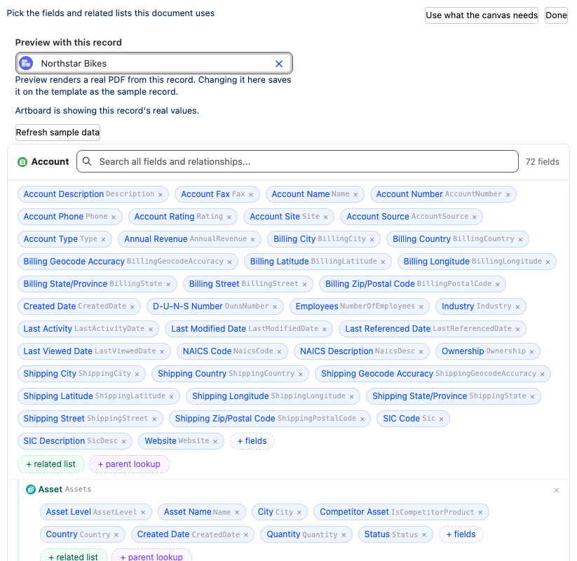

#### Pick information on the record

Select **Name**, **Phone**, or any other fields you need from the base object. A **base object** is simply the type of record you generate from: Account, Opportunity, Case, or another object.

Use search to find fields. Prefer the controls that insert or copy tags so the field's spelling is exact.

#### Pick information from a linked record

Choose **+ parent lookup** and follow the link. For example, an Opportunity's **Account → Account Name** becomes `{Account.Name}`. An Account's **Owner → Full Name** becomes `{Owner.Name}`.

A linked record supplies one value. Use a related list when there can be many values.

#### Pick a related list

1. Choose **+ related list**.
2. Select **Contacts**.
3. Include **First Name**, **Last Name**, **Email**, and **Title**.
4. Check the list's **Tag name**. Use that name in a repeating table.
5. Set a sort order if row order matters. For example, sort Contacts by **Last Name**, ascending.

Each related list can have its own filter, sort, and limit. A filter on Contacts changes the Contacts printed in one document. A filter in **Bulk Generation** chooses which Accounts get documents; it serves a different purpose.

#### Test before adding more

Save the template and preview a record with values in the fields you chose. If a value is missing, check the record, field selection, tag spelling, and the generating user's access to that field.

For more complex data, see [Use prepared or custom data](#custom-data). Manual query formats and provider code live in the [query reference](https://github.com/Portwood-Global-Solutions/Portwood/blob/main/docs/reference/query-config.md).

_Template builders · 6 min read · Reviewed for 3.60.0_

**Next:** [Make a table that grows](#repeating-tables) · [Format dates, amounts, and labels](#format-values) · [Use prepared or custom data](#custom-data)

---

<a id="repeating-tables"></a>

### Make a table that grows

Make a list that grows automatically: Contacts on an Account, products on an Opportunity, or rows from another related list.

**Before you start:** Add the related list and its fields in [Choose the information in a document](#choose-data).

#### In Canvas

1. Choose the **Table** tool and place a table on the page.
2. In its properties, choose the related list you want to repeat.
3. Set the columns and headings.
4. Give the table a name, such as **Contacts**.
5. Select a sample record that has several related records.
6. Turn on **Show sample data** to check the table, then generate a real **Preview**.

If text or totals should sit below the table, set that block to **Follows** this table. Leaving it at a fixed position can let the growing table run into it.

#### In Word

Create a table with a heading row and one example data row. Put the opening tag in the data row's first cell and the closing tag in its last cell:

| Name                                | Title     | Email                |
| ----------------------------------- | --------- | -------------------- |
| `{#Contacts}{FirstName} {LastName}` | `{Title}` | `{Email}{/Contacts}` |

Keep both loop tags in the **same row**. Portwood copies that row once per Contact. The column headings stay outside the loop.

Inside the loop, `{FirstName}` means the current Contact's first name. Outside it, a tag refers to the base record.

#### In HTML

Use a real table heading and one repeating body row:

```html
<table style="width:100%;border-collapse:collapse">
    <thead>
        <tr>
            <th>Name</th>
            <th>Email</th>
        </tr>
    </thead>
    <tbody>
        <tr>
            <td>{#Contacts}{FirstName} {LastName}</td>
            <td>{Email}{/Contacts}</td>
        </tr>
    </tbody>
</table>
```

#### Add numbers or a total

Inside the repeating row, `{RowNumber}` prints 1, 2, 3, and so on.

Outside the loop, `{COUNT:Contacts}` prints the number of Contacts. A numeric example is `{SUM:OpportunityLineItems.TotalPrice:currency}` for a selected line-item relationship.

#### Check three cases

Preview a record with **no rows**, **a few rows**, and **enough rows for another page**. Empty loops print nothing. Use an inverse section if you want a message instead:

```text
{^Contacts}No contacts are listed yet.{/Contacts}
```

Set sorting on the related list if the row order matters. Do not rely on the order you happen to see in an early preview.

_Template builders · 6 min read · Reviewed for 3.60.0_

**Next:** [Show content only when it applies](#conditional-content) · [Set paper, headers, and page backgrounds](#page-layout) · [Try the worked examples](#example-library)

---

<a id="format-values"></a>
<a id="date-formatting"></a>
<a id="currency-formatting"></a>
<a id="auto-detecting-the-currency-from-the-record"></a>
<a id="totalling-across-currencies"></a>
<a id="number-formatting"></a>
<a id="percent-formatting"></a>
<a id="checkbox-formatting"></a>
<a id="picklist-label-formatting"></a>
<a id="copy-paste-symbol-palette"></a>
<a id="conditional-checkbox-pattern"></a>
<a id="what-does-not-work"></a>

### Format dates, amounts, and labels

Keep dates, amounts, labels, and numbers easy to read.

#### Start with a field tag

`{Amount}` prints the field's value. A format after a colon changes how that value looks:

| What you want                     | Tag                        |
| --------------------------------- | -------------------------- |
| A readable date                   | `{CloseDate:MMMM d, yyyy}` |
| A short date                      | `{CloseDate:MM/dd/yyyy}`   |
| A date in the user's locale       | `{CloseDate:date}`         |
| A US dollar amount                | `{Amount:currency}`        |
| Euros                             | `{Amount:currency:EUR}`    |
| Number with separators            | `{Quantity:number}`        |
| Two decimal places                | `{Quantity:#,##0.00}`      |
| Picklist label seen in Salesforce | `{StageName:label}`        |
| Checkbox as `[X]` or `[ ]`        | `{IsClosed:checkbox}`      |
| Today's date                      | `{Today:MMMM d, yyyy}`     |
| Name of the person generating     | `{RunningUser.Name}`       |

These examples assume the fields exist on the relevant record or loop row. Add ordinary fields to the template's selected data. `Today`, `Now`, and the allowed `RunningUser` fields are built in.

#### Match the reader's country

Add an explicit locale when the document must use a particular convention:

```text
{CloseDate:date:en_GB}
{Amount:currency:EUR:de_DE}
```

Use `MM` for the month in a date pattern; lowercase `mm` means minutes. `yyyy` is the calendar year.

#### Work with more than one currency

In a multi-currency org, `{Amount:currency:auto}` follows the record's currency. A fixed `:EUR` chooses euro formatting; it does not by itself convert an amount.

When you need conversion, use the supported `:convert` suffix and verify your org's currency rates. For example:

```text
{Amount:currency:EUR:convert}
```

Totals across mixed currencies need particular care. Portwood rejects conflicting currencies unless conversion is requested. Conversion uses current static Salesforce currency rates, not dated Advanced Currency Management rates.

See the [merge tag reference](https://github.com/Portwood-Global-Solutions/Portwood/blob/main/docs/reference/merge-tags.md) for all supported patterns, currencies, locales, and conversion rules.

_Template builders · 5 min read · Reviewed for 3.60.0_

**Next:** [Show content only when it applies](#conditional-content) · [Give files useful names](#name-documents)

---

<a id="conditional-content"></a>
<a id="boolean-conditional"></a>
<a id="inverse-conditional"></a>
<a id="if-comparison-expressions"></a>
<a id="and--or--not"></a>
<a id="and-or-not"></a>
<a id="live-example-project-status-showcase"></a>
<a id="live-example--project-status-showcase"></a>
<a id="nested-if-blocks"></a>

### Show content only when it applies

Show a paragraph only when it applies, such as a discount note, an approval message, or a section that has related records.

#### In Canvas

Select a block and enter its condition under **Show only when**. For example, an Opportunity block can use:

```text
Amount > 10000
```

The whole block disappears when the condition is false. Preview one record that matches and one that does not.

Use a **variant group** for alternative blocks that should use the same flow position. Give the alternatives the same group name and conditions that do not overlap.

#### In Word or HTML

Put a conditional section around the words:

```text
{#IF Amount > 10000}
This proposal requires manager approval.
{/IF}
```

Use an alternative with `{:else}`:

```text
{#IF StageName = 'Closed Won'}
Thank you for your business.
{:else}
We look forward to working with you.
{/IF}
```

Use the field's exact API name. For an Opportunity stage, that is **StageName**. Text comparisons are case-sensitive; copy the stored value exactly.

#### Show a section only when rows exist

```text
{#IF Contacts.totalSize != 0}
Your contacts
{#Contacts}{FirstName} {LastName}
{/Contacts}
{/IF}
```

Include Contacts in the selected data. `.totalSize` lets you check whether the list is empty.

#### Combine conditions

Use `AND`, `OR`, `NOT`, and parentheses when needed:

```text
{#IF Amount > 10000 AND IsClosed = false}
Manager review is needed before this deal closes.
{/IF}
```

**You are done when:** A matching record shows the section, a nonmatching record hides it, and the surrounding page still looks right.

Every opening section needs the correct closing tag. Copy a working pair before editing a more complicated condition.

_Template builders · 5 min read · Reviewed for 3.60.0_

**Next:** [Make a table that grows](#repeating-tables) · [Try the worked examples](#example-library)

---

<a id="images-and-assets"></a>

### Add logos and pictures

Upload a logo once and reuse it across templates.

#### Add a shared image

1. Open **Portwood → Assets**.
2. Add an image, give it a clear name, and choose a stable asset key such as `company-logo`.
3. Upload the image file and save it.
4. Use the asset's copy or insert controls when placing it in a template.

An asset key is a reusable name. `{%asset:company-logo}` points to that image without tying your template to an org-specific file ID.

#### Put it in a document

- **Canvas:** Choose **Image**, place a block, and choose the asset. Resize it on the page.
- **HTML designer:** Use the Images/Assets panel to insert it.
- **Word or hand-authored HTML:** Use an image tag, for example `{%asset:company-logo:160x}`. Leaving one dimension blank preserves the image's proportions.

Keep logos small enough for their intended print size. A very large photograph can increase file size without improving a small printed logo.

#### Use a picture stored on a record

Portwood also supports image fields and attached record images through image merge tags. Use the template's copy-paste tag tools to get the correct form for your data. Include the image field in the query when the tag reads a field.

Use the [image tag reference](https://github.com/Portwood-Global-Solutions/Portwood/blob/main/docs/reference/merge-tags.md#77-images) for numbered attached images, field images, and exact sizing.

#### Replace a shared logo

Update the asset's image, then generate a document using it. Because templates refer to the key, you do not need to replace the tag in every template. Check headers, footers, and emails too if they use that asset.

Email images need publicly accessible links. Document images and email images have different access requirements; see [Brand the signing experience](#brands-and-emails) before putting a private Salesforce file URL in an email.

**You are done when:** The image appears in a real generated PDF at the intended size. An image visible only in the browser preview is not enough.

_Template builders · 5 min read · Reviewed for 3.60.0_

**Next:** [Set paper, headers, and page backgrounds](#page-layout) · [Use custom PDF fonts](#custom-fonts) · [Brand the signing experience](#brands-and-emails)

---

<a id="page-layout"></a>

### Set paper, headers, and page backgrounds

Set the paper, margins, repeated page content, and page background.

#### Choose paper and margins

- **Canvas:** Open **Page**. Choose the paper size, orientation, and margins there.
- **HTML designer:** Use page setup and check any `@page` rules in imported HTML.
- **Word:** Set page size and margins in Word, then check the generated PDF.

Canvas and HTML can carry their own page rules. Changing a template record's paper setting may not replace a page rule already in its body.

#### Add a header or footer

Use the template's **Header HTML** and **Footer HTML** fields or the designer's **Header/Footer** panel. Put repeating company details in these areas rather than copying them onto each page.

Leave enough margin for the content. An oversized logo can collide with the document even when the logo itself looks fine.

#### Number the pages

Use the supported header/footer tags:

```text
Page {PageNumber} of {TotalPages}
```

Keep page-number tags in the Header/Footer HTML fields, where page numbering is supported. They are different from a field such as `{AccountNumber}`.

#### Add a watermark or background

1. Save the template at least once.
2. Open **Watermark / Background** in the template editor.
3. Upload a correctly sized image.
4. Choose **Light**, **Medium**, **Strong**, or **Original** strength.
5. Generate a PDF and confirm the text remains readable.

For a Letter page, use **816 × 1056 pixels** at 96 DPI. For A4, use **794 × 1123 pixels**; for Legal, **816 × 1344 pixels**.

Use a picture for a text watermark such as DRAFT. Word's text-watermark and rotation settings do not reliably carry into PDF; a pre-rendered image is easier to control.

#### Check more than the first page

Use a record with long text and many table rows. Inspect headers, footers, the last row of a page, blank space, and the last page. In Word, section breaks and different-first-page settings can also affect the PDF.

For troubleshooting widths, AutoFit, and HTML styling, use the [layout reference](https://github.com/Portwood-Global-Solutions/Portwood/blob/main/docs/reference/template-layout.md).

_Template builders · 6 min read · Reviewed for 3.60.0_

**Next:** [Use custom PDF fonts](#custom-fonts) · [Fix a document](#fix-document)

---

<a id="charts-and-codes"></a>

### Add charts, QR codes, and barcodes

Add a chart to explain your data, or a QR code or barcode that readers can scan.

#### Make a chart in Canvas

1. Choose **Chart** and click the page.
2. Choose the related list to summarize, such as **Opportunities** on an Account.
3. Choose the field to group by, such as **StageName**.
4. Choose the chart style and size.
5. Preview a record with several matching related records.

If a chart should move with a growing table, give it a name and use the same **Follows** controls as other Canvas blocks.

#### Add a chart to Word or HTML

Use a chart tag. For example, on an Account template:

```text
{Chart:Opportunities:StageName:bar:title=Opportunities by stage}
```

This groups the Account's Opportunities by stage. Use a valid relationship and field for your object. Start with a simple bar chart before adding filters or multiple series.

Chart support depends on the output path. HTML-to-PDF is safest with the supported CSS chart styles: **bar**, **pivot**, **clustered**, and **stacked**. An inline SVG chart visible in an HTML preview can disappear in Salesforce's PDF renderer. Excel output does not embed chart-tag images.

For the complete style and output matrix, use the [chart reference](https://github.com/Portwood-Global-Solutions/Portwood/blob/main/docs/reference/merge-tags.md#76-charts).

#### Add a QR code or barcode

In Canvas, choose **Code**, place it, then set the code type and value in its properties. A value can come from a field so each generated record gets its own code.

For Word or HTML, use the template's copy-paste tag tools or the [barcode reference](https://github.com/Portwood-Global-Solutions/Portwood/blob/main/docs/reference/merge-tags.md#78-barcodes--qr-codes). Match the barcode type to the scanner or business process that will read it.

#### Check the result

Generate the actual output format. Confirm chart labels are legible and totals make sense. Scan printed codes at the size people will actually use; a code that scans at full screen can become unreadable when printed too small.

_Template builders · 5 min read · Reviewed for 3.60.0_

**Next:** [Choose the information in a document](#choose-data) · [Try the worked examples](#example-library)

---

<a id="custom-fonts"></a>
<a id="716-not-implemented"></a>
<a id="1311-custom-fonts"></a>
<a id="upload-and-approve-a-font"></a>
<a id="use-a-custom-font-in-a-template"></a>
<a id="compatibility-and-failure-behavior"></a>
<a id="142-pdf-font-limitations"></a>
<a id="157-custom-font-doesnt-render-in-pdf"></a>

### Use custom PDF fonts

Use your organization's approved font in generated PDFs.

**Before you start:** You need Portwood Admin access or **Manage Portwood Fonts**. You also need a static `.ttf` font and permission to host and embed it.

#### Upload and approve

1. Open **Portwood → Assets → Custom Fonts**.
2. Choose **Upload font** for one face, or **Bulk upload fonts** for several.
3. Upload the static TrueType file and confirm its usage rights.
4. Set a clear font key using lowercase letters, numbers, and hyphens.
5. Open the face and generate its **native PDF specimen**.
6. Check the letters, numbers, accents, symbols, weight, and spacing your documents need.
7. Confirm you reviewed the specimen, then **Approve** the face.

Only approved faces become available for new selections. Upload regular, bold, and italic faces separately when your documents need them.

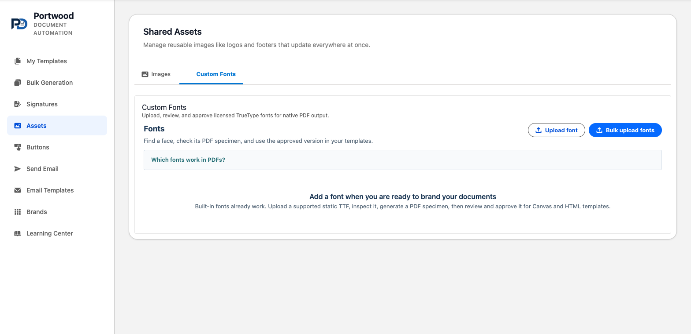

#### Use the font

- **Canvas:** Select the text box and choose the face in **PDF font**.
- **HTML designer:** Select the face in the font picker.
- **HTML source:** Copy the face's verified font tag from its detail panel and use it in a quoted inline `style` attribute.
- **Imported Word/HTML:** Portwood can match an approved face to the declared family, weight, and style. Check the generated PDF to confirm the match.

#### Replace or stop using a face

Retire a face to remove it from new selections while preserving existing template revisions. Retired faces can be deleted when they are no longer needed. Do not delete one until you have checked the templates that depend on it.

#### If the upload is rejected or the PDF uses another font

Use a static TrueType face. Variable fonts, color fonts, font collections, unsupported Unicode coverage, or malformed files may be rejected. The supported font character map is limited to the Unicode Basic Multilingual Plane.

A font also needs the glyphs your text uses. Preview a document containing those actual characters. If an approved face cannot be loaded, Portwood can continue using a fallback instead of stopping the whole document.

Bulk upload accepts up to **25 individual files** or a ZIP of up to **200 TTF files / 25 MB**. A document can use up to **16 distinct approved faces**.

This feature controls native PDF output and previews. It does not install fonts on a recipient's computer or embed this font registry into native Excel or PowerPoint files.

_Template administrators · 6 min read · Reviewed for 3.60.0_

**Next:** [Set paper, headers, and page backgrounds](#page-layout) · [Fix a document](#fix-document)

---

## Make and share documents

Generate one document, a packet, or a whole batch.

<a id="add-to-record-page"></a>

### Add Portwood to a record page

Add the Generate and signing tools where your team works.

**Before you start:** You are a Salesforce administrator who can edit and activate Lightning record pages.

#### Add the document runner

1. Open an example record of the right type, such as an Account.
2. Open Salesforce's **Setup** gear and choose **Edit Page**.
3. In Lightning App Builder's component list, search for **Portwood Runner**.
4. Drag it into a region on the page.
5. Select it and choose which destinations to offer: **Download**, **Save to Record**, and **Save & Download**.
6. Leave the extra packet and PDF-combining options on if your team needs them.
7. Click **Save**, then **Activate**. Assign the page to the intended app, profiles, or record types.
8. Return to the record and refresh it.

**You are done when:** The intended user sees Portwood Runner on that record, can choose a matching template, and can generate a file.

#### Add the signing tool

Follow the same steps, searching for **Portwood Signature Sender**. Place it on the record page where requests should be stored.

#### Make the page simpler

If a team only needs to save documents, turn off the other destinations. The runner hides the destination selector when only one option remains.

Make sure the page also gives users a way to open the record's **Files**. A successful save can be hard to find if the Files related list is absent.

#### If the component does not appear

Check the page's activation assignments, component visibility rules, and the user's Portwood permission set. Editing a page for one app does not necessarily change the page users see in another app.

On mobile, the runner saves to the record. Packet and PDF-combining workflows require desktop download support.

_Salesforce administrators · 6 min read · Reviewed for 3.60.0_

**Next:** [Generate a document](#generate-document) · [Send an uploaded PDF for signature](#sign-uploaded-pdf)

---

<a id="generate-document"></a>
<a id="8-document-generation"></a>
<a id="81-from-a-record-page-single-doc"></a>
<a id="82-what-happens-behind-the-scenes"></a>
<a id="83-output-format-override"></a>

### Generate a document

Make a document for the Salesforce record you are looking at.

**Before you start:** You have Portwood User or Admin access. Your administrator has [added Portwood Runner](#add-to-record-page), and there is an active template for this record type.

#### Make the document

1. Open the record, such as an Account or Opportunity.
2. Find **Portwood Runner**.
3. Choose the template. Use its category filter if the list is long.
4. Choose where the file should go:

| Destination         | What happens                          |
| ------------------- | ------------------------------------- |
| **Download**        | A file downloads to your computer     |
| **Save to Record**  | A file appears in this record's Files |
| **Save & Download** | One generation provides both copies   |

5. If an output-format choice is shown, choose the permitted format you need. Otherwise, the template's saved format is used.
6. Click **Generate** and wait for the result.
7. Open the file and check the name, important values, and all pages before sharing it.

Your page may show only one destination. Your administrator can hide choices the team does not need.

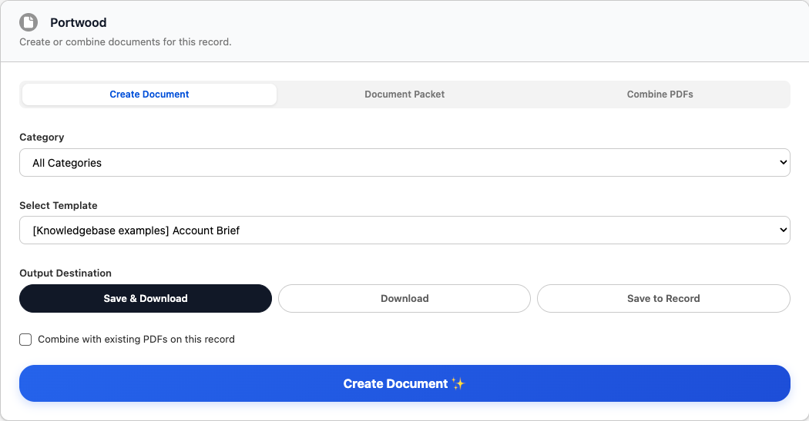

#### Find a saved file

Open the record's **Files** related list. Refresh it if a background generation has just finished. Use the file's preview or download action to open it.

#### When a document takes longer

Records with large related lists can generate in the background. Follow the runner's status message instead of repeatedly clicking Generate. Check the record's Files or the relevant job before starting another copy.

Large native Office files may download first and show a **drag-to-attach** step. Use that uploader when the runner asks for it to finish saving the file to Salesforce.

#### If you cannot find the template

Check that you opened the right type of record. Then ask the template owner to check its active version, Active setting, and visibility rules. A template for Accounts does not automatically appear on Opportunities.

On mobile, the runner uses **Save to Record**. Open the saved file through Salesforce.

_Everyone · 4 min read · Reviewed for 3.60.0_

**Next:** [Combine documents into one PDF](#document-packets) · [Create document and email buttons](#document-buttons) · [Give files useful names](#name-documents)

---

<a id="document-packets"></a>
<a id="84-pdf-merge-combine-with-existing-pdfs"></a>
<a id="85-document-packets"></a>

### Combine documents into one PDF

Put several documents into one PDF, or combine PDFs already saved on a record.

**Before you start:** Use a desktop browser. Your administrator must enable the runner's packet or PDF-combining controls.

#### Make a packet from templates

1. Open the Salesforce record and find Portwood Runner.
2. Choose **Document Packet**.
3. Move the required templates into the packet list.
4. Put them in the order you want readers to see them.
5. If needed, choose the option to include existing PDFs from the record and select those files.
6. Generate and download the packet.
7. Open the result and check the document order, page breaks, and completeness.

Use templates that support PDF output. Packet availability depends on the selected templates and the controls enabled on the page.

#### Combine existing PDFs

1. Choose **Combine PDFs** in the runner.
2. Select at least two PDFs already attached to the record.
3. Order them.
4. Combine and download the result.

This does not require a template. It is useful for collecting a finished proposal, terms, and attachments into one file.

#### Add an attachment after a generated document

For a PDF template, use **Combine with existing PDFs on this record** if offered. Choose the PDFs to append, then generate.

Packets and PDF combines are download workflows. If the result also belongs on the record, upload the finished packet to Files.

For a packet that needs signatures, use the [template signing workflow](#sign-template) instead of treating a combined unsigned download as a completed signing request.

_Document users · 5 min read · Reviewed for 3.60.0_

**Next:** [Send a template for signature](#sign-template) · [Make documents for many records](#bulk-generation)

---

<a id="document-buttons"></a>
<a id="86-one-click-quick-action-button-v328"></a>

### Create document and email buttons

Give people a short action such as **Generate Quote**, **Preview Brief**, or **Email Document** on a record.

**Before you start:** A Salesforce administrator needs **Portwood Button Manager** plus the relevant platform metadata permission, such as **Customize Application**. Portwood Admin alone does not expose the Buttons and Send Email management tabs.

#### Create a document button

1. Open **Portwood → Buttons → New Button**.
2. Choose the object and template.
3. Choose the label, active setting, optional record types, title, and save-to-record behavior.
4. Choose **Delivery mode**:

| Mode                   | The user gets                       |
| ---------------------- | ----------------------------------- |
| **Download**           | A downloaded file                   |
| **Preview**            | Salesforce's file preview           |
| **Preview & Download** | A preview, then an offered download |

5. Save. Configuration can take a few seconds to appear because it is saved as metadata.

#### Put the action on the page

1. In Salesforce Setup, open **Object Manager → your object → Buttons, Links, and Actions**.
2. Create an action with **Action Type = Lightning Web Component**.
3. Select the packaged **docGenButton** component.
4. Add the action to the intended record page's actions or the page layout's Salesforce Mobile and Lightning Experience Actions.
5. Test as a user who will use it.

Creating a configuration does not place the action on the page. Both parts are required.

For a headless preview action, use **docGenPreviewButton** and an active configuration with Preview delivery. Preview creates a Salesforce File even when the file is not linked to the record.

#### Create an email button

1. Open **Portwood → Send Email → New Send Email Button**.
2. Configure its object, optional default template, label, and audience.
3. Place a record action using **docGenSendEmailButton**.
4. Test its three steps: **Template → Preview → Recipients & message**.

Sending generates the document, saves it to the record, and sends an attachment to the selected addresses. Review the preview and recipients before sending. An email-delivery failure is shown to the user; finding a generated file alone does not prove the email was sent.

For very large related lists, use Portwood Runner or an appropriate background Flow action. The one-click document action uses a synchronous generation path.

_Salesforce administrators · 7 min read · Reviewed for 3.60.0_

**Next:** [Add Portwood to a record page](#add-to-record-page) · [Give people the right access](#manage-access)

---

<a id="name-documents"></a>
<a id="87-document-naming-document-title-format-tokens"></a>
<a id="87-document-naming--document-title-format-tokens"></a>

### Give files useful names

Give generated files useful names so people can find them later.

#### Set the default name

Open the template's settings and fill in **Document Title Format**. For an Account template, try:

```text
Account Brief - {Name} - {Today:yyyy-MM-dd}
```

For an Opportunity template, try:

```text
Quote - {Account.Name} - {Name}
```

Generate a sample and check the resulting filename. Set a title format when the name matters. The core merge service falls back to the source data’s `Name` when no format resolves; surrounding UI/signing paths can apply their own defaults. A blank format is not a promise of one identical filename across every entry point.

#### What you can include

- Fields from the record, such as `{Name}`.
- Parent fields, such as `{Account.Name}`.
- The date, such as `{Today:yyyy-MM-dd}`.
- Allowed running-user fields, such as `{RunningUser.Name}`.

Title fields are resolved separately, so they do not need to be selected only to support the filename. Body fields still need to be included in the template's data selection.

#### Why a particular file has a different title

A title explicitly passed by a Flow action or button configuration takes precedence over the template's default. Check those settings if changing the template does not change an automation's filename.

Saved versions can also retain their rendering settings. Save and test the intended active version after changing a title format.

_Template builders · 3 min read · Reviewed for 3.60.0_

**Next:** [Generate a document](#generate-document) · [Make a document with Flow](#flow-generate)

---

<a id="bulk-generation"></a>
<a id="9-bulk-generation"></a>
<a id="91-running-a-bulk-job"></a>
<a id="911-sort-order-controlling-document-order"></a>
<a id="911-sort-order--controlling-document-order"></a>
<a id="912-duplex-padding--every-document-starts-on-a-fresh-sheet"></a>
<a id="912-duplex-padding-every-document-starts-on-a-fresh-sheet"></a>
<a id="92-saved-queries"></a>
<a id="94-what-bulk-supports-by-template-type"></a>

### Make documents for many records

Make one document per record without opening every record yourself.

**Before you start:** Check one document first. Use an active template and a filter that selects only the intended records.

#### Try a small run

1. Open **Portwood → Bulk Generation**.
2. Select the template.
3. Choose a saved filter or enter a **SOQL Condition**. For the fictional Accounts in this guide:

    ```sql
    Name IN ('Northstar Bikes', 'Willow and Pine', 'Bluebird Studio')
    ```

4. Click **Validate Filter** and check how many records match.
5. Select a **Sample Record** and click **Preview Sample PDF** when available.
6. Choose the output mode.
7. Give the job a useful name. Leave **Batch Size = 1** for your first run, especially with images or charts.
8. Click **Run Bulk Generation**.
9. Review the job and its files when processing finishes.

The condition is the filter only. Do not include `SELECT` or the word `WHERE` in that field.

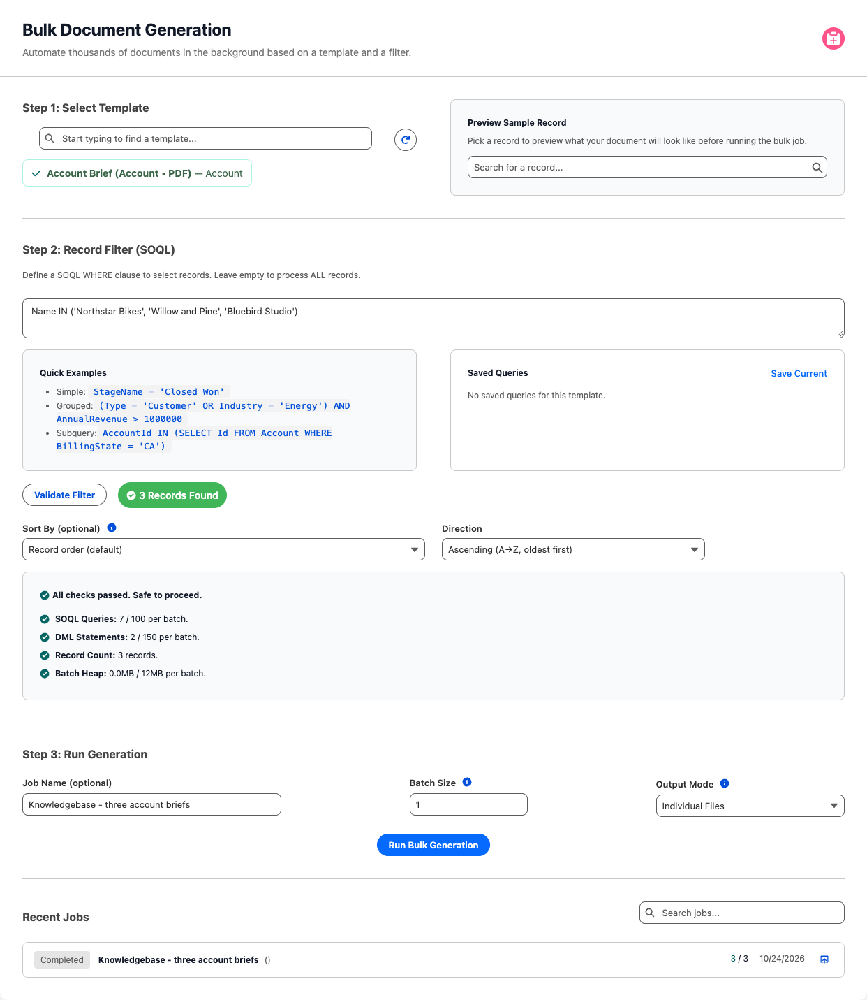

#### Choose the right output

| Mode                      | Use it when…                                     |
| ------------------------- | ------------------------------------------------ |
| **Individual Files**      | Each record needs its own file                   |
| **Print-Ready Packet**    | You want one PDF covering the selected records   |
| **Combined + Individual** | You need the individual files and a combined PDF |

Word, HTML, and supported Canvas PDF workflows can be used for PDF documents. Native Excel and PowerPoint output and fillable PDF forms require **Individual Files**. Follow any compatibility message shown for the selected template.

#### Put the documents in order

Choose **Sort By** and **Direction** before running. This controls processing and the order in the combined PDF. The order of records in a manually prepared list is not a substitute for sorting the job.

#### Print double-sided

For Print-Ready Packet or Combined + Individual, turn on **Duplex Padding** when each document should start on the front of a sheet. Portwood adds a blank page after odd-length documents in the combined packet. Individual files are left unpadded.

Duplex packets have a size estimate based on the sample record. Large images or embedded fonts can reduce how many documents fit in one packet. Split large runs or choose Individual Files when the estimate or job asks for it.

#### Save a filter for next time

Use the bulk runner's save-filter control. Give it a name your team understands, such as **Current customer statements**. Next time, select it instead of typing a condition.

**You are done when:** The success/failure counts match what you expected and a sample of the finished files is correct.

Review [Read job status and recover failures](#job-history) before rerunning a partially successful job.

_Document users · 7 min read · Reviewed for 3.60.0_

**Next:** [Read job status and recover failures](#job-history) · [Schedule a bulk run with Flow](#flow-bulk)

---

<a id="job-history"></a>
<a id="93-job-history"></a>
<a id="96-oversized-records-automatic-giant-query-recovery"></a>
<a id="96-oversized-records--automatic-giant-query-recovery"></a>
<a id="158-giant-query-job-stuck-in-harvesting"></a>

### Read job status and recover failures

Use job history to see whether a large generation is still working, finished, or needs attention.

Open **Portwood → Bulk Generation** and its job-history area. Open the job to inspect its counts, generated files, and errors. Portwood Jobs in the app navigation is another way to find job records.

| Status                    | What to do                                                          |
| ------------------------- | ------------------------------------------------------------------- |
| **Draft**                 | Check whether the job was submitted                                 |
| **Harvesting**            | Wait while records are collected                                    |
| **Processing**            | Let the job continue; check progress                                |
| **Stitching / Merging**   | The engine is assembling large-data fragments or combined PDF parts |
| **Completed**             | Review the files and counts                                         |
| **Completed with Errors** | Read the errors and identify which records still need work          |
| **Failed**                | Read the error before starting another run                          |

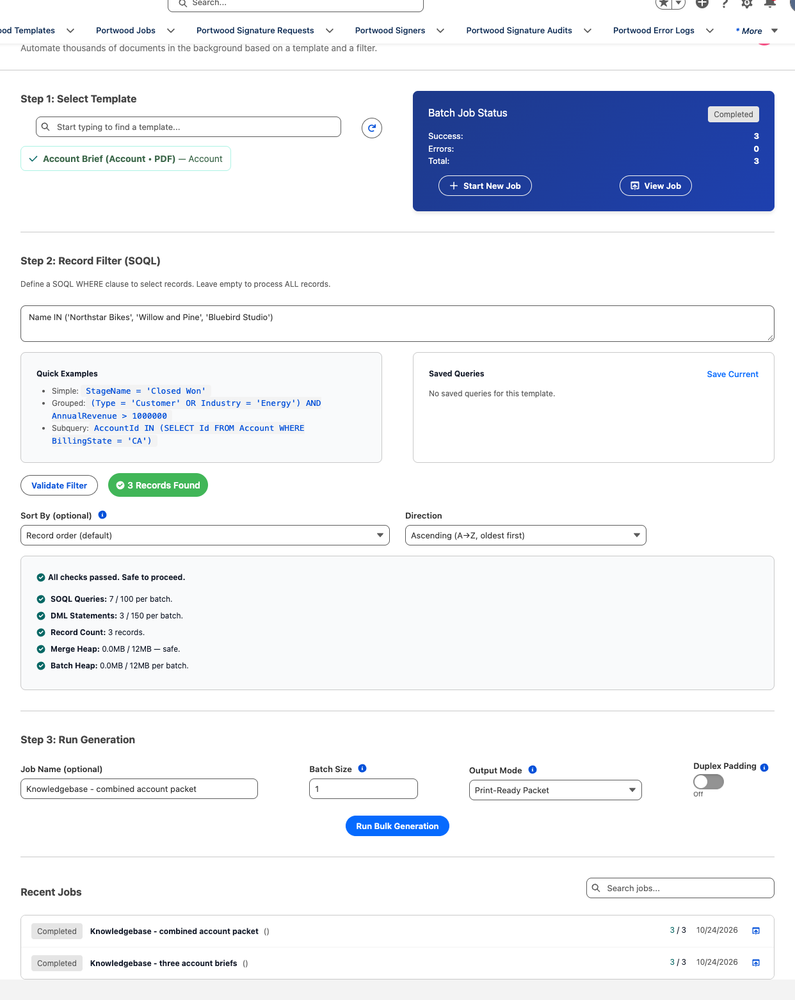

#### Check a partially successful job

1. Open the job.
2. Note its success and failure counts.
3. Open the error details and identify affected records.
4. Check whether separate recovery jobs are still running.
5. Fix the cause or narrow the filter to the records that need another attempt.

Rerunning the original full filter can create additional files for records that already succeeded.

#### When a record has an unusually large related list

Some Individual Files failures are retried automatically through the large-data path. Look for the associated recovery jobs and their results. The original job can still say **Completed with Errors** while those separate jobs finish.

Recovery is capped, and combined-PDF failures are not automatically folded into a new combined packet. Read the job's messages rather than assuming every failed record was recovered.

#### When nothing is moving

Ask your administrator to check Salesforce **Apex Jobs** and **Portwood Error Logs**. Include the job ID, template name, time, and displayed error when reporting a problem. Avoid starting repeated duplicate jobs while the first is queued.

For persisted field/API names and a Flow refresh loop, see [Follow asynchronous jobs](#async-jobs). Friendly progress labels can differ from the stored job state.

_Document administrators · 5 min read · Reviewed for 3.60.0_

**Next:** [Find and fix a problem](#troubleshooting) · [File and format limits](#limits)

---

## Collect signatures

Prepare, send, sign, and track documents.

<a id="sign-uploaded-pdf"></a>
<a id="1011-signing-a-customer-uploaded-pdf"></a>

### Send an uploaded PDF for signature

Send a finished PDF for signature without rebuilding it as a template.

**Before you start:** Open the Salesforce record where the signed file belongs. The page needs **Portwood Signature Sender**. For external recipients, your administrator must [set up external signing](#setup-signatures).

#### 1. Choose the document

1. Click **New signature request**.
2. Choose **Upload PDF** for a file on your computer, or **Salesforce file** for a PDF on this record.
3. Select the PDF and continue.

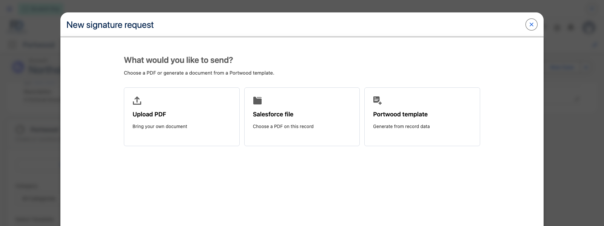

Use an unlocked, unsigned PDF of no more than **2 MB** and **50 pages**. Portwood keeps an original snapshot; choosing an existing Salesforce File does not replace that file.

#### 2. Add the people

Enter each recipient's name and email, or choose a Contact. Add them in the order they should sign.

Uploaded PDFs use **sequential** signing: the second person waits for the first, and so on. You can add up to **10 recipients**.

#### 3. Place the fields

1. In **Assign fields to**, select the recipient.
2. Choose **Signature**, then click the PDF where that person's signature belongs.
3. Add **Initials**, **Date signed**, or **Date picker** fields if needed.
4. Repeat for every recipient.
5. Use the page controls to inspect every PDF page.

Drag a field to move it. Select it to change **Width** and **Height**, move it with arrow keys, or remove it. Every recipient needs at least one Signature field. Keep all fields inside their pages; the request supports up to **100 fields**.

**Date signed** fills automatically. **Date picker** asks the signer to choose a date.

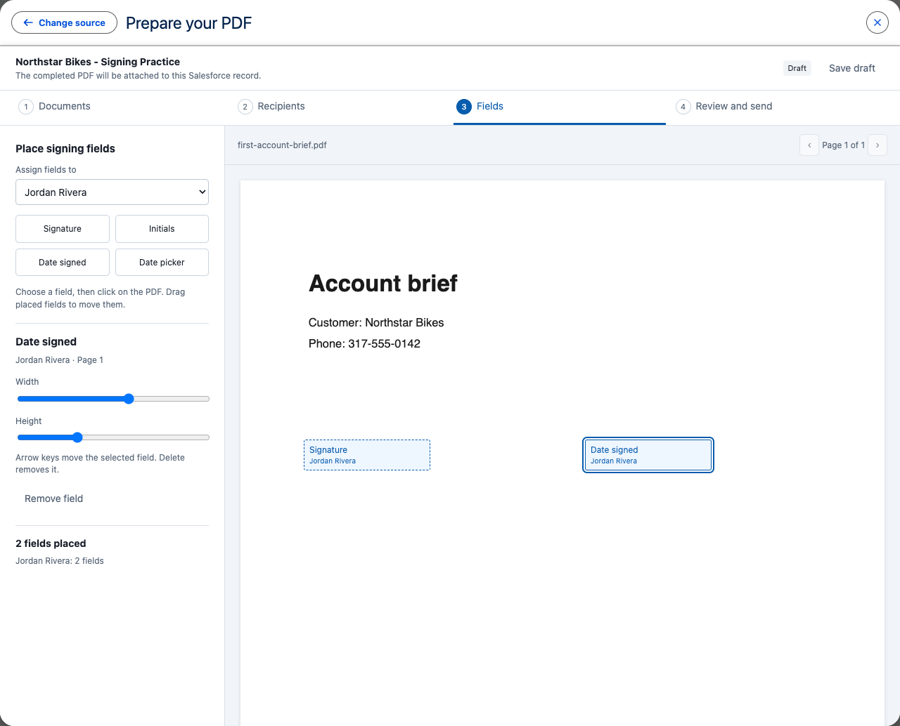

#### 4. Review the request

Click **Review request**. Check the document, assigned people, positions, title, optional Signing Brand, expiration, and email-verification preference.

Choose delivery:

| Delivery                          | What happens                                                                                                                                |
| --------------------------------- | ------------------------------------------------------------------------------------------------------------------------------------------- |
| **Preview signing in Salesforce** | Creates an actual practice request whose signing links require Salesforce login; invitation, reminder, and completion emails are suppressed |
| **Create public signing links**   | Creates external signing links through your configured public site                                                                          |
| **Email invitations**             | Sends invitations through your configured site and sender, in signing order                                                                 |

The internal preview is useful for learning in a test org. Completing it still creates a signed file on the record.

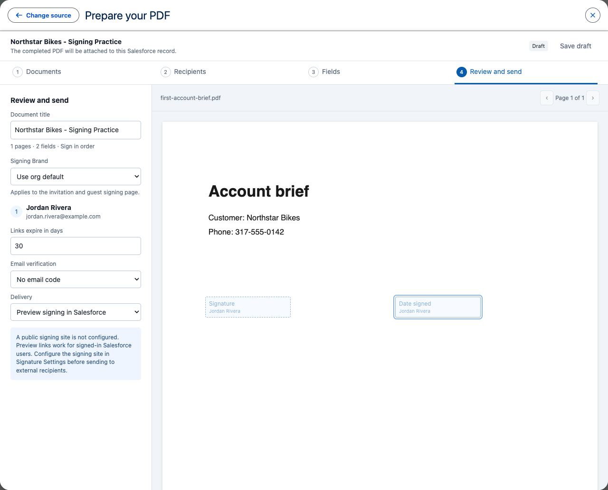

#### 5. Create or send it

Click **Create preview links**, **Create signing links**, or **Send request** for the selected delivery. Find it under **Recent requests** and follow its progress.

**You are done when:** Everyone has signed and the completed PDF appears on the related record. Keep the original, signed PDF, and audit history together.

#### Leave and come back

Use **Save draft** before leaving preparation. On this record, open **Continue preparing → Resume**. Drafts belong to their creator and this record. Once sent, the original and placements are locked; prepare a new request if they need to change.

_Document users · 8 min read · Reviewed for 3.60.0_

**Next:** [What a signer sees](#signer-experience) · [Track, resend, or stop a request](#manage-signatures) · [Set up external signing](#setup-signatures)

---

<a id="sign-template"></a>
<a id="signature-loop-block--signatures-variable-signer-count"></a>
<a id="signature-loop-block-signatures-variable-signer-count"></a>
<a id="10-e-signatures-v3"></a>
<a id="101-sending-a-signature-request"></a>
<a id="102-signature-tag-syntax"></a>
<a id="103-packets-multi-template-signing"></a>
<a id="104-sequential-vs-parallel"></a>

### Send a template for signature

Generate a document from Salesforce information and send it for signature.

**Before you start:** The template is active, includes signature positions, and generates the expected PDF. External delivery needs the [signing-site and email setup](#setup-signatures).

#### Prepare the template once

In Canvas, add a **Signature** block and configure the role and type. In Word or HTML, reserve space and use a signature tag:

```text
Customer signature
{@Signature_Customer:1:Full}

Date signed
{@Signature_Customer:1:Date}
```

The role **Customer** must match the signer's role in the request. Keep each signature on its own line or in its own table cell with room around it.

Use `Initials` for initials and `DatePick` for a date the signer chooses. Use `:inline` as a final suffix when you intentionally want a compact mark instead of the default signature card.

#### Send a request

1. Open the Salesforce record and find **Portwood Signature Sender**.
2. Click **New signature request → Portwood template**.
3. Choose the template, or several compatible templates for a packet.
4. Add each signer from Contacts or enter their name and email.
5. Match each person's **Role** to the template's signature role.
6. Choose the signing order.
7. Check expiration, verification, optional message, and other send settings.
8. Review and send.

| Order          | Use it when…                                      |
| -------------- | ------------------------------------------------- |
| **Single**     | Exactly one person signs                          |
| **Parallel**   | Everyone can receive an invitation at once        |
| **Sequential** | One person must finish before the next is invited |

These choices apply to template requests. The uploaded-PDF preparation path uses sequential signing.

#### Send several documents together

A signature packet gives the signer one session for the selected templates. Review the complete packet, including every role and signing spot. Completion produces a combined signed PDF with its completion certificate.

#### Check the first request

In a test org, verify the signer sees the correct values and only their own signing fields. After completion, open the signed PDF and check its marks and certificate.

A normal **Generate** action produces an unsigned document. Completing a signing request is what produces the signed document and signing audit history.

Use [Signer Inputs](#signer-inputs) when the signer must supply values in addition to their signature.

_Template builders and senders · 6 min read · Reviewed for 3.60.0_

**Next:** [What a signer sees](#signer-experience) · [Track, resend, or stop a request](#manage-signatures) · [Create signing requests with Flow](#flow-signatures)

---

<a id="signer-experience"></a>
<a id="107-signing-page-experience"></a>
<a id="1071-guided-sign-spot-signing-on-the-pdf-viewer-drawn-or-typed"></a>
<a id="1072-stamp-card-vs-inline--how-a-signature-renders"></a>
<a id="1072-stamp-card-vs-inline-how-a-signature-renders"></a>

### What a signer sees

This is what to expect when someone opens a Portwood signing link.

#### Open the link

The invitation identifies the document. Open your own link; each person has a link assigned to them.

If email verification is required, request the code, check the intended inbox, and enter the code. Some requests pre-fill the email address. If verification is off, the link opens the signing document directly.

#### Review and complete the fields

1. Read the document.
2. Follow the highlighted signing fields and progress counter.
3. At a signature or initials field, draw with your mouse/finger or type the value.
4. Choose **Save** to return to the document or **Save & Next** to continue to the next field when offered.
5. Complete any requested date fields.
6. Review the final confirmation, give electronic-signature consent, and submit.

Drawing and typing are alternative ways to fill a signature. Clear the current value before switching methods.

**Date signed** fields fill automatically. A **Date picker** field needs a date you select.

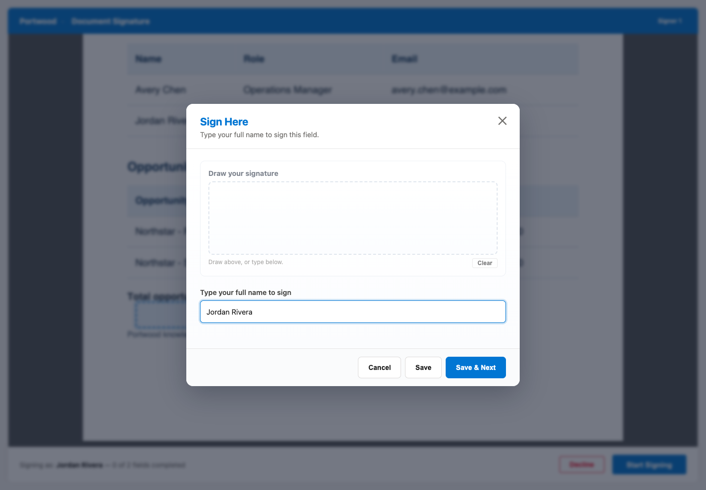

#### After signing

If other people still need to sign, you may see a waiting confirmation. When everyone finishes, Portwood creates the completed file on the related Salesforce record. Depending on the request's delivery settings, completion emails can also carry the finished file.

Active verification and signing screens can use the selected company's branding. The final success and waiting-for-other-signers cards are intentionally plain.

#### If you need to stop

Some signing flows allow you to leave and resume through the same link while it remains valid; verification may be required again. If **Decline** is offered, use it to decline and optionally explain why. Contact the sender if the document or recipient details are wrong.

#### If the link does not work

Ask the sender to check whether it expired, was revoked, was replaced by a resend, or has already been completed. Use the newest link after a resend. On a sequential request, your turn may not have started yet.

_Senders and signers · 4 min read · Reviewed for 3.60.0_

**Next:** [Track, resend, or stop a request](#manage-signatures) · [Fix a signing problem](#fix-signing)

---

<a id="manage-signatures"></a>
<a id="106-in-person-signing-pin-bypass"></a>
<a id="108-link-expiration-reminders-request-management"></a>
<a id="108-link-expiration-reminders--request-management"></a>
<a id="109-audit-trail"></a>
<a id="1010-signed-pdf"></a>
<a id="1011-decline-flow"></a>

### Track, resend, or stop a request

Track a request, replace an expired link, or stop an unsigned request.

#### Find the request

Open the related record and look under **Recent requests** or the sender's previous-request list. Use **Refresh requests** if someone has just completed a step. The Portwood Signature Requests app tab also lists request records.

Open a request to check signer status, delivery information, and its audit records.

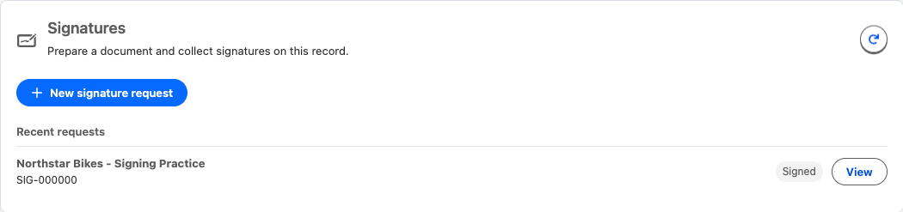

#### Resend

Use **Resend** for an eligible request. Unsigned signers receive new links and a fresh signing window. Their old links stop working, and email verification resets.

Tell the signer to use the newest invitation. Resending does not edit the original document or field placements.

#### Revoke

Use **Revoke** when the remaining people should no longer sign. Review the confirmation first: revocation invalidates the remaining unsigned links.

Completed or cancelled requests do not offer the same resend/revoke actions. If the document needs changing, prepare a new request and stop the old unsigned one where appropriate.

#### Set expiration and reminders

An administrator sets the default in **Portwood → Signatures**. A send can override expiration within the supported **1–365 day** range. A later change to the org default does not rewrite the signing window on a request already sent.

Reminders use hour offsets such as `24, 72, 168`. They go to pending signers while the request remains valid, subject to the configured scheduled job and email setup.

#### Signing in person

Portwood Admin users can use **Sign In Person** when it is offered for a pending signer. Confirm the identity-check attestation only after doing that check. The bypass is recorded in the audit history.

#### Find the completed file

Open **Files** on the related record and inspect the signed PDF. Guided signing adds the marks and a **Certificate of Completion** with signer and verification information. The verification link supports checking the received file against the recorded document hash.

An image merged into an ordinary document is not a completed Portwood signing request and does not create the same signing audit trail.

_Document senders · 5 min read · Reviewed for 3.60.0_

**Next:** [Fix a signing problem](#fix-signing) · [Brand the signing experience](#brands-and-emails)

---

<a id="setup-signatures"></a>
<a id="105-pin-verification"></a>
<a id="making-verification-configurable-onoff-pre-fill"></a>
<a id="1012-admin-setup-one-time"></a>
<a id="assigning-the-guest-permission-set"></a>
<a id="132-signature-settings"></a>

### Set up external signing

Set up the public signing page and email sender before inviting external recipients.

**Before you start:** You are a Salesforce administrator with authority to configure a Salesforce Site or Experience Cloud site and the organization's email settings.

#### 1. Open the checklist

Go to **Portwood → Signatures**. The **Setup Status** checklist shows what is configured and what still needs attention.

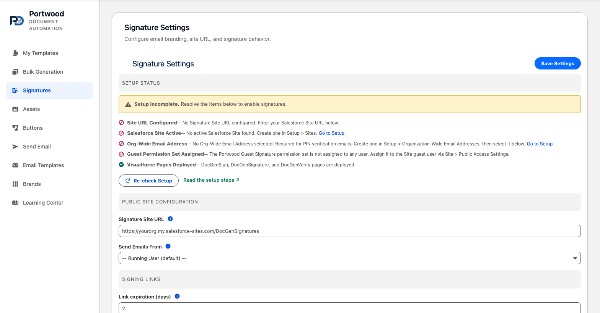

#### 2. Configure the signing site

Follow the complete [Salesforce Site walkthrough](#site-salesforce), or use [an existing Experience Cloud site](#site-experience-cloud). The steps below are the overview.

1. Create or choose the active Salesforce Site or supported Experience Cloud site.
2. Add the packaged signing Visualforce pages to the site's enabled pages, including **DocGenSignature**, **DocGenSignaturePdf**, **DocGenVerify**, and **DocGenSign**.
3. In Portwood's **Signature Site URL**, enter the site's base URL.
4. For an Experience Cloud site, remove a trailing **`/s`** from the URL.

Use the base site address, not an individual signing page or someone's signing token.

#### 3. Give the site's guest user access

For a classic Salesforce Site:

1. Open **Setup → Sites → your site**.
2. Click **Public Access Settings**.
3. Open **View Users**, then the site's guest user.
4. Under **Permission Set Assignments**, assign **Portwood Guest Signature**.

For Experience Cloud, find that site's guest user through its administration/profile controls and assign the same packaged set.

Experience Cloud also needs **Administration → Preferences → Let guest users view asset files, library files, and CMS content available to the site**. Without it, the public PDF preview can say **Document unavailable**.

#### 4. Configure the sender

Use [Configure signing email and verification](#site-email) for the sender, deliverability, and test checklist.

1. In Salesforce Setup, create and verify the intended **Organization-Wide Email Address**.
2. Make it available to the profiles required by the signing workflow; the guest completion path needs an eligible sender.
3. Complete your sending-domain authentication and Salesforce email-deliverability setup.
4. Return to **Portwood → Signatures** and select the address under **Send Emails From**.
5. Save and **Re-check Setup**.

PIN emails need a working sender even if you distribute signing links yourself. Check the request's **Email Status** when an email fails to arrive.

#### 5. Set the defaults

Choose expiration, reminders, email verification, email pre-fill, and whether Decline is available. Verification settings can be inherited or overridden on templates and individual sends; check what the actual send will use.

#### 6. Test the public path

Create a test request for an inbox you control. Open the public link in a private browser window that is not signed into Salesforce. Verify the code email, document preview, signing, completion, and saved file.

**You are done when:** An external test signer can complete the full path and the request shows the expected delivery and completion state. A green setup checklist is useful, but it does not replace this test.

_Salesforce administrators · 9 min read · Reviewed for 3.60.0_

**Next:** [Brand the signing experience](#brands-and-emails) · [Send an uploaded PDF for signature](#sign-uploaded-pdf) · [Fix a signing problem](#fix-signing)

---

<a id="brands-and-emails"></a>
<a id="1013-email-branding"></a>
<a id="1015-brands-command-hub-tab"></a>

### Brand the signing experience

Use the right company name, logo, color, and sender throughout a signing request.

#### Create a brand

1. Open **Portwood → Brands → Add Brand**.
2. Enter an internal **Brand name**.
3. Set its **Company name**, **Brand color**, and **Footer text**.
4. Choose **Send emails from** if this brand uses its own verified Organization-Wide Email Address.
5. Choose a logo URL or shared Asset file.
6. Leave it Active and save.

An inactive brand is not available for new selections; existing assignments fall back to the org default while it is inactive.

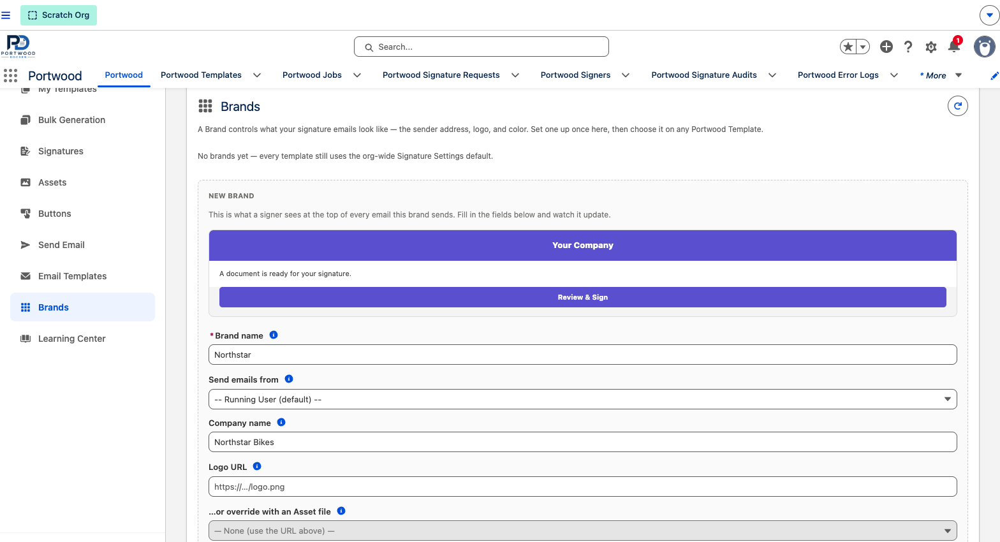

#### Use it on a template or uploaded PDF

Set the template's **Sending Brand**. For an uploaded-PDF request, choose **Signing Brand** on the review step.

Brand settings are reused. To change a document's actual logo or content, edit the document template as well; a signing brand is not a replacement for the document body.

#### Change the signing emails

1. Open **Email Templates**.
2. Choose the email type, such as **Signature Request** or **Email Verification Code**.
3. Leave **Brand = Shared / Default** for shared wording, or pick a brand for an override.
4. Edit the subject and body.
5. Review the live sample and use **Send Test** to an inbox you control before using it with recipients.

There are seven email types: request, reminder, verification code, signer completed, all signatures complete, signer declined, and completion confirmation.

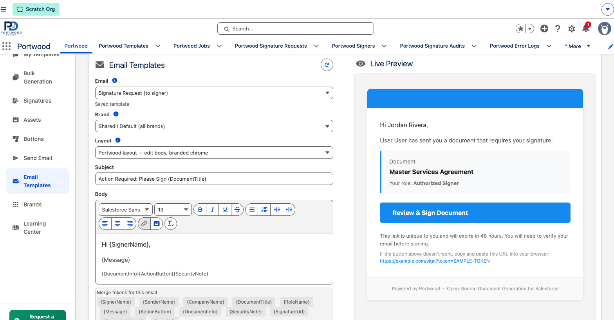

#### Keep the signing controls

The default **Portwood layout** adds the branded frame around your body. **Full custom HTML** gives you the complete layout.

Keep the required link or code tokens when customizing. `{ActionButton}` creates a signing button; `{VerificationCode}` creates the PIN block. If you replace a widget with custom wording, preserve the underlying `{SignatureUrl}` or `{Pin}` token as appropriate for that email type.

Email images need absolute, publicly reachable URLs. Shared-asset email images require Salesforce Content Deliveries/Public Links support. An internal Salesforce file URL that works for you can be broken in a recipient's inbox.

#### Know which settings win

For visual wording and styling, a saved **email type + brand** override is most specific, then the brand identity, then org defaults, then built-in defaults. Sender selection uses the brand sender when eligible, otherwise the org sender.

Automated reminder emails currently use the org-wide identity rather than the selected brand. Check reminders separately when operating several brands.

The active signing and verification experience follows the selected brand. Final success and waiting confirmations remain plain.

The complete [email-token and custom-button reference](#email-tokens) lists the available values for each email type and shows how to replace a widget while preserving its link or verification code.

_Template administrators · 7 min read · Reviewed for 3.60.0_

**Next:** [Set up external signing](#setup-signatures) · [Add logos and pictures](#images-and-assets)

---

<a id="site-salesforce"></a>

### Create the Salesforce signing site

A Salesforce Site gives external recipients a public doorway to the signing experience. They use their unique signing link; they do not need a Salesforce login.

**Before you start:** Install Portwood and use a Salesforce administrator account. This walkthrough uses **Salesforce Sites**. If your organization already uses Experience Cloud, follow [the Experience Cloud route](#site-experience-cloud) instead.

#### 1. Open Sites

1. Open the gear menu and choose **Setup**.
2. Type **Sites** in Quick Find.
3. Open **Sites** under **Sites and Domains**.
4. If this org has no Salesforce Sites domain, register the intended available domain using Salesforce's on-screen process. Domain selection belongs to your organization's site plan; check it before registering.
5. Click **New**.

In the fresh scratch org, Salesforce had already provisioned a Sites domain. A new production org can show a domain-registration step first. Salesforce describes these controls in [Manage Salesforce Sites](https://help.salesforce.com/s/articleView?id=platform.sites_managing_sites.htm&language=en_US&type=5).

#### 2. Name and activate the site

| Field                      | Example or choice                                                                                      |
| -------------------------- | ------------------------------------------------------------------------------------------------------ |
| Site Label                 | Portwood Signing                                                                                       |
| Site Name                  | Portwood_Signing; check the generated value                                                            |
| Site Contact               | The internal user responsible for this site                                                            |
| Default Record Owner       | An appropriate active internal user                                                                    |
| Default Web Address        | A short unused path such as `sign`                                                                     |
| Active                     | Selected                                                                                               |
| Active Site Home Page      | Use the lookup to choose `portwoodglobal.DocGenSignature`, or your organization's neutral landing page |
| Clickjack Protection Level | Leave the recommended same-origin protection for this standalone signing site                          |

Use the home-page lookup rather than guessing its API spelling. Managed pages appear with the namespace, and typed lookup values can fail to resolve. The home page does not replace the complete signing URL generated for each request.

Save. On **Site Details**, copy the HTTPS domain plus the site's path from **Custom URLs**. For example:

```text
https://your-domain.my.salesforce-sites.com/sign
```

Your domain will differ. The example is a base address, not a signing link.

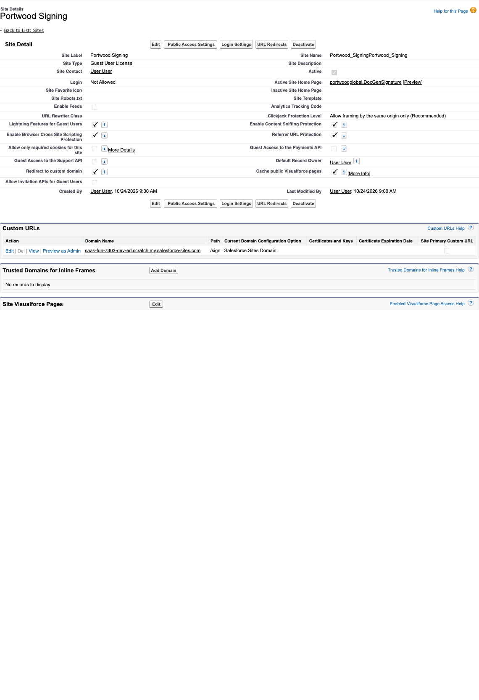

#### 3. Enable the packaged public pages

1. On Site Details, find **Site Visualforce Pages** and click **Edit**.
2. Move these pages into **Enabled Visualforce Pages**:
    - `portwoodglobal.DocGenSignature`
    - `portwoodglobal.DocGenSignaturePdf`
    - `portwoodglobal.DocGenVerify`
    - `portwoodglobal.DocGenSign`
3. Save.

The home page may already be enabled. `DocGenSignaturePrepare` is the authenticated preparation UI used by your internal senders; it is not one of the public pages to add for this setup.

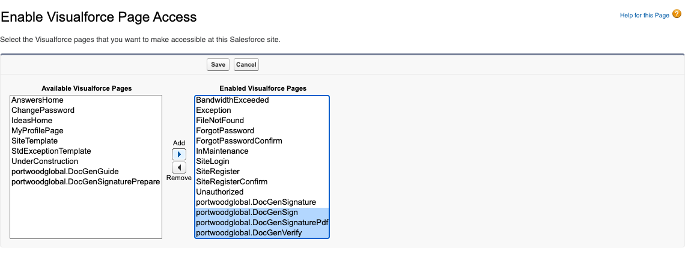

Salesforce documents the available/enabled list in [Assign Visualforce Pages to a Site](https://help.salesforce.com/s/articleView?id=platform.sites_site_pages.htm&language=en_US&type=5).

#### 4. Give this site's guest user the packaged permission set

Each site has its own guest user. Assigning a permission set to yourself or a different site's guest will not complete this step.

1. Return to Site Details and click **Public Access Settings**.
2. On the guest profile, click **View Users**.
3. Open the user named for this site, such as **Portwood Signing Site Guest User**.
4. In **Permission Set Assignments**, click **Edit Assignments**.
5. Move **Portwood Guest Signature** to **Enabled Permission Sets** and save.

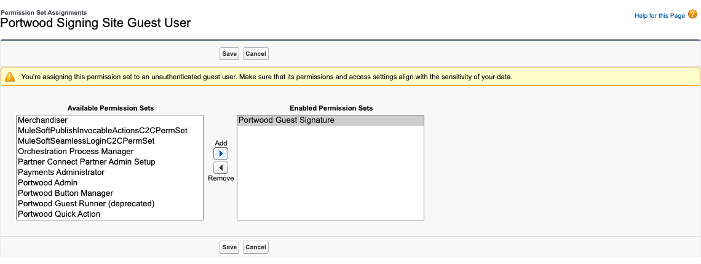

Use the packaged permission set as the starting point. Do not grant a guest the Admin permission set or broad Account/Contact access to make signing work. The signing pipeline uses the specific request/link and packaged access controls.

#### 5. Tell Portwood where the site lives

1. Open the **Portwood** app and its **Signatures** workspace.
2. Paste the base address into **Signature Site URL**, including your site's path such as `/sign`.
3. Save the setting and click **Re-check Setup**.
4. Follow [Configure signing email](#site-email) for the sender and verification delivery.

Do not include `/apex/…`, a token, or a single recipient's signing link in the base setting.

#### 6. Prove the public path

Create a practice request and open its generated signing link in a private browser window signed out of Salesforce. Check document preview, required fields, consent, submission, request status, and the saved completed file. Once email is configured, repeat with verification enabled and an inbox you control.

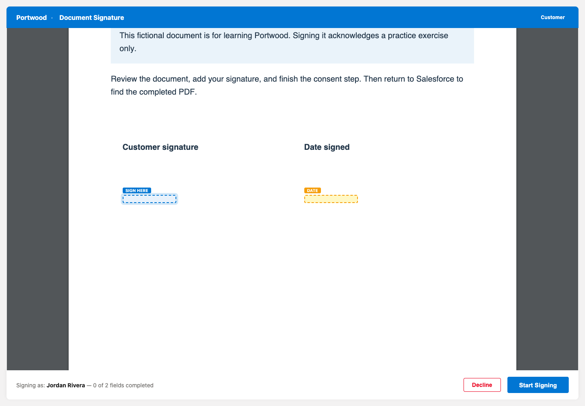

**You are done when:** The intended public signer can finish the full request. A green setup checklist is a configuration check, not a substitute for this test.

_Salesforce administrators · 12 min read · Reviewed for 3.60.0_

**Next:** [Configure signing email and verification](#site-email) · [Set up external signing](#setup-signatures) · [Fix a signing problem](#fix-signing)

---

<a id="site-experience-cloud"></a>

### Use an Experience Cloud signing site

Use this route when your organization wants signing served through an Experience Cloud site. The standalone [Salesforce Site walkthrough](#site-salesforce) is the simpler starting point when you do not need a wider portal.

**Before you start:** Your administrator owns an active Experience Cloud site, its domain, and its guest-access policy. Experience templates and administrative screens vary; follow Salesforce's [Create an Experience Cloud Site](https://help.salesforce.com/s/articleView?id=networks_creating.htm&language=en_US&type=5) for the site's initial creation and publication.

#### 1. Open the site's administration

In **Setup → Digital Experiences → All Sites**, open the site's **Workspaces** and administration controls. Confirm that the site is active/published and that the external domain works while signed out.

#### 2. Enable the packaged public pages

Find this site's guest profile/public access settings. In its **Enabled Visualforce Page Access**, enable the packaged pages `DocGenSignature`, `DocGenSignaturePdf`, `DocGenVerify`, and `DocGenSign` in the `portwoodglobal` namespace.

Open that guest profile's actual user and assign **Portwood Guest Signature** under Permission Set Assignments. Keep the assignment tied to the correct site's guest user. Do not use the logged-in member profile as a substitute for guest access.

#### 3. Allow the public document preview

In the site's **Administration → Preferences**, enable:

**Let guest users view asset files, library files, and CMS content available to the site**.

Without this, the signing shell can load while the PDF says **Document unavailable**. This preference is not a reason to make unrelated Salesforce Files public; verify the actual signing document's token-controlled preview.

#### 4. Enter the correct base address

In **Portwood → Signatures → Signature Site URL**, use the site's base address with its site path, but remove a trailing `/s`.

| Browser's portal address                  | Portwood base setting                   |
| ----------------------------------------- | --------------------------------------- |
| `https://example.my.site.com/customers/s` | `https://example.my.site.com/customers` |

Do not append a Visualforce page or signer token. Save and **Re-check Setup**.

#### 5. Test outside your admin session

Use a practice request and a private browser. Confirm the generated link, PDF preview, signing, and saved output. Then test verification and completion delivery using [Configure signing email](#site-email).

If a link opens **Invalid Page**, first check the `/s` suffix, enabled Visualforce pages, active site, and base path. If the page loads but the PDF is unavailable, check the guest content preference and packaged guest permission set.

This route was reviewed against the current signing URL logic and existing configuration guidance. The fresh-org hands-on setup used Salesforce Sites; it did not provision every Experience template.

_Salesforce administrators · 8 min read · Reviewed for 3.60.0_

**Next:** [Create the Salesforce signing site](#site-salesforce) · [Configure signing email and verification](#site-email) · [Fix a signing problem](#fix-signing)

---

<a id="site-email"></a>

### Configure signing email and verification

The public page and the email sender are separate parts of signing setup. A working page does not prove that invitations or verification codes can be delivered.

**Before you start:** Use an administrator account and a real sender/inbox controlled by your organization. Domain authentication can require your email or DNS administrator.

#### 1. Create the sender address

1. In **Setup**, search for **Organization-Wide Addresses**.
2. Add the intended display name and email address.
3. Make it available to the profiles required by the signing workflow, including the guest completion path where applicable.
4. Open Salesforce's verification message in that inbox and complete verification.
5. Confirm the address is verified and eligible before selecting it in Portwood.

A brand can have its own sender, but that address also needs to be verified and usable. An address that an admin can select is not proof that every runtime path can use it.

#### 2. Complete Salesforce email prerequisites

Check **Setup → Deliverability** and the org's sending-domain verification/authentication requirements. Use your organization's approved sender domain, DKIM and other domain records as required by Salesforce and your email setup. Sandbox/scratch delivery restrictions and unverified domains can prevent mail even when the Portwood settings look complete.

Use Salesforce's current [Organization-Wide Addresses documentation](https://help.salesforce.com/s/articleView?id=sf.emailadmin_manage_orgwide_email_addresses.htm&language=en_US&type=5) and [requirements for sending email](https://help.salesforce.com/s/articleView?id=xcloud.security_email_verification_requirements.htm&language=en_US&type=5) for the platform controls.

#### 3. Select it in Portwood

1. Open **Portwood → Signatures**.
2. Choose the verified address in **Send Emails From**.
3. Save and click **Re-check Setup**.
4. Set the default email verification, pre-fill, expiration, and reminder choices.
5. Open [Brands and Email Templates](#brands-and-emails) if you want different identities or wording.

Check the actual template and send review: template/request overrides can change whether a code is required. Suppressing branded invitations does not suppress required PIN verification emails.

#### 4. Test each delivery separately

| Test               | Check                                                                                            |
| ------------------ | ------------------------------------------------------------------------------------------------ |
| Invitation         | Right sender, subject, brand, recipient, and working link                                        |
| Verification code  | Code arrives in the expected inbox and unlocks the request                                       |
| Sequential signing | Only the currently eligible signer gets the appropriate invitation                               |
| Reminder           | Schedule and sender match your intended operation; reminders currently use the org-wide identity |
| Completion         | Expected recipients receive completion and can access the intended result                        |

Use an inbox you control and a practice document. Open the signing link outside your Salesforce session. Check spam/quarantine and the request's **Email Status** when delivery fails; an already-sent status cannot guarantee that an external mail system placed the message in an inbox.

#### Keep a repeatable setup check

When changing domains, site URLs, guest users, brands, senders, or verification policy, run the public test again. Record which part failed: link, PDF preview, code delivery, signing, file save, or completion delivery. That makes support much faster than a general “signing does not work.”

The fresh knowledgebase org deliberately used no production sender. Site/public signing and email rendering can be tested separately, but actual invitation/PIN/reminder/completion delivery still requires a verified sender and a controlled inbox.

_Salesforce administrators · 9 min read · Reviewed for 3.60.0_

**Next:** [Create the Salesforce signing site](#site-salesforce) · [Brand the signing experience](#brands-and-emails) · [Fix a signing problem](#fix-signing)

---

<a id="signer-inputs"></a>
<a id="1171-signer-form-fields-collect-input-during-signing-write-it-back"></a>
<a id="1171-signer-form-fields--collect-input-during-signing-write-it-back"></a>

### Collect signer answers and write them back

Ask a signer for a PO number, selected date, acknowledgement, or other information while they sign. These are signer inputs, separate from the Salesforce fields merged when the request is created.

#### Configure an input

1. Open the template editor and choose **Signer Inputs**.
2. Click **Add Field**.
3. Set the **Label** and **Type**: text, number, date, checkbox, or picklist. Supply choices for a picklist.
4. Choose **Required** if the signer must answer.
5. Copy the generated **Merge Tag**. Its stable key uses letters, numbers, and underscores.
6. Choose **On Certificate** if the answer should appear on the completion certificate.
7. To update Salesforce after signing, select a suitable **Mapped Field** on the related record and enable **Write Back**.
8. Save the intended version and test a practice signing request.

#### Place the answer

```text
{?poNumber}
{?poNumber|N/A}
```

The second form supplies a fallback when no answer is available. Use the key copied from the editor; typing a new key into the document does not create an input. Reserve its own line or table cell for the value so it has room to render without overprinting a static label.

The signer fills these fields during signing. Answers can appear in the finished document and, when configured, on the certificate. This feature is separate from mapping an uploaded PDF's AcroForm fields or manually placing signature spots in the uploaded-PDF preparation screen.

#### Understand writeback

Writeback runs after the completed signed PDF is saved. It updates only fields explicitly mapped and enabled in the template configuration. The guest does not receive general permission to edit the related Account, Opportunity, or other base record.

**Writeback supports single-signer requests.** With several signers, answers are captured and attributed on the certificate, but record writeback is skipped because there is no unambiguous single answer for a shared field. Do not design a multi-signer packet expecting the last answer to overwrite Salesforce.

Field access, supported value conversion, and validation rules still apply. A failed record update is logged; it does not undo a completed signing request. Check the related record and **Portwood Signature Audits** for writeback failures rather than treating a Signed status as proof of a successful field update.

#### Retry a failed update

Correct the mapped field, permissions, or validation issue first. The global **Write Back Signer Form Fields** action accepts only the completed request Id and re-derives the allowed fields from its configuration. It does not accept arbitrary field/value instructions from the guest.

```apex
portwoodglobal.DocGenFieldWritebackService.WritebackRequest retry =
    new portwoodglobal.DocGenFieldWritebackService.WritebackRequest();
retry.requestId = completedRequestId;
portwoodglobal.DocGenFieldWritebackService.writeBackFields(
    new List<portwoodglobal.DocGenFieldWritebackService.WritebackRequest>{retry});
```

The action returns no success DTO and logs failures instead of throwing them back into signing. Verify the target value and audit after a retry. Test an optional blank answer, required answer, invalid value, inaccessible field, validation-rule failure, and multi-signer request before enabling this in a business process.

_Developers and advanced administrators · 8 min read · Reviewed for 3.60.0_

**Next:** [Signature tags and variable signer blocks](#tag-signatures) · [Create signing requests with Flow](#flow-signatures) · [Call Flow actions and signing APIs from Apex](#apex-actions)

---

## Automate the work

Use Salesforce Flow and prepared data when a manual click is not enough.

<a id="flow-generate"></a>
<a id="11-flow-automation-cookbook"></a>
<a id="111-picking-the-right-action"></a>
<a id="112-recipe--when-an-opportunity-closes-won-generate-a-pdf-and-attach-it"></a>
<a id="112-recipe-when-an-opportunity-closes-won-generate-a-pdf-and-attach-it"></a>
<a id="113-recipe--email-a-generated-pdf-without-keeping-a-copy"></a>
<a id="113-recipe-email-a-generated-pdf-without-keeping-a-copy"></a>
<a id="115-recipe-generate-when-dataset-size-is-unpredictable"></a>
<a id="115-recipe--generate-when-dataset-size-is-unpredictable"></a>
<a id="1111-error-handling"></a>

### Make a document with Flow

Let a Salesforce Flow make a document when a business event happens.

**Before you start:** You know Flow Builder and have a tested template. Give the template a stable **API Name**, such as `Opportunity_Summary`, and confirm the Flow's running context can access the required data.

#### Example: make a summary when a deal is won

1. Create an after-save, record-triggered Flow on **Opportunity**.
2. Set entry conditions so it runs when the record **first changes to Closed Won**, rather than on every later edit to a won deal.
3. Put document work on an appropriate asynchronous path when required by the rendering method and your transaction design.
4. Add an **Action** and search for **Generate Document** from Portwood.
5. Set the inputs:

| Input                      | Example                                                     |
| -------------------------- | ----------------------------------------------------------- |
| **Template API Name**      | `Opportunity_Summary` — use your template's actual API Name |
| **Record ID**              | `{!$Record.Id}`                                             |
| **Save to Record**         | `True`                                                      |
| **Document Title**         | An optional title you build from the record                 |
| **Output Format Override** | Leave blank for the template's default                      |

6. Store **Success**, **Error Message**, **Content Document ID**, and **Content Version ID** outputs.
7. Add a Decision: continue only when **Success = True**.
8. Connect the action's fault path to your Flow's error handling too.
9. Debug with a test Opportunity, then activate after checking the saved document.

**You are done when:** One qualifying change creates the intended file, and an unrelated later edit does not create another copy.

#### Email the generated file

Use the returned **Content Version ID** with the supported attachment input of Salesforce's Send Email action. Verify the attachment ID type expected by that action. Preview and test with an inbox you control before enabling customer delivery.

**Save to Record = False** avoids linking the file to the source record; the Generate Document action still creates a standalone Salesforce File. It is not a storage-free PDF action.

#### When the data can be large

**Generate Document (Auto Giant Query)** can choose a background path for supported large Word datasets. It takes a **Template ID** and **Record ID**. Check **Is Giant Query**: if true, follow **Job ID** and wait for completion; otherwise use the returned file IDs.

That action's background route requires a supported V3 query and is Word-only. For other large formats, use the runner or a suitable bulk workflow. A successful job submission does not mean its file is ready yet.

_Flow builders · 8 min read · Reviewed for 3.60.0_

**Next:** [Schedule a bulk run with Flow](#flow-bulk) · [Use prepared or custom data](#custom-data) · [Developer and advanced references](#developer-reference)

---

<a id="flow-bulk"></a>
<a id="114-recipe--mass-generate-quarterly-statements"></a>
<a id="114-recipe-mass-generate-quarterly-statements"></a>

### Schedule a bulk run with Flow

Schedule a document run instead of starting it by hand.

**Before you start:** Test the template and filter in [Bulk Generation](#bulk-generation). A Salesforce administrator should design the schedule and Flow error handling.

#### Configure the action

1. Create the automation that should launch the run, such as one scheduled Flow.
2. Add **Generate Bulk Documents** from Portwood.
3. Set **Template API Name** or **Template ID**.
4. Supply a **WHERE Condition** or a **Record IDs** collection.
5. Set the job label, output options, batch size, and sort order.

Example inputs for the downloadable Account Brief template:

| Input                          | Example                                          |
| ------------------------------ | ------------------------------------------------ |
| **Template API Name**          | `KB_Account_Brief`                               |
| **WHERE Condition**            | `Name IN ('Northstar Bikes', 'Willow and Pine')` |
| **Sort Order**                 | `Name ASC`                                       |
| **Job Label**                  | `Practice account briefs`                        |
| **Combined PDF Only**          | `False`                                          |
| **Also Keep Individual Files** | `True`                                           |
| **Batch Size**                 | `1`                                              |

Use your own filter for real work. **Sort Order** contains field names and direction, without the words `ORDER BY`.

#### Avoid launching the same run repeatedly

If a scheduled Flow starts once per matching record, adding a bulk action that already queries all records can launch the entire run many times. Design one launch per intended batch, or pass the intended record IDs with a deliberate batching strategy.

#### Follow the result

Store **Success**, **Error Message**, and **Job ID**. Add a Decision for an unsuccessful response and a fault connector for an unexpected action failure.

The action submits background work and returns. Follow the job in Portwood job history; do not email a completion notice just because submission returned successfully.

When producing a combined PDF for double-sided printing, the action's **Duplex Padding** input applies the same behavior as the bulk UI.

_Flow builders · 6 min read · Reviewed for 3.60.0_

**Next:** [Make documents for many records](#bulk-generation) · [Read job status and recover failures](#job-history)

---

<a id="flow-signatures"></a>
<a id="116-recipe--send-a-contract-for-signature-on-opportunity-approval"></a>
<a id="116-recipe-send-a-contract-for-signature-on-opportunity-approval"></a>
<a id="1161-sign-in-session--capture-the-signature-in-your-own-portal-or-screen-flow"></a>
<a id="1161-sign-in-session-capture-the-signature-in-your-own-portal-or-screen-flow"></a>
<a id="117-recipe-send-a-document-for-signature-on-the-pdf-viewer-page"></a>
<a id="117-recipe--send-a-document-for-signature-on-the-pdf-viewer-page"></a>

### Create signing requests with Flow

Create a signing request automatically when a record is ready for approval or acceptance.

**Before you start:** Test the template, signature roles, public signing path, and email sender manually. This article is for a Flow builder.

#### 1. Prepare the signer resources

Create a single **Apex-Defined** variable using the packaged **DocGenSigner** class and a collection variable of the same type.

Assign the single signer's fields:

| Field         | Example                                             |
| ------------- | --------------------------------------------------- |
| **name**      | Your Contact's full name                            |
| **email**     | Your Contact's email                                |
| **role**      | `Customer`, matching `{@Signature_Customer:1:Full}` |
| **contactId** | The Contact ID, when available                      |

Add the populated signer to the collection. Repeat for additional people.

#### 2. Create the request

Add **Portwood: Create Signature Request** and set:

| Input                                    | What to supply                                     |
| ---------------------------------------- | -------------------------------------------------- |
| **Template API Name** or **Template Id** | The tested template                                |
| **Related Record Id**                    | The record where the signed file belongs           |
| **Signers**                              | Your DocGenSigner collection                       |
| **Signing Order**                        | `Single`, `Parallel`, or `Sequential`              |
| **Send Branded Emails**                  | Leave on when Portwood should send the invitations |

Set expiration, message, and verification overrides only when your process needs them.

Store **Signature Request Id**, **Signer URLs**, **Email Status**, **Success**, and **Error Message**. Connect the **fault path**: invalid signature inputs can fault the interview before outputs are returned.

#### 3. Let the request finish the document

Follow the request's status. Once everyone signs, the signing workflow creates the completed PDF and certificate. Do not add a separate Generate Document action expecting it to supply the signed version; that can create an extra unsigned file.

#### In-session signing

A screen Flow can direct a signer to their returned signing URL. This keeps signing inside Portwood's audited signing surface. On a sequential request, signer URLs are returned in signer order; capture the first URL with a loop/assignment if the first person signs immediately.

The **Send Branded Emails = False** input suppresses the initial invitations. On sequential requests it does not suppress every later signer's automatic invitation. Choose one deliberate delivery approach to avoid duplicate invitations.

Legacy custom-signature actions do not accept modern v3 signer tokens. Use the returned Portwood signing link for current requests; see the [automation reference](https://github.com/Portwood-Global-Solutions/Portwood/blob/main/docs/reference/automation.md) for compatibility and advanced options.

Use [Collect signer answers](#signer-inputs) for `{?key}` fields, optional certificate entries, and single-signer record writeback.

_Flow builders · 8 min read · Reviewed for 3.60.0_

**Next:** [Send a template for signature](#sign-template) · [Set up external signing](#setup-signatures) · [Developer and advanced references](#developer-reference)

---

<a id="custom-data"></a>
<a id="66-apex-data-provider-v4-class-backed-templates"></a>
<a id="66-apex-data-provider-v4--class-backed-templates"></a>
<a id="step-1-write-the-provider-class-in-your-org"></a>
<a id="step-1--write-the-provider-class-in-your-org"></a>
<a id="step-2-bind-a-template-to-the-class"></a>
<a id="step-2--bind-a-template-to-the-class"></a>
<a id="step-3--generate"></a>
<a id="step-3-generate"></a>
<a id="common-patterns"></a>
<a id="661-json-data-from-flow--template-authoring-mode"></a>
<a id="661-json-data-from-flow-template-authoring-mode"></a>
<a id="118-recipe--pass-pre-built-json-data-instead-of-querying"></a>
<a id="118-recipe-pass-pre-built-json-data-instead-of-querying"></a>

### Use prepared or custom data

Use information your Flow or developer has prepared instead of querying a normal Salesforce record.

Most templates should start with the visual field chooser. Use a custom-data path when the document needs calculated structures, API results, or a deliberately prepared dataset.

#### Pass JSON from a Flow

Create a template using **Data Source = JSON Data (from Flow)** and provide sample data for authoring. In **Generate Document**, set **JSON Data** to the text your Flow prepares.

A small example:

```json
{
    "Name": "Northstar Bikes",
    "Total": 240,
    "Items": {
        "records": [{ "Description": "Workshop", "Quantity": 2, "Price": 120 }]
    }
}
```

The template can use `{Name}`, `{Total:currency}`, and a repeating `{#Items}…{/Items}` section.

Supplying JSON bypasses the normal data query. Portwood does not create those Salesforce records for you. If the result should attach to a record, provide its **Record ID** and **Save to Record = True** as well.

#### Use an Apex data provider

A developer can implement **DocGenDataProvider** and bind the template to that class. The provider returns the values and lists the document needs.

Your developer is responsible for the provider's data access, filtering, errors, and any external integrations. The core document-generation path does not automatically make a provider's callouts or data handling safe or storage-free.

The [query and provider reference](https://github.com/Portwood-Global-Solutions/Portwood/blob/main/docs/reference/query-config.md) includes the interface, configuration, examples, and execution constraints.

#### Test the shape, not just one example

Try empty lists, missing optional values, many rows, long text, and errors from the source system. Keep authoring sample data representative and free of sensitive customer information.

_Flow builders and developers · 6 min read · Reviewed for 3.60.0_

**Next:** [Choose the information in a document](#choose-data) · [Developer and advanced references](#developer-reference)

---

<a id="async-jobs"></a>
<a id="1110-polling-an-async-job-from-a-screen-flow"></a>

### Follow asynchronous jobs from Flow or Apex

An accepted background job is not a finished document. Store the returned **Job ID** and wait for the job's terminal state before using a File or telling someone generation is complete.

#### Read the actual job record

In subscriber Apex and Flow, use **Portwood Job** (`portwoodglobal__DocGen_Job__c`) with the access granted to the running user. These are useful API fields:

| Field                                                                | Meaning                                       |
| -------------------------------------------------------------------- | --------------------------------------------- |
| `portwoodglobal__Status__c`                                          | Persisted job state                           |
| `portwoodglobal__Total_Records__c`                                   | Intended record count                         |
| `portwoodglobal__Success_Count__c`, `portwoodglobal__Error_Count__c` | Outcome counts                                |
| `portwoodglobal__Error_Log__c`                                       | Recorded error details                        |
| `portwoodglobal__Merged_PDF_CV__c`                                   | Combined output ContentVersion, when produced |

```apex
portwoodglobal__DocGen_Job__c job = [
    SELECT portwoodglobal__Status__c, portwoodglobal__Success_Count__c,
        portwoodglobal__Error_Count__c, portwoodglobal__Merged_PDF_CV__c,
        portwoodglobal__Error_Log__c
    FROM portwoodglobal__DocGen_Job__c
    WHERE Id = :jobId WITH USER_MODE LIMIT 1
];
```

`DocGenBulkController.getJobStatus()` is a package-internal UI endpoint, not a subscriber Apex API. Use the job record or your own authorized wrapper around its query.

#### Distinguish persisted states from screen labels

**Draft**, **Harvesting**, **Processing**, **Stitching**, and **Merging** describe preparation or work still in progress. **Completed**, **Completed with Errors**, and **Failed** are terminal outcomes; inspect counts and logs before deciding whether your business process succeeded. Some screens can use friendlier progress labels; do not build a status comparison against a word that is not actually stored on the record.

A completed individual-file run may have no combined output Id. Giant-query recovery can launch separate child jobs; the original batch's terminal status does not mean every recovery child has finished.

#### Refresh in a screen Flow

1. **Get Records** for the returned Job ID.
2. Use a **Decision** for Completed, Completed with Errors, and Failed.
3. For a nonterminal state, show a **Screen** containing the status and a **Refresh** navigation choice.
4. Connect the refresh route back to Get Records so it re-reads the job.
5. Provide an exit choice; the user does not need to keep a browser open for the job to run.

Do not create a tight Get Records/Decision loop with no screen or asynchronous boundary. It repeats in one transaction and can consume the query limit without giving the background job time to finish.

Screen Flows do not support a Wait element. For unattended processing, choose an automation pattern compatible with its Flow type, such as a record-triggered Flow on the job's completion update, or an autolaunched Flow with a supported Wait configuration. A record-triggered Flow does not simply gain a generic Wait element; check Salesforce's [Flow types](https://help.salesforce.com/s/articleView?id=sf.flow_concepts_type.htm&language=en_US&type=5) and [Wait considerations](https://help.salesforce.com/s/articleView?id=platform.flow_considerations_design_pause.htm&language=en_US&type=5).

#### Handle partial success and recovery

For supported Individual Files runs, oversized records can be queued for giant-query recovery. The current batch caps automatic recovery at **100 records** and records any overflow for manual handling. A combined packet is not automatically reconstructed from recovery results. Confirm the correct parent/child job outputs before retrying failed records; rerunning the whole original filter can duplicate successful Files.

_Developers and advanced administrators · 9 min read · Reviewed for 3.60.0_

**Next:** [Read job status and recover failures](#job-history) · [Schedule a bulk run with Flow](#flow-bulk) · [Make a document with Flow](#flow-generate) · [Call Flow actions and signing APIs from Apex](#apex-actions)

---

## Keep your team organized

Manage templates, access, upgrades, and practical limits.

<a id="template-versions"></a>
<a id="52-template-versions"></a>
<a id="521-cloning-a-template-v329"></a>

### Save changes and return to an earlier version

Keep a working template while making improvements, and return to an earlier design when needed.

#### Save a new version

- **Canvas:** Click **Save**.
- **HTML designer or uploaded file:** Click **Save as New Version** after changing the document.

The active version is the saved copy used for generation. A newly uploaded file can be staged in the editor without being active yet.

#### Change a template safely

1. Open **Your Templates**.
2. Use the row's **Show actions → Clone**.
3. Rename the copy, for example **Account Brief - Review**.
4. Edit and generate a sample from the copy.
5. Check a short record, a long record, and one with missing optional information.
6. Activate the copy when it is ready, and deactivate the old template if it should no longer be offered.

A clone starts **Inactive** and is not the object's Default. This keeps an unfinished copy out of the everyday picker.

#### Return to an earlier version

Open the template's **Versions** area and activate the earlier version. Canvas also has an active-version picker in its toolbar.

Generate again after changing the active version. Some rendering settings are saved with each version, so returning to a version can restore its earlier paper, header, footer, and output settings too.

#### Remove versions you no longer need

Use **Delete** beside a non-active version in **Versions**. Check that you no longer need its design before confirming. Activate a different version first if you need to remove the current one.

#### Change the template type

Changing Word to HTML, for example, also requires a body file in the new format. Upload it and **Save as New Version**. Changing only the Type field cannot convert the old document for you.

_Template builders · 5 min read · Reviewed for 3.60.0_

**Next:** [Move a template between orgs](#move-templates) · [Organize and limit template choices](#organize-templates)

---

<a id="organize-templates"></a>
<a id="55-template-visibility-audience-control"></a>
<a id="56-template-sharing"></a>

### Organize and limit template choices

Help people find the right template and keep unfinished ones out of their way.

#### Use clear names and categories

In a template's settings, set **Category** to a useful group such as **Quotes**, **Customer letters**, or **Certificates**.

Set **Default** for the template most people should choose on that object. Use **Sort Order** to arrange templates; lower numbers appear earlier.

Give variants names that explain the result, such as **Quote - PDF** and **Quote - Editable Word**.

#### Hide a work in progress

Turn **Active** off. The template stays editable in My Templates but disappears from generation pickers. Turn it back on after checking the finished output.

#### Offer a template only when it applies

In **Visibility & Sort**, use:

| Setting                      | Example                                                       |
| ---------------------------- | ------------------------------------------------------------- |
| **Required Permission Sets** | Offer a template to people with the sales-team permission set |
| **Specific Record Ids**      | Offer it only on selected test records                        |
| **Record Filter**            | Offer it only when `StageName = 'Closed Won'`                 |

List permission-set API names exactly. When several permission sets are listed, having at least one matches that setting. When you combine different visibility settings, they must all match.

#### Understand visibility and data access

The packaged **Portwood User** permission set gives read access to all template records. The visibility settings control the template choices users are offered; they do not hide the existence of those template records from someone with View All.

Merged record and field access still matters. If template definitions themselves must be private, ask your administrator to design a custom permission set and sharing approach without the packaged template View All grant.

**You are done when:** A test user sees the intended choices on the intended record, and does not see unfinished or inapplicable ones in the picker.

_Template administrators · 5 min read · Reviewed for 3.60.0_

**Next:** [Give people the right access](#manage-access) · [Save changes and return to an earlier version](#template-versions)

---

<a id="move-templates"></a>
<a id="511-api-name-a-stable-key-for-automation-v328"></a>
<a id="511-api-name--a-stable-key-for-automation-v328"></a>
<a id="522-exporting--importing-templates"></a>
<a id="522-exporting-importing-templates"></a>

### Move a template between orgs

Move a working template from a sandbox to production, or share it with another Portwood org.

#### Export from the first org

1. Open **My Templates → Your Templates**.
2. Find the template and choose **Show actions → Export**.
3. Keep the downloaded `.docgen.json` file.

The bundle includes the active version and its document, template settings, supported inline images, watermark, and saved queries. Older version history stays in the original org.

#### Import into the other org

1. Make sure a compatible Portwood version is installed.
2. Open **My Templates → Your Templates → Import Template**.
3. Select the `.docgen.json` bundle.
4. Open the imported template and review its settings.
5. Choose a sample record from the destination org.
6. Generate and review a real document before offering it to users.

#### Check what differs between orgs

- Custom objects, fields, and related lists must exist in the destination.
- A record ID from the old org does not identify the same record in the new one.
- Review audience permission-set names, record filters, and specific-record restrictions.
- Recheck sending brands, approved custom fonts, external signing setup, and any separately managed shared assets or provider classes. Do not assume every dependency is in a template bundle.
- The **API Name** is preserved unless the destination already has a template using that key. In that case, resolve the conflict before connecting automation.

#### Give automation a stable name

Set the template's **API Name** to a unique value such as `Account_Brief`. Use it in supported Flow actions and Portwood buttons so you do not have to replace a template record ID after moving between orgs.

**You are done when:** The imported template generates correctly in the destination and its users and automations can find the intended template.

_Template administrators · 6 min read · Reviewed for 3.60.0_

**Next:** [Save changes and return to an earlier version](#template-versions) · [Upgrade without losing your way](#upgrade-portwood)

---

<a id="manage-access"></a>
<a id="4-permission-sets"></a>
<a id="assigning-a-permission-set"></a>
<a id="assigning-docgen_guest_signature-to-a-site-guest-user"></a>
<a id="adding-custom-fields-to-portwood-objects"></a>
<a id="134-custom-fields-on-portwood-objects"></a>

### Give people the right access

Give each person enough access for their job and test the experience as that person.

| Person                                                     | Usually needs                                                     |
| ---------------------------------------------------------- | ----------------------------------------------------------------- |
| Template builder / administrator                           | **Portwood Admin**                                                |
| Internal user making documents or sending signing requests | **Portwood User**                                                 |
| Signing site's guest user                                  | **Portwood Guest Signature**                                      |
| Administrator configuring document/email buttons           | **Portwood Button Manager** plus the platform metadata permission |

You can find these sets in Salesforce **Setup → Permission Sets**. Open the set, choose **Manage Assignments → Add Assignments**, and select the intended users.

Portwood Quick Action and Guest Runner are additional specialized sets. Do not assign every set to every user; use the set appropriate to the entry point and supported Salesforce license.

#### A user cannot open Portwood

Check the permission assignment, user license, app visibility, and whether the page or action is available in the user's app/profile. Refresh the session after an access change.

#### A user can open Portwood but sees no template

Check the record's object, template Active setting, active version, audience settings, and record filter. [Template organization](#organize-templates) explains these controls.

The packaged User permission set includes template View All. Manual template sharing is not normally required with current versions. Custom permission sets without that grant may behave differently.

#### A user sees the template but data is missing

Check access to the source record, related records, and selected fields. Template visibility is separate from permission to read the information merged into it.

#### You added your own fields to Portwood objects

Manage field access through an appropriate subscriber permission set. Decide which administrators, internal users, and guest paths need each field. Test each affected role. Managed permission sets are package-owned; add your own grants rather than assuming a new subscriber field is automatically covered.

_Salesforce administrators · 5 min read · Reviewed for 3.60.0_

**Next:** [Add Portwood to a record page](#add-to-record-page) · [Organize and limit template choices](#organize-templates)

---

<a id="upgrade-portwood"></a>
<a id="1512-a-value-is-missing-from-the-type-picklist-canvas-html-excel"></a>

### Upgrade without losing your way

Keep templates and workflows working when you install a new release.

**Before you start:** Read the [changelog](https://github.com/Portwood-Global-Solutions/Portwood/blob/main/CHANGELOG.md), note your installed version in **Setup → Installed Packages**, and test in a sandbox.

#### Before upgrading

1. Export important templates and keep their authoring files.
2. Record the template API Names used by buttons and Flows.
3. Choose a small set of representative documents: simple, long, image-heavy, bulk, and signed.
4. Check that Portwood permission sets are assigned only to supported users.
5. Install the new release in the test environment and run those examples.

#### Check picklists in an older installation

Salesforce may not add newer managed-package picklist values during an upgrade.

If a type is missing, open **Setup → Object Manager → Portwood Template → Fields & Relationships → Type**. Confirm these values exist and are active:

```text
Word
PowerPoint
Excel
HTML
PDF
Canvas
```

Add a missing value with its exact spelling and check record-type availability. Repeat on **Portwood Template Version**. Both objects matter. Fresh installs receive the current values; upgraded older orgs can need this repair.

If your automation uses **Signing Order = Single**, also confirm **Single** exists on Portwood Signature Request's Signing Order picklist.

If scripts create versions without setting Type, check whether **Word** is still an old picklist default on Portwood Template Version. Set Type explicitly in automation; remove a stale default deliberately if needed.

#### After upgrading

- Generate and inspect the representative documents.
- Open and save a test copy in each designer you use.
- Check button and Flow entry points as their intended users.
- Run a small bulk job and inspect its files.
- Test public signing and email delivery with a controlled recipient.
- Confirm custom fonts, shared images, and brand behavior.

Do not change the active production template just to test a new design. Use a clone and switch it on after review.

#### Update this knowledgebase

Documentation maintainers should follow the [release maintenance workflow](https://github.com/Portwood-Global-Solutions/Portwood/blob/main/docs/knowledgebase/MAINTAINING.md). The guide is built from task articles so a release can update only the affected lessons and screenshots.

_Salesforce administrators · 7 min read · Reviewed for 3.60.0_

**Next:** [Save changes and return to an earlier version](#template-versions) · [Find and fix a problem](#troubleshooting)

---

<a id="limits"></a>
<a id="95-governor-limit-analysis"></a>
<a id="14-limits--known-constraints"></a>
<a id="14-limits-known-constraints"></a>
<a id="141-apex-heap-limits"></a>
<a id="143-powerpoint-pdf-not-supported"></a>
<a id="143-powerpoint--pdf-not-supported"></a>
<a id="144-today-now"></a>
<a id="144-today--now"></a>
<a id="145-browser-payload-limit"></a>
<a id="146-lightning-web-security-lws"></a>
<a id="147-guest-user-constraints-signing-page"></a>
<a id="148-template--output-size-guidance"></a>
<a id="148-template-output-size-guidance"></a>

### File and format limits

Choose a format and run size that fit the document. Test representative data before a large run.

| Item                                       | Practical limit or behavior                                                                       |
| ------------------------------------------ | ------------------------------------------------------------------------------------------------- |
| Uploaded template file                     | Uploader limit: **10 MB**; compress large pictures                                                |
| PDF prepared for uploaded-document signing | **2 MB**, **50 pages**, **10 recipients**, **100 fields**                                         |
| PDF/HTML/Canvas output                     | PDF; browser preview and final PDF can differ                                                     |
| Word template output                       | Word or PDF                                                                                       |
| PowerPoint / Excel template output         | Native Office file; no conversion to PDF                                                          |
| Bulk native Office or fillable PDF form    | Use **Individual Files**                                                                          |
| Large native Office save                   | May require downloading and then using the shown drag-to-attach uploader                          |
| Duplex combined packet                     | Size-dependent estimate; split the run or use Individual Files if it exceeds the available budget |
| Custom fonts per document                  | Up to **16 distinct approved faces**                                                              |

#### Large data is not the same as a large file

A few rows containing large pictures or rich text can cost more memory than thousands of short rows. Keep data selection focused and use sensible image dimensions.

Portwood has background paths and browser assembly for supported scenarios, but they do not make every format unlimited. Flow and Apex do not have the browser assembly available to an interactive runner.

#### Features to test particularly carefully

- Canvas is **Beta**.
- Fillable PDF templates are **in testing**.
- Excel and PowerPoint templates are **Alpha**.
- Modern web CSS and inline SVG do not have the same support in Salesforce's PDF renderer as in a browser.
- Built-in PDF fonts do not cover every character. Use a supported, approved face and test the actual text.

Start with a small run and increase it only after inspecting output and job results. Use [job history](#job-history) and [document troubleshooting](#fix-document) when a size-related error appears.

_Everyone · 4 min read · Reviewed for 3.60.0_

**Next:** [Fix a document](#fix-document) · [Make documents for many records](#bulk-generation)

---

## Merge tags, from A to Z

Find a tag, understand its inputs, and copy an example.

<a id="merge-tags"></a>
<a id="7-merge-tag-reference"></a>

### Find the right merge tag

A merge tag is a small instruction inside braces. Portwood replaces `{Name}` with a name, repeats a row for `{#Contacts}`, or draws a chart for `{Chart:...}`. You can build a useful document with just fields and a loop; the rest are here when you need them.

#### Find the tags for your own Salesforce data

1. Open your template and its **Data** or query-builder controls.
2. Select the base record, fields, parent fields, and related lists the document needs.
3. Copy the exact field path or relationship alias into the template.
4. Pick a sample record that actually has those values and related records.
5. Preview, then generate the final output format.

There is no single fixed list of every Salesforce field tag. Your org supplies standard fields, custom fields, namespaced fields, and relationship names. Query selection supplies the values. A typed tag alone does not add its field to the query. A custom provider or JSON input supplies its own map keys instead.


#### Tag directory

| I want to…                                                                 | Start with                                                           | Full instructions                                          |
| -------------------------------------------------------------------------- | -------------------------------------------------------------------- | ---------------------------------------------------------- |
| Print a field or a parent record value                                     | `{Name}`, `{Account.Name}`                                           | [Fields and formatting](#tag-fields)                       |
| Format money, numbers, dates, percent, checkbox, or picklist labels        | `{Amount:currency}`, `{CloseDate:MMMM d, yyyy}`, `{StageName:label}` | [Fields and formatting](#tag-fields)                       |
| Print today's date, the current time, or the person preparing the document | `{Today}`, `{Now}`, `{RunningUser.Name}`                             | [Built-in and user tags](#tag-fields)                      |
| Repeat one row per related record                                          | `{#Contacts}…{/Contacts}`                                            | [Loops](#tag-loops)                                        |
| Number rows, group by a field, or use root data from inside a loop         | `{RowNumber}`, `{#GroupBy … by …}`, `{~Root}…{/Root}`                | [Grouping and scope](#tag-loops)                           |
| Show optional content or one of two messages                               | `{#IF Amount > 10000}…{:else}…{/IF}`                                 | [Conditions](#tag-conditions)                              |
| Count or total related records                                             | `{COUNT:Contacts}`, `{SUM:Opportunities.Amount:currency}`            | [Totals](#tag-totals)                                      |
| Add a chart                                                                | `{Chart:Opportunities:StageName:donut}`                              | [Charts and options](#tag-charts)                          |
| Add an image, asset, barcode, or QR code                                   | `{%LogoUrl}`, `{%asset:company-logo}`, `{*Website:qr:200}`           | [Images and codes](#tag-media)                             |
| Place a signature or initials for a role                                   | `{@Signature_Buyer}`, `{@Signature_Buyer:1:Initials}`                | [Signature tags](#tag-signatures)                          |
| Print classic approvals                                                    | `{#Approvals}…{/Approvals}`                                          | [Approval history](#tag-approvals)                         |
| Repeat a Word table header                                                 | `{RepeatHeader}` in the header row                                   | [Repeating table headers](#repeat-table-headers)           |
| Number PDF pages                                                           | `{PageNumber}`, `{TotalPages}` in Header/Footer HTML                 | [Page headers and footers](#running-headers-footers)       |
| Collect an answer from the signer                                          | `{?poNumber}`, `{?poNumber\|N/A}`                                    | [Signer inputs and writeback](#signer-inputs)              |
| Customize a signing email                                                  | `{SignerName}`, `{SignatureUrl}`, `{VerificationCode}`               | [Email tokens by type](#email-tokens)                      |
| Use an approved custom PDF font                                            | `{%font:asset-key:revision}` inside `style`                          | [Font tags](#tag-media) and [font approval](#custom-fonts) |

#### Check the output path

| Output                | What to check before you commit to it                                                               |
| --------------------- | --------------------------------------------------------------------------------------------------- |
| HTML or Canvas to PDF | CSS 2.1 and paged rendering, table growth, actual page breaks, fonts, images, header/footer margins |
| Word to Word          | Keep each tag together; use real table rows for repeated records; check the finished DOCX in Word   |
| Word to PDF           | Word layout is converted; inspect widths, headers, section breaks, and the resulting PDF            |
| Excel                 | Native XLSX output; chart-image tags are currently unsupported; test loop placement in the workbook |
| PowerPoint            | Native PPTX output; PDF output is unsupported; inspect the populated slides                         |
| Fillable PDF          | Map actual form fields; this is a separate field-mapping workflow, not an HTML layout engine        |

See [Choose a template format](#choose-format) and the [chart output matrix](#tag-charts) for more detail.

#### When a tag is blank or remains on the page

Check its spelling and case, confirm its field is selected, confirm its current loop scope, and check the sample record. A missing value can legitimately be empty. An unclosed brace or mismatched block can stop generation. If you need literal braces in HTML prose, use `&#123;` and `&#125;`.

Email-template tokens such as `{SignerName}` belong to the signing email editor. They are a separate token list; use [Signing email tokens](#email-tokens) for the complete list.

_Template builders · 6 min read · Reviewed for 3.60.0_

**Next:** [Choose the information in a document](#choose-data) · [Fields, dates, currency, and user tags](#tag-fields) · [Loops, row numbers, grouping, and scope](#tag-loops) · [Charts and every chart modifier](#tag-charts)

---

<a id="tag-fields"></a>
<a id="71-field-merge"></a>
<a id="72-format-specifiers"></a>
<a id="712-built-in-datetime-tags"></a>
<a id="713-running-user-tags-prepared-by"></a>
<a id="714-checkmarks-symbols-pdf-safe"></a>
<a id="714-checkmarks--symbols-pdf-safe"></a>

### Fields, dates, currency, and user tags

Print a value and make it readable. These tags work with fields selected for the template, or keys supplied by your own data provider.

**Before you start:** Choose the fields and relationships in [Choose information](#choose-data). For an orientation and the format checklist, open [Find the right merge tag](#merge-tags).

#### Field merge

```
{FieldName}
{!FieldName}              Salesforce-style prefix — treated identically to {FieldName}
{Account.Name}            Parent lookup
{Owner.Profile.Name}      Multi-level lookup (any depth)
```

Null/missing fields render as empty string — no error, no placeholder.

Tag names are case-sensitive, and there's **no escape or comment syntax** — any `{…}` pair is treated as a tag (an unknown name resolves to empty string, so `{like this}` silently disappears), and an unclosed `{` fails the merge with a "Malformed merge tag" error. If a document needs literal braces: in HTML templates use the entities `&#123;` and `&#125;`; in Word templates avoid brace-wrapped prose.

#### Format specifiers

Append `:format` to a field tag.

#### Date formatting

```
{CloseDate:MM/dd/yyyy}          Java SimpleDateFormat pattern
{CloseDate:MMMM d, yyyy}        April 17, 2026
{CloseDate:date}                User's locale default
{CloseDate:date:de_DE}          17.04.2026 (German)
{CloseDate:date:ja_JP}          2026/04/17 (Japanese)
{CloseDate:date:en_GB}          17/04/2026 (British)
```

Locale defaults: `en_US` → `MM/dd/yyyy`; `en_GB/AU/NZ/IE/IN` → `dd/MM/yyyy`; `de_*`, `ru_*`, `pl_*`, `cs_*`, `hu_*`, `tr_*` → `dd.MM.yyyy`; `fr_*`, `es_*`, `it_*`, `pt_*` → `dd/MM/yyyy`; `nl_*` → `dd-MM-yyyy`; `ja_*` → `yyyy/MM/dd`; `zh_*` and Nordic → `yyyy-MM-dd`; `ko_*` → `yyyy. MM. dd`.

#### Currency formatting

```
{Amount:currency}               $500,000.00 (US default)
{Amount:currency:EUR}           €500,000.00
{Amount:currency:EUR:de_DE}     500.000,00 € (German formatting)
{Amount:currency:JPY}           ¥500000 (no decimals)
{Amount:currency:GBP}           £500,000.00
```

Supported currencies: USD, EUR, GBP, JPY, CNY, CHF, CAD, AUD, INR, KRW, BRL, MXN, SEK, NOK, DKK, PLN, CZK, HUF, TRY, ZAR, SGD, HKD, NZD, THB, MYR, PHP, IDR, TWD, ILS, RUB, NGN, KES, AED, SAR, COP, CLP, PEN, ARS, EGP, GHS, ISK, VND.

Zero-decimal currencies (JPY, KRW, CLP, VND, HUF, ISK, TWD) format without decimals automatically.

##### Auto-detecting the currency from the record

Use `:currency:auto` when the symbol should follow the **record's own currency** rather than a fixed ISO code — ideal for multi-currency orgs.

```
{Amount:currency:auto}                       Reads the standard CurrencyIsoCode field
{Amount:currency:auto=CustomerCurrency__c}   Reads a named currency field (e.g. an ERP field)
{Amount:currency:auto:en_GB}                 auto + an explicit locale for separators/placement
{Amount:currency:auto=CustomerCurrency__c:de_DE}
```

How it works and what to know:

- **The source field must hold an ISO 4217 code** (`GBP`, `USD`, `EUR`, …) — its value is matched against the supported-currency list above.
- **List the source field in your template's Query Config.** Portwood builds its query from the Query Config (it does not scan the template body), so a field referenced only inside `:currency:auto=...` must be added to the Query Config like any other merge field. The standard `CurrencyIsoCode` is added automatically in multi-currency orgs, so bare `:currency:auto` works without listing it.
- **Safe fallback:** if the source field is missing, blank, or not a recognized ISO code, the tag falls back to the default `$` format — it never errors or prints a raw code.
- **Bare `:currency` is unchanged** — it always emits `$`. Auto-detection is strictly opt-in via `:auto`.
- **Aggregates** support it too: `{SUM:Lines.Amount:currency:auto=CustomerCurrency__c}` uses the **parent** record's currency for the symbol.

##### Totalling across currencies

In a multi-currency org, the rows behind an aggregate can each carry their own currency. Adding them together and stamping one symbol on the result produces a number that looks authoritative and is meaningless — so Portwood won't do it silently.

```
{SUM:Lines.Amount:currency:EUR}            Mixed-currency rows → generation fails with a clear error
{SUM:Lines.Amount:currency:EUR:convert}    Every row converted to EUR first, then summed
{SUM:Lines.Amount:currency:auto:convert}   Converts into the parent record's own currency
{SUM:Lines.Amount:currency:EUR:de_DE:convert}   convert always goes last, after any locale
```

What to know:

- **The guard only fires when there's a real conflict** — two or more different currency codes among the rows being aggregated. One currency, or rows with no currency code at all, behave exactly as they always have.
- **Append `:convert` to any aggregate** (`SUM`, `AVG`, `MIN`, `MAX`) to convert first. `MIN`/`MAX` compare converted amounts, so the smallest _number_ isn't mistaken for the smallest _amount_.
- **Rates come from Setup → Manage Currencies** (`CurrencyType`), pivoting through your corporate currency. If a rate is missing, the tag fails with an actionable message rather than quietly returning an unconverted number.
- **Advanced Currency Management dated rates are not used** — conversion applies your current static rate. See issue #273.
- **Single-currency orgs are entirely unaffected.** None of this engages.
- **Without `:convert`, nothing converts.** `{SUM:Lines.Amount:currency:EUR}` over EUR-only rows formats them as euros; it does not translate other currencies into euros.
- **Beyond aggregates: `:convert` works on a plain currency field too (v3.57+).** `{Amount:currency:EUR:convert}` converts the record's own amount from its `CurrencyIsoCode` into the target ISO before formatting, and composes with locale (`:EUR:de_DE:convert`) and `auto`. A record with no source currency passes through unconverted; a missing rate raises the same "add it under Manage Currencies" error as above.

#### Number formatting

```
{Quantity:number}               1,234 (US separators)
{Quantity:number:de_DE}         1.234 (German — dot-as-thousands)
{Quantity:number:fr_FR}         1 234 (French — space-as-thousands)
{Quantity:#,##0}                Custom pattern — always US separators
{Quantity:#,##0.00}             1,234.56
{Quantity:0,000}                Custom pattern with leading zeros
```

#### Percent formatting

```
{Rate:percent}                  15.5%
{Rate:percent:de_DE}            15,5 %
```

#### Checkbox formatting

```
{IsActive:checkbox}             [X] when true, [ ] when false
```

Uses ASCII box-drawing characters — works in any font.

#### Picklist label formatting

```
{Status__c}                     Stored API value
{Status__c:label}               User-facing picklist label
```

Use `:label` when a picklist stores integration-friendly API codes but the document should show the label users see in Salesforce.

#### Built-in date/time tags

Two special merge tags resolve to the current date/time without needing a formula field. They accept the same format suffixes as any date field:

```
{Today}                         2026-04-20 00:00:00 (bare tag carries a midnight time — add a format suffix for a clean date)
{Today:MM/dd/yyyy}              04/20/2026
{Today:MMMM d, yyyy}            April 20, 2026
{Today:date}                    Running user's locale default
{Today:date:de_DE}              20.04.2026 (German)
{Now}                           2026-04-20 14:30:00 (current DateTime)
{Now:yyyy-MM-dd HH:mm}          2026-04-20 14:30
{Now:date:ja_JP}                2026/04/20 (Now formatted as Japanese date)
```

Case-insensitive for the keyword itself (`{today}` works). Works in sync, giant-query, bulk, and signature-stamped documents. All format suffixes from §7.2 apply.

#### Running user tags (Prepared by:)

`{RunningUser.X}` resolves against the **executing user's** record (whoever clicks Generate, runs the Flow, or owns the bulk job). No configuration — works on every template, every record, every output format.

```
Prepared by: {RunningUser.Name}
Email:       {RunningUser.Email}
Title:       {RunningUser.Title} · {RunningUser.Department}
Phone:       {RunningUser.Phone}
```

**Allowlist** — these are the only User fields exposed (other field names resolve to empty by design, so signed templates can't be edited to leak arbitrary User columns):

| Group     | Fields                                                              |
| --------- | ------------------------------------------------------------------- |
| Identity  | `Id`, `Name`, `FirstName`, `LastName`, `Email`, `Username`, `Alias` |
| Title/org | `Title`, `Department`, `CompanyName`, `EmployeeNumber`              |
| Contact   | `Phone`, `MobilePhone`, `Extension`, `Fax`                          |
| Address   | `Street`, `City`, `State`, `PostalCode`, `Country`                  |
| Locale    | `TimeZoneSidKey`, `LocaleSidKey`, `LanguageLocaleKey`               |

Case-insensitive for the namespace (`{runninguser.name}` works). Format suffixes from §7.2 apply: `{RunningUser.Phone}`, `{RunningUser.Name:!}` (no formatter needed for strings — most useful for date-typed extensions).

Works in sync generation, bulk runs, giant-query PDFs (headers/footers/title blocks), Flow-triggered docs, and HTML templates. The User row is queried **once per transaction** and cached, so a 60K-row PDF with `{RunningUser.Name}` in the header costs one extra SOQL total.

#### Checkmarks & symbols (PDF-safe)

Salesforce's PDF engine (Flying Saucer) only ships with four fonts (Helvetica, Times, Courier, Arial Unicode MS) and does not render arbitrary Wingdings or Symbol glyphs. Approved custom static TrueType faces are supported through **Assets → Custom Fonts**. Most "decorative" Word symbols (Wingdings checkboxes, custom dingbats) silently render as a blank box.

Portwood handles this for you in two ways:

1. **Word checkbox glyphs** (Insert → Symbol → Wingdings 0xFE / 0xA8, or Word content-control checkboxes) are auto-translated to their Unicode equivalents at PDF render time.
2. **Unicode symbols** typed directly in Word, Google Docs, Notion, or any HTML template are auto-wrapped in an Arial Unicode MS span so they render instead of dropping to tofu.

#### Copy-paste symbol palette

These all render reliably in PDF and DOCX. Highlight + copy any of them into your template:

**Checkboxes**
| Symbol | Name | Codepoint |
|---|---|---|
| ☐ | Empty checkbox | U+2610 |
| ☑ | Checked checkbox | U+2611 |
| ☒ | Crossed checkbox | U+2612 |

**Checks & crosses**
| Symbol | Name | Codepoint |
|---|---|---|
| ✓ | Check mark | U+2713 |
| ✔ | Heavy check mark | U+2714 |
| ✗ | Ballot X | U+2717 |
| ✘ | Heavy ballot X | U+2718 |

**Bullets & arrows**
| Symbol | Name | Codepoint |
|---|---|---|
| • | Bullet | U+2022 |
| ▪ | Black square | U+25AA |
| ▶ | Right-pointing triangle | U+25B6 |
| ► | Right-pointing pointer | U+25BA |
| → | Right arrow | U+2192 |
| ← | Left arrow | U+2190 |
| ↑ | Up arrow | U+2191 |
| ↓ | Down arrow | U+2193 |
| ⇒ | Heavy right arrow | U+21D2 |

**Stars & rating**
| Symbol | Name | Codepoint |
|---|---|---|
| ★ | Filled star | U+2605 |
| ☆ | Empty star | U+2606 |
| ♥ | Heart | U+2665 |
| ♦ | Diamond | U+2666 |

**Punctuation & misc**
| Symbol | Name | Codepoint |
|---|---|---|
| § | Section | U+00A7 |
| ¶ | Pilcrow | U+00B6 |
| † | Dagger | U+2020 |
| ‡ | Double dagger | U+2021 |
| … | Ellipsis | U+2026 |
| — | Em dash | U+2014 |
| – | En dash | U+2013 |
| © | Copyright | U+00A9 |
| ® | Registered | U+00AE |
| ™ | Trademark | U+2122 |
| ° | Degree | U+00B0 |
| ± | Plus-minus | U+00B1 |
| × | Multiplication | U+00D7 |
| ÷ | Division | U+00F7 |

#### Conditional checkbox pattern

Combine the checkbox glyphs with `{Field:checkbox}`, or use `{#IF}` with `{:else}` to render dynamic checked/unchecked state from a Salesforce checkbox field:

```
Approved: {#IF IsApproved}☑{:else}☐{/IF}
```

Or in tabular form for surveys / inspection forms (the inverse section `{^Field}` works too):

| Item             | Status                                                              |
| ---------------- | ------------------------------------------------------------------- |
| Pre-flight check | {#IF Preflight_Complete\_\_c}☑{:else}☐{/IF}                         |
| Safety briefing  | {#IF Safety_Done\_\_c}☑{/IF}{^Safety_Done\_\_c}☐{/Safety_Done\_\_c} |

> There is no `{#IFNOT}` tag — use `{:else}` inside an `{#IF}`, or the inverse section `{^Field}…{/Field}` (§7.4).

#### What does NOT work

- **Wingdings / Webdings glyphs** other than checkboxes — Flying Saucer can't render them at all. Portwood translates the common checkbox/check codepoints (Wingdings F0A8, F0FE, F0FD, F0FB, F0FC, F0A2; Wingdings 2 F050–F053, F0A3, F0A4); anything else falls back to a neutral □ placeholder.
- **Emoji** (😀 🎉 etc.) — out of Arial Unicode MS coverage, render as tofu in PDF. Use the Unicode symbols above instead.
- **Unapproved or unsupported fonts** — use an approved static TrueType face for PDF, or native DOCX output where the recipient has the font installed. See [custom fonts](https://github.com/Portwood-Global-Solutions/Portwood/blob/main/UserGuide.md#custom-fonts).

_Template builders · 8 min read · Reviewed for 3.60.0_

**Next:** [Find the right merge tag](#merge-tags) · [Choose the information in a document](#choose-data) · [Fix a document](#fix-document)

---

<a id="tag-loops"></a>
<a id="73-loops"></a>

### Loops, row numbers, grouping, and scope

A loop repeats content for each record. Start with a two-row example, then add nesting or grouping once the simple version works.

**Before you start:** Choose the fields and relationships in [Choose information](#choose-data). For an orientation and the format checklist, open [Find the right merge tag](#merge-tags).

#### Loops

Repeat a block for each child record.

```
{#Contacts}
  {FirstName} {LastName} — {Email}
{/Contacts}
```

**Container auto-expansion.** If the loop tags sit inside a table row or a bulleted/numbered list paragraph, Portwood detects it and repeats the **entire row/paragraph** instead of just the inner content. This is how invoice line-item tables work — drop `{#OpportunityLineItems}` and `{/OpportunityLineItems}` anywhere inside the row and every line item gets its own row automatically.

**Repeating the column header (`{RepeatHeader}`).** Add the text `{RepeatHeader}` anywhere inside the header row (the row with your column labels) to mark it as a repeating header. Portwood strips the marker and groups that row as the table's `<thead>`, which reprints at the top of the table and at each section break in very large (giant-query) documents. Place it once, in the header row only:

```
| {RepeatHeader}Short Code | Cost to send | Cost to receive |
| {#ShortCodes} {Code} | {Send} | {Receive} {/ShortCodes} |
```

This works in **Word (`.docx`) templates**; **HTML templates** use a native `<thead>…</thead>`. _(For large datasets that use the giant-query path, re-save the template once after adding `{RepeatHeader}` so the change is captured.)_

> **Note on per-page repetition.** The PDF engine (Flying Saucer) does not reliably reprint a header on _every_ page of a large bordered table — so on multi-page tables the header repeats per section, not strictly per page. (Portwood previously attempted true per-page repeat via the engine's `-fs-table-paginate`, but that caused severe mis-pagination on real templates with running headers/footers and was removed.)

Nested loops are supported:

```
{#Opportunities}
  Opp: {Name}
  {#OpportunityLineItems}
    · {Product2.Name} × {Quantity}
  {/OpportunityLineItems}
{/Opportunities}
```

Empty loops (null or empty child list) render nothing — no error.

**Numbering the rows — `{RowNumber}`.** Inside any loop, `{RowNumber}` is the row's position, starting at **1**:

```
| # | Product | Qty |
| {#OpportunityLineItems}{RowNumber} | {Product2.Name} | {Quantity}{/OpportunityLineItems} |
```

- **Counts rendered rows**, so it reflects whatever the Query Config's `WHERE`/`ORDER BY`/`LIMIT` actually returned — not the record's position in the database.
- **Nested loops each count their own rows.** An inner `{RowNumber}` restarts at 1 for every parent row, and the outer number is intact again after the inner loop closes.
- **Counts continuously through very large tables.** A 30,000-row giant-query table numbers 1…30,000 straight through, not per page or per batch.
- **Restarts per group** inside a `{#GroupBy}` block — each group's table numbers from 1.
- Verified in Word and HTML templates across single, bulk and giant-query generation. PowerPoint and Excel loops run through the same engine and should behave identically, but that combination hasn't been exercised end-to-end.
- Outside a loop it isn't a tag and resolves to nothing.
- If a record happens to have a field literally named `RowNumber`, the counter wins inside the loop body.

**Group into a table (or block) per value — `{#GroupBy}` (v3.42+).** When you want one table per _type_ / _category_ / _status_ — and you don't want to hand-write a separate loop for every value — group a child relationship by a field and repeat the block once per distinct value:

```
{#GroupBy OpportunityLineItems by Product2.Family}
  <h3>{GroupName}</h3>
  <table>
    {#OpportunityLineItems}
      <tr><td>{Product2.Name}</td><td>{TotalPrice:currency}</td></tr>
    {/OpportunityLineItems}
    <tr><td>Subtotal</td><td>{SUM:OpportunityLineItems.TotalPrice:currency}</td></tr>
  </table>
{/GroupBy}
```

- `{#GroupBy <Relationship> by <Field>}` repeats its whole block once per **distinct value** of `<Field>` among the relationship's records. 50 distinct values → 50 tables, automatically — no need to know the values in advance.
- Groups render in **first-seen order**, so add `ORDER BY <Field>` to that relationship in the Query Config to control (e.g. alphabetize) group order.
- `<Field>` may be a **dot-path** on the child (e.g. `Product2.Family`, `Owner.Name`).
- Inside the block: **`{GroupName}`** is the group's value (use it as the header); the inner **`{#<Relationship>}…{/<Relationship>}`** loops only that group's members; and **`{SUM|COUNT|AVG|MIN|MAX:<Relationship>.Field}`** aggregate just that group.
- Works identically in Word and HTML templates. An empty/absent relationship renders nothing.

**Reaching parent-level data from inside a loop — `{~Label}`.** A tag inside a loop normally only sees the current row's own data — a merge tag or `{#ChartBucket}` that depends on a **different**, sibling relationship on the parent record resolves to nothing. Wrap that content in `{~Label}…{/Label}` to resolve it against the top-level record instead, no matter how deeply nested the tag itself is:

```
{#Contacts}
  {LastName}:
  {~Pipeline}{#ChartBucket:Opportunities:StageName}{key_label} {percent}%{/ChartBucket}{/Pipeline}
{/Contacts}
```

- `Label` is a free-form match key, not a relationship name — it only pairs the tag with its closing `{/Label}`. Pick one that's unique across the whole template; a `{~Offices}` and an unrelated `{#Offices}` sharing the same label text can miscount each other's nesting depth.
- Works at any nesting depth, including inside another `{~Label}` block.
- Composes with `{#ChartBucket}` — a chart wrapped in `{~Label}` resolves against the parent record even when the whole block sits inside an unrelated loop.
- **Not supported inside a giant-query loop** (a relationship over the 2,000-row threshold) — using it there fails generation immediately with a clear error instead of silently rendering blank.

_Template builders · 8 min read · Reviewed for 3.60.0_

**Next:** [Find the right merge tag](#merge-tags) · [Choose the information in a document](#choose-data) · [Fix a document](#fix-document)

---

<a id="tag-conditions"></a>
<a id="74-conditionals"></a>

### Conditions and alternative content

Use a condition when part of your document should appear only for certain records. Always test both outcomes and an empty value.

**Before you start:** Choose the fields and relationships in [Choose information](#choose-data). For an orientation and the format checklist, open [Find the right merge tag](#merge-tags).

#### Conditionals

#### Boolean conditional

```
{#IsActive}
  Account is active.
{/IsActive}

{#IsActive}
  Active.
{:else}
  Inactive.
{/IsActive}
```

Truthy values: Boolean `true`, non-empty lists, any non-null non-false non-empty-string value.

#### Inverse conditional

Show when falsy. Opposite of `{#Field}`.

```
{^Closed__c}
  Still open.
{/Closed__c}

{^IsActive}
  Inactive.
{:else}
  Active.
{/IsActive}
```

#### IF comparison expressions

Supports `>`, `<`, `>=`, `<=`, `=` (or `==`), `!=`. Values can be field refs, quoted strings, or numbers.

```
{#IF Amount > 100000}
  Large deal — requires approval.
{/IF}

{#IF StageName = 'Closed Won'}
  Congratulations!
{:else}
  Keep pushing.
{/IF}

{#IF Priority != 'Low'}
  Escalate this case.
{/IF}
```

String comparisons are case-sensitive.

#### AND / OR / NOT

Combine comparisons with boolean operators. Both word-form (`AND`, `OR`, `NOT` — case-insensitive) and symbolic form (`&&`, `||`, `!`) work. Parentheses control precedence.

```
{#IF Amount > 100000 AND Stage = 'Negotiation/Review'}
  Large deal in negotiation — escalate.
{/IF}

{#IF Stage = 'Closed Won' OR Stage = 'Closed - Pending Funding'}
  Pipeline closed.
{/IF}

{#IF NOT IsPrivate__c}
  Public record.
{/IF}
```

Default precedence (highest first): `NOT` → comparisons → `AND` → `OR`. Use parens to override:

```
{#IF (Amount > 100000 OR Strategic__c) AND IsClosed = false}
  Large or strategic, still open.
{/IF}
```

Arbitrarily long chains and grouping work:

```
{#IF (Region = 'NA') OR (Region = 'EU' AND Tier__c = 'Gold') OR (Strategic__c)}
  Eligible for premium support.
{/IF}
```

Quoted strings are opaque — `AND` / `OR` inside quotes is treated as part of the string, not as an operator.

#### Nested IF blocks

`{#IF}…{/IF}` blocks can be nested arbitrarily deep. Common pattern: an outer IF gates a whole section, inner IFs gate sub-sections within it.

```
{#IF Work_Tasks__r.totalSize != 0}
  WORK TASKS
  …table with Work Tasks loop…
  {#IF Work_Task_Step_Count__c != 0}
    …Steps table with Steps loop…
  {/IF}
{/IF}
```

`Rel.totalSize` returns 0 (not null) when the child relationship is empty, so `{#IF Rel.totalSize != 0}` is the canonical "render this section if there are rows" check.

_Template builders · 8 min read · Reviewed for 3.60.0_

**Next:** [Find the right merge tag](#merge-tags) · [Choose the information in a document](#choose-data) · [Fix a document](#fix-document)

---

<a id="tag-totals"></a>
<a id="75-aggregates"></a>

### Counts, sums, averages, minimums, and maximums

Summarize the records that are actually available to the template. Filtering a query changes the input to the total.

**Before you start:** Choose the fields and relationships in [Choose information](#choose-data). For an orientation and the format checklist, open [Find the right merge tag](#merge-tags).

#### Aggregates

Grand totals across a child relationship. Works in sync and giant-query paths.

```
{COUNT:OpportunityLineItems}                          1000
{COUNT:OpportunityLineItems:number}                   1,000
{SUM:OpportunityLineItems.TotalPrice}                 50000
{SUM:OpportunityLineItems.TotalPrice:currency}        $50,000.00
{SUM:Lines.Amount:currency:EUR:de_DE}                 50.000,00 €
{AVG:OrderItems.UnitPrice:currency}                   $127.50
{MIN:Quotes.Amount:currency}                          $100.00
{MAX:Deals.Amount:currency:GBP}                       £999,999.00
{SUM:Lines.Amount:currency:auto=CustomerCurrency__c}  uses the parent record's currency
```

All five functions support any format suffix (`currency`, `number`, `percent`, custom patterns), including `currency:auto` (see [Auto-detecting the currency from the record](#auto-detecting-the-currency-from-the-record)).

**Aggregate fields don't need to be rendered columns** — you can aggregate `UnitPrice` even if your loop table only shows `Product2.Name` and `Quantity`. The resolver validates field names against the child object's schema.

_Template builders · 8 min read · Reviewed for 3.60.0_

**Next:** [Find the right merge tag](#merge-tags) · [Choose the information in a document](#choose-data) · [Fix a document](#fix-document)

---

<a id="tag-charts"></a>
<a id="76-charts"></a>
<a id="760-one-line-chart-blocks"></a>
<a id="761-complete-modifier-reference"></a>
<a id="762-output-format-matrix--what-flows-where"></a>
<a id="762-output-format-matrix-what-flows-where"></a>
<a id="7621-charts-on-large-datasets--client-side-rendering-v355"></a>
<a id="7621-charts-on-large-datasets-client-side-rendering-v355"></a>
<a id="763-llm-authoring-prompt--copy-this-to-generate-a-template"></a>
<a id="763-llm-authoring-prompt-copy-this-to-generate-a-template"></a>
<a id="764-reference-templates"></a>
<a id="765-resolution-paths--query_config__c-setup"></a>
<a id="765-resolution-paths-query_config__c-setup"></a>
<a id="766-security-fls-sharing-and-soql-injection"></a>
<a id="766-security--fls-sharing-and-soql-injection"></a>
<a id="767-governor-budget"></a>
<a id="768-hand-authored-chartbucket-loops"></a>
<a id="769-css-21-reminders-pdf-output"></a>
<a id="7610-word-templates--supported-as-of-v192"></a>
<a id="7610-word-templates-supported-as-of-v192"></a>

### Charts and every chart modifier

Start with a one-line chart, then add only the options you need. Chart rendering depends on the output format and the way the document is generated; use the matrix below before building a large report.

**Before you start:** Choose the fields and relationships in [Choose information](#choose-data). For an orientation and the format checklist, open [Find the right merge tag](#merge-tags).

#### Charts

Render **nine chart styles** inline in your generated documents — bar, column, pie, donut, pivot, stacked, clustered, line, and area. Charts use a prepared PNG image on supported paths, with browser rendering for interactive work and an Apex rasterizer for server work. HTML can also use CSS chart blocks or opt-in browser-only SVG. Excel output does not embed chart-tag images. Test the exact entry point you intend to use:

| Output             | How charts get there                                                  |
| ------------------ | --------------------------------------------------------------------- |
| HTML → browser     | ``            |
| HTML → PDF         | Same `` — Flying Saucer (`Blob.toPdf`) fetches it server-side    |
| Word `.docx`       | `<w:drawing>` referencing a PNG embedded in `word/media/`             |
| Word → PDF         | Word → HTML → PDF chain; the embedded PNG flows through transparently |
| PowerPoint `.pptx` | `<p:pic>` referencing a PNG in `ppt/media/`                           |
| Excel `.xlsx`      | (Coming in a follow-up release)                                       |

**Zero external callouts.** The chart engine is 100% native Apex — same constraint that makes Portwood suitable for AppExchange security review and managed-package customers. Charts work in Flow actions, batch jobs, Queueables, and Apex tests as well as the runner LWC.

**Two authoring paths:**

1. **`{Chart:relationship:field:style:opts}`** — one-line tag. The engine resolves bucket data via SOQL aggregate (constant cost regardless of row count), rasterizes to PNG, embeds the image. Works on supported Word, HTML/PDF, Canvas, and PowerPoint paths; Excel image embedding is not supported. **This is the canonical path — use it for 95% of cases.**
2. **`{#ChartBucket:relationship:field}…{/ChartBucket}`** — hand-authored loop. You write the chart HTML body yourself with `{key}` / `{count}` / `{percent}` placeholders. Use only when you need a custom layout the engine doesn't ship (e.g., embedded sparklines inside a table cell).

#### One-line `{Chart:...}` blocks

A single tag that expands into a complete chart image at render time. **Tag syntax:**

```
{Chart:RELATIONSHIP:FIELD:STYLE:OPTS}
```

| Position       | Required | Meaning                                                |
| -------------- | -------- | ------------------------------------------------------ |
| `RELATIONSHIP` | yes      | Child relationship name on the parent record (one-hop) |
| `FIELD`        | yes      | Field on the child to group by                         |
| `STYLE`        | no       | One of nine styles (default: `bar`)                    |
| `OPTS`         | no       | `key=value&key=value` modifiers                        |

**All nine styles:**

| Style       | Visual                                                                       | Cross-tab? | Best for                                                 |
| ----------- | ---------------------------------------------------------------------------- | ---------- | -------------------------------------------------------- |
| `bar`       | Horizontal bar per bucket, label left, count+% right                         | no         | One question, one dimension. Long category labels.       |
| `column`    | Vertical bar per bucket, labels under, % above                               | no         | One question, one dimension. Short labels.               |
| `pie`       | Pie chart with right-side legend showing count + %                           | no         | "Share of total" framing, ≤8 slices                      |
| `donut`     | Pie with a center hole, same legend                                          | no         | Same as pie, lighter visual weight                       |
| `pivot`     | Cross-tab table — rows = buckets, cols = `groupBy` values + Total            | required   | Numeric matrix readout. CSS-bar path (HTML-friendly).    |
| `stacked`   | Horizontal stacked bar — one row per bucket, segments by `groupBy`           | required   | "How does each row break down across the 2nd dimension?" |
| `clustered` | Vertical clustered bars — one cluster per bucket, mini-bar per col           | required   | Side-by-side comparison across the 2nd dimension         |
| `line`      | Polyline through (bucket index, count). Multi-series when `groupBy` present. | optional   | Trend / ordering matters. Single or multi-series.        |
| `area`      | Line chart with semi-transparent fill below each series                      | optional   | Trend + accumulated volume                               |

**Worked examples** (against the canonical Commute Survey Demo — 425 responses, 6 modes, 2 locations):

```
{Chart:Survey_Responses__r:Selected_Answer__c:bar:title=Commute Mode Distribution}
{Chart:Survey_Responses__r:Selected_Answer__c:column:title=Commute Mode (Vertical)}
{Chart:Survey_Responses__r:Selected_Answer__c:pie:title=Commute Mode Share}
{Chart:Survey_Responses__r:Selected_Answer__c:donut:title=Commute Mode Share (Donut)}
{Chart:Survey_Responses__r:Selected_Answer__c:stacked:groupBy=Location__c&colSort=8000 Marina,3260 Bayshore&title=Location Mix per Mode}
{Chart:Survey_Responses__r:Selected_Answer__c:clustered:groupBy=Location__c&colSort=8000 Marina,3260 Bayshore&title=Mode by Location Comparison}
{Chart:Survey_Responses__r:Selected_Answer__c:line:groupBy=Location__c&colSort=8000 Marina,3260 Bayshore&title=Commute Trend by Location}
{Chart:Survey_Responses__r:Selected_Answer__c:area:groupBy=Location__c&colSort=8000 Marina,3260 Bayshore&title=Commute Volume by Location}
{Chart:Survey_Responses__r:Selected_Answer__c:pivot:groupBy=Location__c&colSort=8000 Marina,3260 Bayshore&title=Mode by Location (Table)}
```

#### Complete modifier reference

Modifiers come after the style, joined with `&`. **Order doesn't matter.** Values containing `&` or `=` are not supported (use `where=` for SOQL with operators — see below).

| Modifier      | Applies to                        | Example                                                  | What it does                                                                                                                                                                                                                                                                                                           |
| ------------- | --------------------------------- | -------------------------------------------------------- | ---------------------------------------------------------------------------------------------------------------------------------------------------------------------------------------------------------------------------------------------------------------------------------------------------------------------- |
| `title=`      | all styles                        | `title=How satisfied are you with your role?`            | Chart header text drawn above the chart. Becomes the `` attribute on the HTML side.                                                                                                                                                                                                                       |
| `width=`      | all styles                        | `width=420`                                              | Logical-pixel width of the chart. Defaults: 540 (stacked/clustered), 500 (bar/column/line/area), 360 (pie/donut). Word/PDF downsample bigger PNGs for free AA.                                                                                                                                                         |
| `height=`     | all styles                        | `height=240`                                             | Logical-pixel height. Defaults vary per style (see source); bar auto-grows by bucket count.                                                                                                                                                                                                                            |
| `fontSize=`   | all styles                        | `fontSize=16`                                            | Axis-label size in pixels. Default 12; titles and other text scale with it, keeping their proportions. Raise it when the chart lands in a small frame. On a Canvas chart use the **Label size** box rather than writing the tag. Honoured by all three renderers — browser, Word/PowerPoint, and HTML-to-PDF. (v3.56+) |
| `where=`      | all styles                        | `where=Survey_Question__r.Display_Order__c=1`            | SOQL fragment appended to the chart's `WHERE`. Identifier-only, sanitized through the same keyword blocklist as Query Builder. Forces server-side aggregation.                                                                                                                                                         |
| `groupBy=`    | stacked/clustered/pivot/line/area | `groupBy=Department__c`                                  | Cross-tab dimension. **Required** for `stacked`/`clustered`/`pivot`; **optional** for `line`/`area` (omit → single-series). Field on the same child object as `FIELD`.                                                                                                                                                 |
| `colSort=`    | stacked/clustered/pivot/line/area | `colSort=Engineering,Sales,Marketing,Support,Operations` | Author-controlled column ordering. Named values appear first in this order; remaining values alpha-sorted; synthetic `Total` always last (pivot path only).                                                                                                                                                            |
| `colors=`     | all styles                        | `colors=#1e40af,#b91c1c,#16a34a`                         | Override the default 8-color palette. Cycles by row/series index. Each color is `#hex` (6 chars).                                                                                                                                                                                                                      |
| `split=`      | all (bucket-shape only)           | `split=;`                                                | Multi-select delimiter. Each respondent's pick contributes to every value they selected. Percentages sum to >100% by design.                                                                                                                                                                                           |
| `scale=`      | all (raster path only)            | `scale=2`                                                | Supersample multiplier. Default 1 for stacked/clustered/line/area, 2 for bar/column/pie/donut. Larger = sharper PNG but slower; 4 is the practical ceiling.                                                                                                                                                            |
| `htmlRender=` | HTML browser preview              | `htmlRender=svg`                                         | (HTML only, opt-in.) Inline `<svg>` instead of ``. **Browser-only — Flying Saucer drops SVG**. Prepared PNG images work in browser and PDF; without image preparation, supported CSS chart styles are the fallback.                                                                                               |

**Composability:** every modifier composes with every other modifier where it makes sense:

```
{Chart:Survey_Responses__r:Mode__c:stacked:groupBy=Location__c&colSort=Marina,Bayshore&colors=#1e40af,#b91c1c&where=CreatedDate=THIS_YEAR&title=Modes by Office, 2026}
```

**Inside a relationship loop**, the chart's relationship resolves against the iterating record:

```html
{#Survey_Questions__r}
<h2>Q{Display_Order__c}: {Question_Text__c}</h2>
{Chart:Survey_Responses__r:Selected_Answer__c:bar} {/Survey_Questions__r}
```

Here `Survey_Question__c.Survey_Responses__r` is the child relationship from Question (not from the outer Survey). One chart per question, no `where=` needed.

> **If chart labels come out too small, raise `fontSize=`.** Label sizes are in canvas
> pixels, so how big they look in the finished document depends on how far the image is
> scaled to fit its frame.
>
> On a **Canvas** template that is straightforward: the chart block renders at its own
> size, so the 12px default prints at about 9pt whatever size the block is. Set **Label
> size** in the chart properties to change it.
>
> On a **PowerPoint or Word** template the image is stretched to fit the shape you drew,
> and `width=` does not change that — a chart squeezed into a 3-inch shape has small
> labels however many pixels it was rendered at. Raising `width=` sharpens the picture
> while making the text smaller relative to the frame, which is the opposite of what
> most people expect. `fontSize=` is the knob: adjust it until it reads well at the size
> the shape actually is.

**Error handling.** Malformed tags render an inline error block in HTML output (red border, monospace tag dump) and a `[Chart error: …]` text placeholder in Word — you see the problem at first preview rather than chasing a silent miss. Errors include the original tag verbatim so you can diff it against a working sample.

#### Output-format matrix — what flows where

The chart engine can emit prepared PNGs, HTML CSS chart blocks, or opt-in browser-only inline SVG. The result depends on the calling path and whether chart images were prepared. The runner LWC, Flow actions, batch jobs, and the Apex `generate*` entry points all orchestrate chart preparation automatically — **you do not call `prepareChartImages` in your template; just write the tags.**

| Template Type | Output           | Image format                                  | Engine path                                                                                   |
| ------------- | ---------------- | --------------------------------------------- | --------------------------------------------------------------------------------------------- |
| HTML          | HTML download    | `` referencing CV URL                    | Browser fetches the CV via lightning subdomain                                                |
| HTML          | PDF              | `` referencing CV URL                    | Flying Saucer's `Blob.toPdf` fetches the CV server-side (relative URL — managed-package safe) |
| HTML          | Browser preview  | `` (default) OR inline `<svg>` (opt-in)  | Lightning UI / Experience Cloud render natively                                               |
| Word          | DOCX             | PNG embedded in `word/media/`                 | LWC orchestrates: SVG → canvas → PNG → CV → client-side ZIP assembly fetches CV bytes         |
| Word          | PDF              | PNG embedded in `word/media/`, then converted | Same DOCX assembly, then DocGenHtmlRenderer → `Blob.toPdf`                                    |
| Word          | Sample PDF       | PNG embedded                                  | Same path                                                                                     |
| PowerPoint    | PPTX             | PNG in `ppt/media/` via `<p:pic>`             | Server-side OOXML embed, or client-side Chart.js on the giant-query path (below)              |
| Excel         | XLSX             | Chart-tag image embedding is not supported    | Use a supported Word/PDF or PowerPoint output when chart images are required                  |
| Canvas        | PDF              | `` referencing CV URL                    | Chart block previews live via Chart.js; the tag renders like any other HTML chart             |
| Flow / batch  | any of the above | PNG via pure-Apex rasterizer                  | `DocGenChartImageController.prepareChartImagesServerSide` — no browser canvas, no callouts    |

#### Charts on large datasets — client-side rendering (v3.55+)

The pure-Apex rasterizer runs inside a synchronous transaction, and both the chart data and
the rendered PNGs have to fit in a 6 MB Apex heap. On a record with thousands of child rows
that is not a limit you can tune around — a PowerPoint or Excel template over a few thousand
child records used to fail outright with _"too large for sync PowerPoint/Excel output"_.

For PowerPoint and Excel, Portwood now takes the same route it has always taken for Word:
**the browser does the work.** The runner pages the child records down in chunks, aggregates
each page into buckets as it arrives, and renders the finished chart with **Chart.js** on a
real `<canvas>` before embedding the PNG. Nothing large is ever held in Apex at once, so the
heap ceiling stops being the constraint — verified against 30,000 child records.

You do not opt in and you do not change your tags. Write `{Chart:...}` exactly as documented
above; the runner picks the path. What you should know:

- **It needs a browser.** Flow, batch and Apex entry points still use the server-side
  rasterizer, which is why the heap guidance in [§14.8](https://github.com/Portwood-Global-Solutions/Portwood/blob/main/UserGuide.md#148-template--output-size-guidance)
  still applies to unattended generation.
- **Non-groupable fields are refused with a message.** A Long Text Area cannot be used in a
  SOQL `GROUP BY`, and attempting it throws an uncatchable platform exception — so Portwood
  checks the field first and tells you, rather than letting the transaction die. Group by a
  Text, Picklist, Number, Date or Checkbox field instead.
- **Charts still render on the Canvas artboard** while you design, using the same library.

**Cleanup.** Each generated chart produces a transient `docgen_chart_*` ContentVersion. The runner cleans them up after the document downloads/saves. A daily orphan reaper (`DocGenChartCleanupSchedulable`) sweeps stragglers (failures or browser-closed-mid-flow).

#### LLM authoring prompt — copy this to generate a template

Paste the block below into Claude / GPT / Gemini with one substitution: `${MY_DATA_DESCRIPTION}` should describe your child relationship name, the dimension field you want bucketed, and (optionally) the cross-tab field plus its expected values. The LLM will produce a complete HTML template you can upload.

```text
You are writing a Portwood HTML template that renders 8 chart styles using Portwood's
{Chart:...} tag syntax. Portwood is a native Salesforce 2GP package; the template is a single
HTML file uploaded as a ContentVersion against a DocGen_Template__c with Type__c='HTML'.

Hard constraints (Flying Saucer PDF engine, CSS 2.1 + small CSS 3 subset):
- Use <table>/<tr>/<td> for layout OR <div> with display:table/table-row/table-cell.
- Do NOT use: flex, grid, gap, linear-gradient, calc(), CSS variables. Silently ignored.
- Do NOT use <svg> for charts — Flying Saucer drops it. {Chart:...} emits  by default.
- Wrap @page in a <style> at the top. Do not also set Page_Size__c / Page_Orientation__c /
  Custom_Margins__c on the template if the source HTML declares @page.

Chart tag syntax: {Chart:RELATIONSHIP:FIELD:STYLE:OPTS}
  - RELATIONSHIP: child relationship name on the parent record (e.g. Survey_Responses__r)
  - FIELD: field on the child to bucket by (e.g. Selected_Answer__c)
  - STYLE: bar, column, pie, donut, pivot, stacked, clustered, line, area
  - OPTS: key=value&key=value (any order). All optional unless noted.

Available modifiers:
  - title=...                — chart header text, becomes img alt text
  - width=N  height=N        — logical pixels (defaults: 500x ~by-style)
  - where=SOQL_FRAGMENT      — appended to chart's WHERE. Identifier-only.
  - groupBy=FIELD            — cross-tab dimension. REQUIRED for stacked/clustered/pivot;
                               optional for line/area (omit → single-series).
  - colSort=val1,val2,...    — author-controlled column order. Required when groupBy is used.
  - colors=#hex,#hex,...     — palette override, cycles by row/series index
  - split=DELIM              — multi-select picklist delimiter (sums to >100% by design)
  - scale=N                  — PNG supersample (default 1-2). 4 max.

Required output:
1. A single self-contained HTML file (<!DOCTYPE html>...</html>) with inline <style>.
2. A title row with {Name} of the parent record.
3. Eight H2 sections — one per chart style. Each section:
   - H2 heading numbered and named (e.g. "5. Stacked (cross-tab)")
   - A one-line description of when to use this style
   - The {Chart:...} tag itself, wrapped in <div class="chart">
   - <h2 class="page-break"> on sections 2-8 so each chart gets its own page
4. A footer line acknowledging "Portwood Chart Engine — pure-Apex PNG rasterization".

Data shape — ${MY_DATA_DESCRIPTION}
(Example: "Survey__c parent. Child relationship Survey_Responses__r. Bucket by Selected_Answer__c.
Cross-tab dimension Location__c with values 8000 Marina, 3260 Bayshore.")

Use the bucket field for bar/column/pie/donut single-dimension styles. Use the cross-tab field
in groupBy for stacked/clustered/line/area/pivot. ColSort must match the cross-tab values.

Return the complete HTML file, ready to upload as a Portwood HTML template. No commentary.
```

#### Reference templates

A ready-to-upload showcase ships in `docs/`:

- **`docs/ChartEngineShowcase.html`** — all 8 chart styles against the Commute Survey Demo (Selected_Answer**c bucketed by Location**c). Upload as `Type=HTML`, set `Base_Object_API__c=Survey__c`, set `Query_Config__c=Survey_Questions__r` (omit `Survey_Responses__r` — see §7.6.5 for why).
- **`docs/ChartEngineShowcase.docx`** — same template, Word format. Same chart tags, drops directly into the Word body as plain text.
- **`docs/SurveyChartExample.html`** — per-question single-dimension chart pattern (one chart per question via outer `{#Survey_Questions__r}` loop).
- **`docs/CommuteSurveyExample.html`** — full composition of all five chart modifiers using the `<div>` table-row layout.

The showcase HTML is short enough to read end-to-end. Highly recommended starting point if you're authoring a template from scratch.

#### Resolution paths — `Query_Config__c` setup

How you configure `Query_Config__c` determines whether your charts work at 30K rows, 300K rows, or fail. The engine picks one of four resolution paths automatically:

1. **In-memory** — the child collection is already loaded into the data map (small relationship, eagerly queried), no `where=` / `groupBy=` used. Aggregation runs in Apex. Fastest path, zero extra SOQL.
2. **SOQL fallback (recommended for >2000 rows)** — the relationship is **NOT** in `Query_Config__c`, OR `where=` / `groupBy=` is present. The engine issues one `GROUP BY` aggregate. **Constant cost regardless of row count.**
3. **Parent-level** — chart sits outside any loop (header/summary). Same in-memory / SOQL behavior as above.
4. **Giant-query parent** — chart targets a relationship in giant-query templates (>2000 rows under the "giant" child). Same modifiers, same shape, server-side aggregation.

**Author's rule of thumb — applies to the chart's target relationship specifically:**

> ✅ **DON'T pre-load the relationship the chart aggregates.** Leave it out of `Query_Config__c` (or omit it from any nested subquery). The chart aggregates it server-side at constant cost.
>
> ✅ **DO pre-load the relationship the chart's parent loop iterates.** If the chart sits inside `{#Survey_Questions__r}`, the **Questions** subquery is still required — but it must NOT include a nested `(SELECT … FROM Survey_Responses__r)` underneath it.
>
> ❌ **DON'T pre-load the chart's target AND also chart against it at >2000 rows** — that triggers the giant-query path looking for a traditional loop body that isn't there.

The engine throws an actionable error pointing you to the fix when this misconfiguration is detected.

**Worked example — Survey with 30K responses, per-question chart inside a Question loop:**

```
Name, (SELECT Id, Question_Text__c, Display_Order__c FROM Survey_Questions__r ORDER BY Display_Order__c ASC)
```

- `Name` loads onto the Survey for the title bar.
- The `Survey_Questions__r` subquery loads each Question's Id, prompt, and order — needed because the template iterates `{#Survey_Questions__r}`.
- **`Id` in the question subquery is required** — the chart's SOQL fallback uses each question's Id as the parent record to scope its `GROUP BY` aggregate.
- **No nested `(SELECT … FROM Survey_Responses__r)`** — that's what keeps responses out of Apex heap and lets the chart's server-side aggregate handle them at constant cost.

The per-question chart tag inside the loop runs against each question's Id automatically. CPU stays under 500ms and SOQL queries stay under 10 regardless of whether the survey has 425 responses or 30,000.

**Subquery syntax note (V1 Query Config):** the V1 flat-string format uses standard SOQL-style subqueries — `(SELECT field1, field2 FROM RelationshipName)`. Bare `RelationshipName(field1,field2)` does NOT parse and silently drops the relationship.

#### Security — FLS, sharing, and SOQL injection

Charts run with **`AccessLevel.USER_MODE`** — Salesforce enforces object permissions, field-level security, sharing rules, and record-level access at the database layer. A user without read access to the child object or grouped field sees empty buckets (catch with `{:else}`), never a leaked aggregate.

The chart resolver **validates every dynamic identifier** (relationship, child object, group field, lookup field, `groupBy` column) against `Schema.SObjectType.fields.getMap()` and `Schema.SObjectType.fields.ChildRelationship` before interpolation, and **sanitizes `where=` fragments** through the same keyword blocklist that protects Query Builder. SOQL injection is structurally impossible — identifiers are checked, values are bound.

#### Governor budget

Portwood caps chart aggregates at **50 SOQL queries per transaction** (static budget inside `DocGenChartBucketResolver`). When the budget is exhausted, remaining charts render a single sentinel bucket labeled `"Chart limit reached"` — they never silently render as empty. Re-author the template to consolidate charts (or use a pivot instead of N single-dimension charts) if you hit the ceiling.

Per-chart CPU budget is tracked too — the rasterizer auto-tunes `scale=` defaults so an 8-chart document fits comfortably in the 10-second synchronous Apex limit.

#### Hand-authored `{#ChartBucket:...}` loops

When you want a custom layout the `{Chart:...}` engine doesn't ship (e.g., a chart inside a Word table cell, or a sparkline next to a text column), drop down to the underlying section tag. The aggregation is identical — same modifiers, same body fields, same SOQL fallback at scale.

**Basic syntax:**

```html
{#ChartBucket:Survey_Responses__r:Selected_Answer__c}
<tr>
    <td>{key_label}</td>
    <td><div style="background:{color};width:{percent}%;height:14px;"></div></td>
    <td>{count} ({percent}%)</td>
</tr>
{/ChartBucket}
```

Buckets sort **descending by count**, alpha by key for ties. Null/blank values collapse into a single bucket labeled `"Not Specified"`.

**Body fields:**

| Tag             | Type    | What it returns                                                                  |
| --------------- | ------- | -------------------------------------------------------------------------------- |
| `{key}`         | String  | Raw group value (HTML-escaped)                                                   |
| `{key_label}`   | String  | Picklist label if available, else `{key}`; `"Not Specified"` for blanks          |
| `{count}`       | Integer | Records in this bucket                                                           |
| `{percent}`     | Decimal | Percent of total, 1 decimal place (use directly as `width:{percent}%`)           |
| `{percent_int}` | Integer | Rounded integer percent                                                          |
| `{max_percent}` | Decimal | Percent normalized so the largest bucket = 100 (for "longest bar = full" charts) |
| `{index}`       | Integer | 1-based bucket index                                                             |
| `{color}`       | String  | Cycled palette color, `#hex` form (override with `colors=` modifier)             |
| `{color_hex}`   | String  | Same color without the leading `#` — for Word `w:shd w:fill` attributes          |

Empty bucket lists render the body zero times. Add `{:else}No responses yet.` before the closing `{/ChartBucket}` for a fallback (`{:else}` splits the branch — it has no closing tag of its own).

**Modifiers** (pass as a third colon segment using `key=value&key=value`):

| Modifier   | Example                                              | What it does                                                                                                                             |
| ---------- | ---------------------------------------------------- | ---------------------------------------------------------------------------------------------------------------------------------------- |
| `colors=`  | `colors=#1e40af,#b91c1c,#16a34a`                     | Override the default 8-color palette; cycles by row index.                                                                               |
| `where=`   | `where=Mode__c='Drive Alone' AND Reasons__c != null` | SOQL fragment appended to the chart's WHERE. Forces server-side aggregation.                                                             |
| `split=;`  | `split=;`                                            | Treat the field as multi-select (semicolon-separated).                                                                                   |
| `groupBy=` | `groupBy=Location__c`                                | Cross-tab pivot. Each bucket exposes a `cols` sub-list — iterate with `{#cols}{key}={count} ({percent}%){/cols}`. Total column appended. |
| `colSort=` | `colSort=8000 Marina,3260 Bayshore`                  | (Pairs with `groupBy=`.) Column ordering.                                                                                                |

**Pivot tables (`groupBy=`).** The body becomes a row containing another loop, `{#cols}`. Each col is one value of the `groupBy` field plus a final `Total` column:

```html
<div class="row">
    <div class="cell">{key_label}</div>
    {#cols}
    <div class="cell">{count} ({percent}%)</div>
    {/cols}
</div>
```

Inside `{#cols}` you get the standard bucket fields (`{key}` / `{key_label}` / `{count}` / `{percent}` / `{percent_int}` / `{color}` / `{color_hex}` / `{index}`) plus two pivot-only fields:

- `{percent_of_row}` — Decimal — this cell's count as a percent of its row's total.
- `{percent_of_row_int}` — Integer — same, rounded.

Use these when you want each row's segments to sum to 100% (stacked-bar composition) rather than each cell's value as a percent of the overall total.

**Layout gotcha for pivot bodies:** Portwood's HTML container auto-expansion reacts to nested loops by duplicating the nearest open `<tr>`. If you put `{#cols}` directly inside `<tr>`, every column gets a whole row. **Use `<div>` + `display:table-row` + `display:table-cell` for pivot bodies, not `<tr>`/`<td>`.** See `docs/CommuteSurveyExample.html` for the canonical pattern.

#### CSS 2.1 reminders (PDF output)

Because Flying Saucer renders PDFs as CSS 2.1:

- ✅ `<table>` + `<tr>` + `<td>` for non-pivot charts
- ✅ `<div>` with `display: table` / `table-row` / `table-cell` for pivot charts
- ✅ Solid `background:#hex;` for bar fills (`{color}` returns `#hex` strings)
- ❌ `flex`, `grid`, `gap`, `linear-gradient(...)`, `calc(...)` — silently ignored, layout collapses
- ❌ CSS variables — `var(--brand)` is dropped

For DOCX output, an HTML-authored chart template still renders the same way; Word treats the chart `<div>` blocks as styled boxes.

#### Word templates — supported as of v1.92

The `{Chart:...}` PNG-via-CV pipeline (shipped this release) made Word a **peer of HTML** for chart output. All 9 styles render correctly in `.docx` output. The legacy "Word doesn't do pivot/stacked/clustered" caveat is **no longer in effect**.

What's supported in Word today:

- ✅ All 9 styles via `{Chart:...}` tags
- ✅ All five modifiers (`colors=`, `where=`, `split=`, `groupBy=`, `colSort=`)
- ✅ Outer record loops driving page-per-iteration layout (page-breaks via `<w:pageBreakBefore/>`)
- ✅ Hand-authored `{#ChartBucket:...}` simple-bar pattern (legacy)

What's still Word-specific:

- Hand-authored cross-tab `{#ChartBucket}` with `{#cols}` inside `<w:tr>` — **still hits the row auto-expansion limitation.** Use `{Chart:...:stacked}` or `{Chart:...:clustered}` instead, which generate PNGs server-side and embed them via `<w:drawing>`.

Reference Word template: `docs/ChartEngineShowcase.docx` (all 8 chart styles, one per page). Open in Word to see how the `{Chart:...}` tags drop in as plain paragraph text. The engine handles every conversion downstream.

_Template builders · 12 min read · Reviewed for 3.60.0_

**Next:** [Find the right merge tag](#merge-tags) · [Choose the information in a document](#choose-data) · [Fix a document](#fix-document)

---

<a id="tag-media"></a>
<a id="77-images"></a>
<a id="771-shared-assets-assetkey"></a>
<a id="772-sizing-images-in-html-pdf"></a>
<a id="772-sizing-images-in-html--pdf"></a>
<a id="78-barcodes--qr-codes"></a>
<a id="78-barcodes-qr-codes"></a>
<a id="710-rich-text-fields"></a>
<a id="711-watermarks--page-backgrounds-pdf-output"></a>
<a id="711-watermarks-page-backgrounds-pdf-output"></a>

### Images, assets, codes, rich text, and backgrounds

These tags place visual content in your document. A working image URL or valid asset key is part of the input, just as a selected field is part of a text tag.

**Before you start:** Choose the fields and relationships in [Choose information](#choose-data). For an orientation and the format checklist, open [Find the right merge tag](#merge-tags).

#### Images

**Option 1 — record-attached (easiest).** `{%Image:N}` renders the Nth oldest image attached to the current record. No ContentVersion ID field, no query-builder setup — drag a photo onto the record in Files and the tag picks it up. Filters to PNG/JPG/GIF/BMP/TIFF/SVG automatically (non-image attachments are skipped).

```
{%Image:1}                First image attached to the record, natural size
{%Image:1:200}            Max 200px in either dimension (preserves aspect)
{%Image:1:200x200}        Explicit 200px × 200px
{%Image:1:400x}           400px wide, auto height
{%Image:1:x150}           Auto width, 150px tall
{%Image:2}, {%Image:3}    Second, third, … attached image
```

Inside a `{#Relationship}` loop, `{%Image:N}` scopes to the iterating record's images — ideal for inspection reports, real estate listings, product catalogs. Out-of-range indexes render empty silently.

**Option 2 — image field (advanced).** When you need to pick a specific image that isn't the Nth attachment, store the ContentVersion ID (starts with `068`) in a text field and reference it:

```
{%ImageField}                   Embed an image from a rich text field or Files
{%LogoImage:200x100}            Width × height in pixels (see §7.7.2 for sizing in PDF)
```

Handles multiple sources automatically:

- Rich text HTML `` — decoded and embedded
- Raw base64 strings (100+ chars) — decoded and embedded
- ContentVersion IDs (18-char, starts with `068`) — looked up and fetched
- Salesforce file URLs (`/sfc/servlet.shepherd/...`) — resolved to blob
- HTTPS URLs — embedded as URL references for PDF rendering

**PDF path (special behavior).** For ContentVersion IDs, the PDF pipeline skips blob loading entirely — it uses relative Salesforce URLs (`/sfc/servlet.shepherd/version/download/<cvId>`) and `Blob.toPdf()` fetches them natively via the VF rendering engine. This is what enables unlimited images in PDFs without heap pressure.

**Image size limits.** PDFs with attached images are limited to roughly **30MB of total image content** for reliable Save-to-Record. Above that threshold, the save operation will error out (Salesforce platform limits on the ContentVersion insert path). If you need to include more images than this threshold allows, use **Download** instead of Save-to-Record — downloads work at a higher ceiling because they don't go through the same save pipeline. A typical inspection report with 20–30 phone photos fits within the 30MB ceiling; 50+ high-resolution photos may need to be downloaded and attached manually.

#### Shared assets (`{%asset:<key>}`)

Use a **shared asset** when the same image — a logo, a footer band, a letterhead — appears in many templates and you want to update it in one place. Instead of pasting the same image (or its file ID) into every template, you reference the asset by a short, stable key. When you upload a new version of the asset, **every template that uses its tag picks up the new image automatically** — no template edits.

**Set one up** from the **Command Hub → Assets** tab: give the asset a friendly name (e.g. "Primary Footer"), choose its **tag key** (a short, human-readable handle such as `footer`, suggested from the name and checked for availability as you type), upload an image, and copy its merge tag. The key is **permanent** — renaming the asset later never changes the key, so templates keep working — and it is case-insensitive (`{%asset:Footer}` and `{%asset:footer}` are the same asset).

**Finding assets in a growing library (v3.30+).** The Assets tab shows a **thumbnail preview** of each asset's current image, and a **search box** filters the list live by name, tag key, merge tag, or category. Assets can carry an optional free-text **Category** ("Logos", "Footers", "Backgrounds" — any label you like, set when creating the asset or later via the row's **Edit** action); once at least one asset is categorized, a **category dropdown** appears next to the search box, including an _Uncategorized_ bucket. Categories are purely organizational — they never affect how the merge tag resolves.

```
{%asset:footer}            Latest version of the asset whose key is "footer"
{%asset:companylogo}       (any key you chose when creating the asset)
{%asset:companylogo:200x100}   Fixed 200×100 px
{%asset:companylogo:600x}      Fixed 600 px wide, height auto (keeps aspect)
{%asset:companylogo:x80}       Fixed 80 px tall, width auto
```

> **Assets in email templates (v3.32+):** the same `{%asset:<key>}` tag works inside **signature email templates** (Command Hub → Email Templates) — there it resolves to the asset's **public image URL** instead of embedding the image, so you write and size your own markup: ``. This is the easiest way to host email images in Salesforce Files: reference any asset in your email HTML, and replacing the asset's image later updates every email automatically. Size suffixes are ignored in emails (use CSS); saving or previewing the template publishes the referenced assets so recipients' email clients can load them. See §10.14.

A size token must contain an `x` (the width × height separator); a bare number with no `x` is ignored. **Pixels (`px`, or a bare number) and percentages (`50%x`) are the supported units** — see **§7.7.2** for exactly what works in HTML → PDF (and the named-unit / max-width limits to be aware of).

- Resolves to the asset's **latest** uploaded version every time a document is generated, so an updated logo flows through to all referencing templates at once.
- Works across **Word, HTML, PDF, and PowerPoint** output, in the document body and in headers/footers — including very large datasets.
- **Cross-user by design:** an asset one administrator creates renders correctly in documents other users generate.
- **Deactivate** an asset (rather than deleting it) to retire it without losing history. A tag that points at a deactivated or unknown key renders a small `[missing asset: <key>]` placeholder so you notice it in review — it never breaks document generation.

**What the tag produces.** The tag resolves to the asset's current image and then flows through Portwood's normal image pipeline, so it behaves like an inline image native to each format. You place the tag **where you want the image to appear** — you do not wrap it in your own `` or pass it to a `src`; the tag _is_ the image.

| Output                          | What `{%asset:key}` becomes                                                                                                                                                                                                                                                                                                                                                                                             |
| ------------------------------- | ----------------------------------------------------------------------------------------------------------------------------------------------------------------------------------------------------------------------------------------------------------------------------------------------------------------------------------------------------------------------------------------------------------------------- |
| **HTML / PDF (HTML template)**  | An `` element. The relative URL is fetched at render — exactly what the PDF engine (Flying Saucer) needs; no absolute URLs or data URIs required. A size token on the tag (`:300x`, `:200x100`, `:50%x`) is honored precisely; with no token the image renders at its natural size (capped to `max-width:100%`). See **§7.7.2** for the supported units and limits. |
| **Word (`.docx`)**              | The image bytes are **embedded** directly in the document. The `.docx` is self-contained and shows the image offline.                                                                                                                                                                                                                                                                                                   |
| **PDF (Word template)**         | Referenced by relative URL via the zero-heap path, so large images don't exhaust heap on big jobs.                                                                                                                                                                                                                                                                                                                      |
| **PowerPoint (`.pptx`)**        | Embedded as a picture shape on the slide.                                                                                                                                                                                                                                                                                                                                                                               |
| **Excel (`.xlsx`)**             | Image assets are **not** rendered in Excel output in v1 — the tag is removed cleanly (no error).                                                                                                                                                                                                                                                                                                                        |
| **Large datasets (>2000 rows)** | Tags in headers, footers, and grand-summary areas resolve the same way (the high-volume rendering path emits the same ``).                                                                                                                                                                                                                                                                                         |

**Permissions:** administrators (Portwood Admin) create and manage assets; standard Portwood users get read-only access, which is all that is needed to generate documents that reference them.

> **v1 scope:** shared assets are **images** only. Text/HTML snippet assets and pinning a template to a specific asset version are planned follow-ups.

#### Sizing images in HTML → PDF

The size token on any image tag — `{%Image:N:…}`, `{%ImageField:…}`, `{%asset:key:…}` — controls the rendered size in **HTML-template → PDF** output. (As of **v3.26** these are honored precisely; earlier versions could collapse every size of the same image to one.) The rules below are specific to the PDF engine (Flying Saucer); Word/DOCX output is more flexible because Word does its own layout.

**Supported units: pixels and percent only.**

| Token         | Result                                                                                         |
| ------------- | ---------------------------------------------------------------------------------------------- |
| `:300x100`    | 300 px wide × 100 px tall (exact — may stretch off-aspect)                                     |
| `:300x`       | 300 px wide, height **auto** (keeps aspect)                                                    |
| `:x100`       | 100 px tall, width **auto** (keeps aspect)                                                     |
| `:50%x`       | 50% of the page content width, height auto                                                     |
| `:300` (bare) | `{%Image:N}` only → 300 px wide; on `{%Field}`/`{%asset}` a bare number with no `x` is ignored |

A blank side means **auto** (aspect-preserving): `{%LogoImage:100x}` is the same as 100 px wide with auto height. Pixels map to physical size at **96 DPI** (so `:96x` ≈ 1 inch wide, `:288x` ≈ 3 inches).

**Named units are not parsed.** `in`, `pt`, `cm`, `mm`, `pc` (e.g. `:3inx`, `:x25mm`) are silently ignored and the image falls back to natural size. Convert to pixels at 96 DPI:

| 1 in  | 1 cm    | 1 mm    | 1 pt    | 1 pc  |
| ----- | ------- | ------- | ------- | ----- |
| 96 px | 37.8 px | 3.78 px | 1.33 px | 16 px |

So `:3inx` → `:288x`, `:x25mm` → `:x95`.

**`max-width` / `max-height` are _not_ honored in PDF.** Flying Saucer applies only an explicit `width`/`height` to these images — a CSS `max-width`, `max-height`, or a "max size" token is ignored and the image renders at its natural size. There is no "cap large, leave small alone" sizing in PDF.

- **Fitting a row of mismatched logos** (partner firms upload very different dimensions): give them all a **uniform width**, `` tag, you control the CSS directly, but two caveats apply:

1. Only `width`/`height` take effect — `max-width` does not (same engine limit as above).
2. The renderer computes one rendered size **per image URL** and reuses it. If you reference the **same** file at two different sizes, both come out the same. Add a throwaway query parameter to make each distinct (`…/068…?n=1`, `…/068…?n=2`). Portwood's `{%}` tags do this automatically, so prefer the tag unless you specifically need raw markup. (A grid of _different_ logos — different files — isn't affected.)

#### Barcodes & QR codes

```
{*OrderNumber}                  Code 128 barcode (default)
{*TrackingId:code128}           Explicit type
{*SKU:code128:300x80}           300×80 px
{*ProductCode:qr}               QR code
{*URL:qr:200}                   200px QR code
```

Barcodes render in Word **and** HTML templates (HTML support added in v3.15) across PDF and DOCX output. Types supported: `code128`, `qr` — **only** those two. A typo'd or unsupported type (e.g. `{*SKU:code39}`) renders nothing, silently; leaving the type off defaults to Code 128.

QR codes are generated natively in Salesforce with Level Q error correction and support values up to 600 characters. For printed or mailed documents, short URLs or tokens under 120 characters are recommended for 1 inch square QR codes.

#### Rich text fields

When a field value contains HTML (`<p>`, `<div>`, `<br>`, `<b>`, `<i>`, `<u>`, `<strong>`, `<em>`, `<span>`, ``, `<a>`), Portwood preserves the formatting in the output — paragraphs, line breaks, bold/italic/underline, hyperlinks, and embedded images all carry through. Works in **Word templates** (DOCX or PDF output) and **HTML templates** (PDF output). PowerPoint strips HTML to plain text.

**Inline images in rich text** (the kind you paste directly into a Rich Text Area field) render across all three target formats — Word→PDF, Word→DOCX, and HTML→PDF — when you generate from the runner on a record page. Behind the scenes Portwood handles three flavors of image source automatically:

- **Lightning inline images** (`/servlet/rtaImage?...&refid=…`) — refids that resolve to a `ContentVersion` (068/069 prefix) are rewritten to relative `/sfc/servlet.shepherd/…` URLs. `0EM` Lightning ContentReference refids aren't queryable, so they keep their absolute `*.file.force.com` URL — works in authenticated server-side rendering, but not in environments that lack reach to the file subdomain.
- **Inline data URIs** (``) — DOCX and Word→PDF embed them; HTML→PDF drops them (Flying Saucer's `Blob.toPdf` can't decode data URIs).
- **Hosted Salesforce file URLs** (`/sfc/servlet.shepherd/...`) — pass through to all targets.

A few caveats:

- The **Generate Sample** button in the template builder doesn't render inline rich-text images — they show as broken placeholders. Test the real output via the runner instead.
- For pixel-perfect images, use the `{%Image:N}` tag with an attached File rather than inline rich text — DOCX image quality is slightly lossy when sourced from rich-text inline images.
- Inline-image rotation isn't preserved. Rotate the source before pasting.
- **Pre-size images before pasting.** Lightning's rich text editor doesn't write `width=`/`height=`/`style=` to the HTML it stores — even when you drag-resize the image in the editor, the displayed size never makes it into the saved markup. (In Chrome, drag-resize is disabled outright; Firefox lets you drag but the resize still doesn't persist.) Portwood falls back to a 4-inch default for DOCX output and to natural pixel dimensions for PDF output, so a phone photo pasted at 4000×3000 will render correctly in DOCX but bleed off the page in PDF. The reliable fix is to **resize the image to your intended dimensions in an editor BEFORE pasting** — once it's in the rich text field, the size is locked to whatever the source pixels were. For pixel-precise sizing across both formats, prefer `{%Image:N}` with `:WxH` (§7.7).

Plain multiline (long text, textarea) fields work too — newlines in the field value render as proper line breaks in the output across all three targets. No manual `<br>` needed.

#### Watermarks / page backgrounds (PDF output)

Two ways to add a full-page watermark or background image to your PDF output:

**Option A: Upload via the template builder (recommended).** In the template editor, click the **Watermark / Background** tab and upload a pre-sized image. This bypasses Word's Watermark dialog entirely and gives you exact pixel-level control over the output. A **Watermark strength** control (Light 15% / Medium 30% / Strong 50% / Original) fades the image — the opacity is baked into the stored PNG because Flying Saucer has no CSS opacity, and Portwood keeps the unfaded original so changing the strength after upload re-fades from it rather than compounding. The new setting applies immediately and survives a page reload (v3.57+).

**Option B: Insert via Word's Design → Watermark dialog.** Word's built-in watermark works too, with these constraints:

- **Scale must be set to 100%.** Word's "Auto", "50%", etc. scale settings are ignored by the PDF renderer — only the source image's pixel dimensions matter.
- **Washout must be OFF.** Leave the Washout checkbox unchecked. To get a faded look, pre-fade the image in an editor (~15–20% opacity over white) BEFORE inserting in Word.
- **No rotation.** Word's 315° diagonal default isn't honored. If you need a rotated watermark, save the image pre-rotated as a PNG.

Both options use the same rendering pipeline — `@page { background-image: url(...) }` extending edge-to-edge across the full page bleed.

**Pre-resize your watermark image to the page dimensions at 96 DPI** (the resolution Flying Saucer renders at — NOT the standard 72 DPI you might assume from PDF specs):

| Page size            | Pixels at 96 DPI  |
| -------------------- | ----------------- |
| Letter (8.5 × 11 in) | **816 × 1056 px** |
| A4 (8.27 × 11.69 in) | **794 × 1123 px** |
| Legal (8.5 × 14 in)  | **816 × 1344 px** |

Other limitations (apply to both options):

- **Text watermarks** ("DRAFT", "CONFIDENTIAL" via Word's text watermark option) are not supported. Use a picture watermark with the text rendered into a PNG.
- **DOCX output preserves whatever Word would render natively** — these constraints only apply to PDF output.

#### Approved PDF font tags

Use `{%font:asset-key:revision}` only inside a quoted inline `style` attribute, as a complete style declaration. Copy the real tag from the approved face in **Assets → Custom Fonts**; the revision pins the exact face instead of choosing a mutable latest font.

```html
<!-- Illustrative key/revision only: replace with the tag copied from your approved face. -->
<p style="{%font:brand-body:0123456789abcdef};font-size:12pt;color:#193b57;">Prepared for {Name}</p>
```

Use one font tag per element. Do not write `font-family:{%font:…}` or combine it with another font-family/weight/style override; the tag supplies those declarations. You can add font size, color, and other non-font-face styling. The face must have passed native PDF review; a missing, ambiguous, or unapproved revision can fail validation. Test retired/deleted font dependencies before changing them.

For page furniture, use [CSS page-counter spans](#running-headers-footers) rather than putting a font tag and literal page-number tokens in the same header/footer. This registry controls native PDF rendering, not a recipient's Office font installation. See [Upload and approve a custom font](#custom-fonts).

_Template builders · 8 min read · Reviewed for 3.60.0_

**Next:** [Find the right merge tag](#merge-tags) · [Choose the information in a document](#choose-data) · [Fix a document](#fix-document)

---

<a id="tag-signatures"></a>
<a id="79-signatures"></a>

### Signature tags and variable signer blocks

Signature tags reserve places for named signing roles. A role in the template must match the role supplied when you create the signing request.

**Before you start:** Choose the fields and relationships in [Choose information](#choose-data). For an orientation and the format checklist, open [Find the right merge tag](#merge-tags).

#### Signatures

See [§10](https://github.com/Portwood-Global-Solutions/Portwood/blob/main/UserGuide.md#10-e-signatures-v3) for the full signature feature. Tag syntax:

```
{@Signature_Buyer}                  v2 — typed full signature (default)
{@Signature_Buyer:1:Full}           v3 — role=Buyer, order=1, type=Full signature
{@Signature_Buyer:1:Initials}       v3 — initials
{@Signature_Buyer:1:Date}           v3 — auto-filled signed date
{@Signature_Buyer:1:DatePick}       v3 — user-chosen date
{@Signature_Loan_Officer:2:Full}    Role names with underscores for multi-word
{@Signature_Buyer:1:Full:inline}    v3 — compact in-place mark, no stamp card (tight layouts)
```

- **Role**: any string (Buyer, Seller, Witness, Loan_Officer, etc.). Underscores become spaces in the UI.
- **Order**: sequence number per-role (optional, defaults to 1). Used for sequential signing and multi-placement per signer.
- **Type**: `Full` | `Initials` | `Date` | `DatePick` (optional, defaults to `Full`).
- **Style** (optional): add `:inline` as a final suffix (e.g. `{@Signature_Buyer:1:Full:inline}`, `{@Signature_Buyer:1:Date:inline}`) to render a **compact in-place mark** instead of the stamp card. See [§10.7.2](https://github.com/Portwood-Global-Solutions/Portwood/blob/main/UserGuide.md#1072-stamp-card-vs-inline--how-a-signature-renders).

Pre-signing, tags are preserved in the output (not replaced). Post-signing, each tag position carries the signer's mark as a **stamp card** — drawn ink or typed name in a signature font, with a "Signed by X · date" caption (see §10.10). Date tags stamp the signed date as text.

#### Signature loop block — `{#Signatures}` (variable signer count)

Role tags above pin each signer to a **fixed spot** — perfect when you know the parties (Buyer + Seller). But when the **number of signers varies** (a quote signed by one person today, three next week), you'd otherwise need a separate template per count, and any unused role tag leaks as literal text.

The `{#Signatures}` loop block solves this: author **one** signature layout and it repeats **once per signer**, for any count, wherever you place it in the document.

```
{#Signatures}
  ______________________________
  {Name}
  Electronically signed on {SignedDate}
  {Role} · {Email}
{/Signatures}
```

Per-row fields available inside the block:

| Field              | Value                                                                                           |
| ------------------ | ----------------------------------------------------------------------------------------------- |
| `{Name}`           | The name the signer typed at signing (their e-signature); the invited name if none was captured |
| `{RegisteredName}` | The name the signer was invited under                                                           |
| `{Role}`           | The signer's role (defaults to `Signer`)                                                        |
| `{Email}`          | The signer's email                                                                              |
| `{SignedDate}`     | The date they signed (blank before signing)                                                     |
| `{Status}`         | `Pending` before signing, `Signed` after                                                        |

**Styling is yours.** The block is plain template content, so style `{Name}` however you like — a cursive web font for a handwritten look, a bordered box, a two-column table of signers, etc. (HTML templates have full CSS control within the Flying Saucer CSS 2.1 subset; Word templates can style the line too.)

Notes:

- **Backwards-compatible and additive.** Role tags (`{@Signature_Role}`) are unchanged and continue to work exactly as before — use them when you want signatures in fixed, scattered positions. A template **without** a `{#Signatures}` block renders identically to previous releases. You can even combine both in one template.
- **Where it applies.** The loop is populated by the snapshot/PDF-viewer signing flow (the flow that re-renders the document from a send-time data snapshot and attaches the completed PDF + certificate to the record). Before signing, the block previews the invited signers with a `Pending` status; on completion it shows each signer's typed signature and signed date.
- **Typed-name signatures** today (drawn-signature images are a planned future enhancement; the loop already supports per-row image fields for when that lands).

_Template builders · 8 min read · Reviewed for 3.60.0_

**Next:** [Find the right merge tag](#merge-tags) · [Choose the information in a document](#choose-data) · [Fix a document](#fix-document)

---

<a id="tag-approvals"></a>
<a id="715-classic-approvals-related-list--approvals-v192"></a>
<a id="715-classic-approvals-related-list-approvals-v192"></a>

### Print classic approval history

Use this built-in relationship for classic Salesforce approval history. Check the output against a record with an actual approval submission.

**Before you start:** Choose the fields and relationships in [Choose information](#choose-data). For an orientation and the format checklist, open [Find the right merge tag](#merge-tags).

#### Classic Approvals related list — `{#Approvals}` (v1.92+)

Render the host record's Salesforce **Classic Approvals** process history (submission, every approval/rejection step) directly in a generated document. Common use cases: Purchase Orders showing every approver up the chain in the final PDF, NDAs stamped with each signatory's role + timestamp, change-management forms with the approval audit trail rendered alongside the form data.

**Opt-in via Query_Config\_\_c.** Add the standalone word `Approvals` somewhere in the template's Query_Config**c (case-insensitive, word-boundary — `MyApprovalsList**c`doesn't activate it). When Portwood sees the token, it queries`ProcessInstance`+`ProcessInstanceStep`for the host record and exposes the flattened step list as a child collection at the`Approvals` key.

Example Query_Config\_\_c entry:

```
Name, Status__c, Amount__c, Approvals
```

Example template body:

```
{#Approvals}
{ActorName} ({ActorTitle}) — {StepStatus} — {CreatedDate:MM/dd/yyyy h:mm a}
Comments: {Comments}

{/Approvals}
```

**Fields available inside the loop:**

| Field               | Source                                                                                                 |
| ------------------- | ------------------------------------------------------------------------------------------------------ |
| `ActorName`         | `Step.Actor.Name` — who actually took the action                                                       |
| `ActorTitle`        | `Step.Actor.Title` — title on the User who acted                                                       |
| `ActorEmail`        | `Step.Actor.Email`                                                                                     |
| `OriginalActorName` | `Step.OriginalActor.Name` — useful when an approval was reassigned (delegated to)                      |
| `StepStatus`        | `Started`, `Approved`, `Rejected`, `Removed`, `NoResponse` — see Salesforce docs for the full list     |
| `Comments`          | Approver's comments (empty string when omitted)                                                        |
| `CreatedDate`       | When the step occurred — works with the standard `{CreatedDate:MM/dd/yyyy}` format specifiers (§7.2)   |
| `ProcessStatus`     | The parent `ProcessInstance.Status` — the overall outcome of the approval process this step belongs to |
| `SubmittedByName`   | Who originally submitted for approval (constant within one ProcessInstance)                            |
| `SubmittedByTitle`  | Submitter's User.Title                                                                                 |

**Sorting.** Steps are sorted earliest-first within each ProcessInstance, and ProcessInstances are sorted earliest-first. So a record that was submitted, rejected, then resubmitted and approved produces the steps in chronological order across both submissions.

**What's not included (yet).** Only steps that have been _acted on_ appear — pending approval items (`ProcessInstanceWorkitem`) are not in the list. If you need "still awaiting approver X", that's a separate query. Flow-based approval orchestration is a different object model and out of scope; this tag covers the Classic Approvals process only.

**Cost.** One extra SOQL query per generation when the token is present. Templates that don't reference `Approvals` in Query_Config\_\_c skip the query entirely — no overhead.

_Template builders · 8 min read · Reviewed for 3.60.0_

**Next:** [Find the right merge tag](#merge-tags) · [Choose the information in a document](#choose-data) · [Fix a document](#fix-document)

---

<a id="email-tokens"></a>
<a id="1014-email-templates-command-hub-tab"></a>
<a id="changing-a-widgets-wording-or-styling"></a>

### Signing email tokens and custom buttons

Signing-email tokens belong to the **Email Templates** editor. They are not the document's Salesforce field-query syntax. Their values are supplied by the type of email being sent.

#### Choose the email before choosing a token

Open **Portwood → Email Templates**, pick the **Brand**, then the email type. The editor offers these insertable tokens for each type:

| Email                   | Editor tokens                                                                                                                                                                                           |
| ----------------------- | ------------------------------------------------------------------------------------------------------------------------------------------------------------------------------------------------------- |
| Signature Request       | `{SignerName}`, `{SenderName}`, `{CompanyName}`, `{DocumentTitle}`, `{RoleName}`, `{Message}`, `{ActionButton}`, `{DocumentInfo}`, `{SecurityNote}`, `{SignatureUrl}`, `{ExpirationHours}`, `{LogoUrl}` |
| Signature Reminder      | `{SignerName}`, `{SenderName}`, `{CompanyName}`, `{DocumentTitle}`, `{RoleName}`, `{Message}`, `{ActionButton}`, `{DocumentInfo}`, `{SecurityNote}`, `{SignatureUrl}`, `{ExpirationHours}`, `{LogoUrl}` |
| Email Verification Code | `{VerificationCode}`, `{Pin}`, `{ExpirationMinutes}`, `{CompanyName}`, `{LogoUrl}`                                                                                                                      |
| Signer Completed        | `{SignerName}`, `{RoleName}`, `{RequestId}`, `{CompanyName}`, `{LogoUrl}`                                                                                                                               |
| All Signatures Complete | `{RequestId}`, `{CompanyName}`, `{LogoUrl}`                                                                                                                                                             |
| Signer Declined         | `{SignerName}`, `{RoleName}`, `{Message}`, `{RequestId}`, `{CompanyName}`, `{LogoUrl}`                                                                                                                  |
| Completion Confirmation | `{SignerName}`, `{DocumentTitle}`, `{CompanyName}`, `{LogoUrl}`                                                                                                                                         |

`{CompanyName}`, `{BrandColor}`, and `{LogoUrl}` are resolved through branding. `{Message}` is supplied by the send/template message when that email supports it. Missing or unknown ordinary tokens resolve to empty; a value visible in a generic sample preview is not proof that a production sender supplies it for every email type. In particular, do not assume `{DocumentTitle}` is supplied to every sender-notification type.

Values in HTML bodies are HTML-escaped. Shared assets use the separate `{%asset:asset-key}` syntax to resolve to a public image URL. In an email, write the `` yourself; document asset tags use a different image-embedding path.

#### Understand the widgets

| Widget               | Creates                               | Raw values to use for your own design |
| -------------------- | ------------------------------------- | ------------------------------------- |
| `{ActionButton}`     | Branded Review & Sign button          | `{SignatureUrl}`                      |
| `{DocumentInfo}`     | Document/role callout                 | `{DocumentTitle}`, `{RoleName}`       |
| `{SecurityNote}`     | Expiry note and fallback signing link | `{SignatureUrl}`, `{ExpirationHours}` |
| `{VerificationCode}` | Large verification-code block         | `{Pin}`, `{ExpirationMinutes}`        |

The widget's wording and inline styles are generated. A surrounding wrapper can change spacing, but it does not reliably rename or recolor the widget itself in email clients. Replace the widget with your own HTML when you need different wording. Keep the matching raw tokens so the real link or code is still present.

#### Example: a button with your own label

Use **Full custom HTML** when you want the entire email layout under your control:

```html
<table role="presentation" cellpadding="0" cellspacing="0">
    <tr>
        <td style="background:#193b57;padding:14px 28px;">
            <a href="{SignatureUrl}" style="color:#ffffff;text-decoration:none;font-weight:bold;">
                Review your proposal
            </a>
        </td>
    </tr>
</table>
<p>This link expires in {ExpirationHours} hours.</p>
<p>If the button does not work, open <a href="{SignatureUrl}">{SignatureUrl}</a>.</p>
```

Use this on a request/reminder email that carries a signing URL. A custom verification email instead needs `{Pin}` and `{ExpirationMinutes}`. Never replace the real URL with the website homepage or a sample link from the preview.

#### Message and subject precedence

For supported single-template sends, the send-time custom message wins, then the template's **Default Email Message**, then the generic email wording. A send-time custom subject can also override that send's saved subject. Check packet/bulk sends separately; they use their saved email configuration.

Choose the email type and brand, inspect the live preview, then use **Send Test** to an inbox you control before customer delivery. Public image access and a verified eligible sender remain necessary. The global `DocGenEmailTemplateService.render()` helper renders content; it does not send or invent request-specific tokens.

_Developers and advanced administrators · 10 min read · Reviewed for 3.60.0_

**Next:** [Brand the signing experience](#brands-and-emails) · [Configure signing email and verification](#site-email) · [Use PDF, email, and cleanup helpers](#apex-utilities)

---

## Make the engine purr

Build long reports, repeat page furniture, and diagnose demanding templates.

<a id="repeat-table-headers"></a>

### Repeat table headers across PDF pages

Keep the column labels close to the rows they describe. There are two levels to this: mark the header correctly, then decide whether your HTML layout needs the PDF engine's optional pagination rule.

**Before you start:** You have a working repeated table. Make a copy of the template and prepare enough rows to fill at least three pages.

#### For Word templates

Put `{RepeatHeader}` once in the row containing the column labels. Keep the data-loop tags in the data row. Portwood removes the marker and turns the marked row into a table header during conversion.

```text
| {RepeatHeader}Name | Email |
| {#Contacts}{Name}  | {Email}{/Contacts} |
```

For giant-query documents, save the template again after adding the marker so the prepared sections capture it. This marker identifies the header; it does not guarantee perfect per-page pagination in every PDF layout.

#### For HTML templates

Use a real `<thead>` for labels and `<tbody>` for the repeated row. Keep both loop markers inside cells; text placed directly between table rows can be moved by an HTML editor or parser.

```html
<table class="directory">
    <thead>
        <tr>
            <th>No.</th>
            <th>Name</th>
            <th>Email</th>
        </tr>
    </thead>
    <tbody>
        <tr>
            <td>{#Contacts}{RowNumber}</td>
            <td>{Name}</td>
            <td>{Email}{/Contacts}</td>
        </tr>
    </tbody>
</table>
```

```css
.directory {
    width: 100%;
    border-collapse: collapse;
    table-layout: fixed;
    page-break-inside: auto;
}
.directory thead {
    display: table-header-group;
}
.directory tr {
    page-break-inside: avoid;
}
.directory th,
.directory td {
    border: 0.5px solid #808080;
    padding: 5px 6px;
}
```

The semantic header is the right starting point. In the 3.60.0 test, this baseline printed the labels on page one but did not repeat them on pages two through four.

#### Opt in to per-page table pagination

For a controlled HTML template, add this engine-specific rule:

```css
.directory {
    -fs-table-paginate: paginate;
}
```

With that rule, the downloadable lab printed all 90 rows across four pages, repeated the column header on every page, and retained the two-line page-count footer. Inspect the second page below.

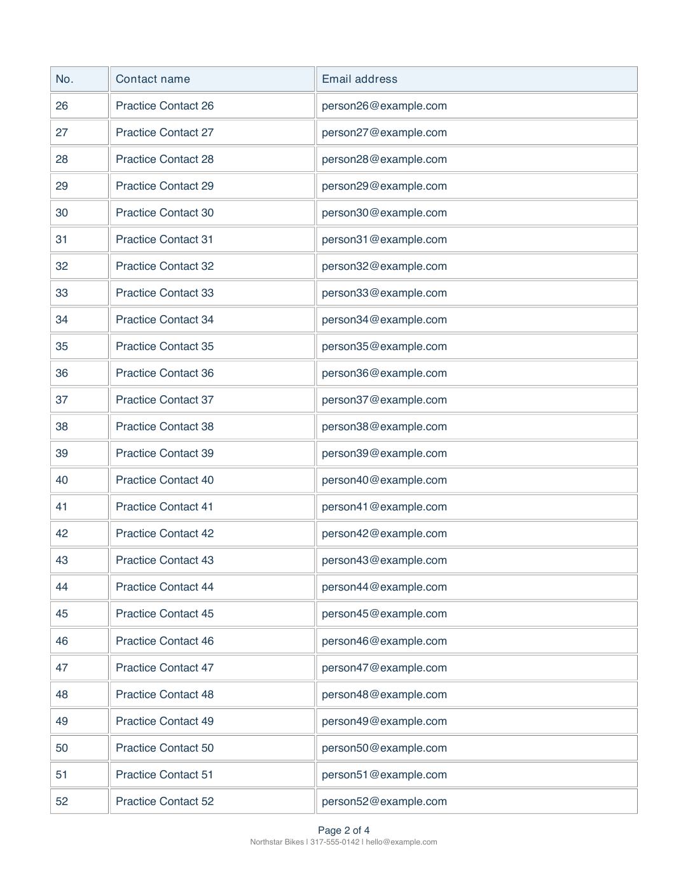

Portwood does not apply this rule to every template. Earlier layouts suffered mis-pagination with running page headers/footers and large bordered tables. Treat it as a template-specific choice: test long cells, wrapping rows, running headers, different page sizes, and the actual single, bulk, or giant-query entry point. A row taller than a page cannot be kept together simply by asking CSS to avoid a break.

#### Try the exact lab

Use the [HTML body](https://github.com/Portwood-Global-Solutions/Portwood/blob/main/docs/knowledgebase/examples/repeating-header-lab.html) and [Footer HTML](https://github.com/Portwood-Global-Solutions/Portwood/blob/main/docs/knowledgebase/examples/two-line-footer.html). The lab uses prepared `Name` and `Contacts.records` data; it does not require 90 real Contacts in your org. For normal Account queries, select the Contact fields and use the matching relationship alias.

**You are done when:** Every row appears once, labels repeat where needed, and no row or footer overlaps on any page.

The semantic-table approach was adapted from a [Portwood Community example](https://portwoodcommunity.slack.com/archives/C0AQS3BJG6L/p1790805020706859). The pagination rule and observed limits above come from the fresh 3.60.0 lab, rather than an assumption that the community snippet repeats on every layout.

_Advanced template builders · 9 min read · Reviewed for 3.60.0_

**Next:** [Build rich headers and two-line page footers](#running-headers-footers) · [Loops, row numbers, grouping, and scope](#tag-loops) · [Tune a demanding document](#engine-tuning)

---

<a id="running-headers-footers"></a>
<a id="574-header-footer-fields"></a>
<a id="574-header--footer-fields"></a>
<a id="575-page-numbers"></a>

### Build rich headers and two-line page footers

Use a simple page-number tag for a simple footer. Use CSS counters when you need page numbers alongside multiple formatted lines, logos, or other HTML.

#### The simple footer

In **Footer HTML**, enter:

```html
Page {PageNumber} of {TotalPages}
```

In the current engine, literal `{PageNumber}` or `{TotalPages}` in a header/footer selects a text-based page-margin path. The engine converts that HTML to text, so separate lines, images, and rich formatting can flatten. That explains a footer that looks right in the editor but loses its layout in the PDF.

#### The rich footer

1. Put these rules inside the main template body's `<head><style>…</style></head>`.
2. Put the following HTML in the template's **Footer HTML** field.
3. Keep literal `{PageNumber}` and `{TotalPages}` out of that header/footer.
4. Save a new active version and generate a multi-page PDF.

```css
.pw-page-number:before {
    content: counter(page);
}
.pw-total-pages:before {
    content: counter(pages);
}
```

```html
<div style="text-align:center;font-family:Helvetica,Arial,sans-serif;line-height:1.3;">
    <div style="font-size:9pt;">Page <span class="pw-page-number"></span> of <span class="pw-total-pages"></span></div>
    <div style="font-size:7pt;color:#7d7d7d;">Northstar Bikes | 317-555-0142 | hello@example.com</div>
</div>
```

Without the literal counter tags, Portwood uses a running HTML element for page furniture. The pseudo-elements supply the counters while keeping the HTML structure intact. The 3.60.0 lab verified both footer lines and the correct `Page 1 of 4` through `Page 4 of 4` values.

#### Make room for it

Set enough top/bottom margin for the actual logo, line height, and number of lines. Choose one owner for page size and margins. Imported `@page` rules, the designer's page setup, and header/footer controls can otherwise compete.

Keep counters in page furniture. These are PDF layout counters, not record fields or row numbers. A packet assembled from separately rendered PDFs can retain numbering from each original document; test whether that meets your requirement for the final packet.

#### When something still looks wrong

| Symptom                               | Check                                                                            |
| ------------------------------------- | -------------------------------------------------------------------------------- |
| Everything becomes one line           | Remove literal page-number tags from that header/footer and use counter spans    |
| Footer overlaps the body              | Increase the bottom margin and reduce oversized content                          |
| Page number is blank                  | Keep the CSS in the main body stylesheet; verify exact class names and final PDF |
| Custom font and literal counters fail | Use running HTML plus CSS counters and test the approved font specimen           |
| Header image is missing               | Confirm image access and dimensions in the actual render path                    |

This recipe adapts Dave's [two-line footer answer in Portwood Community](https://portwoodcommunity.slack.com/archives/C0B37JT11RA/p1792162191491549), checked against `wrapHtmlForPdf` and a real 3.60.0 PDF.

_Advanced template builders · 7 min read · Reviewed for 3.60.0_

**Next:** [Set paper, headers, and page backgrounds](#page-layout) · [Repeat table headers across PDF pages](#repeat-table-headers) · [Use custom PDF fonts](#custom-fonts)

---

<a id="grouped-reports"></a>

### Build grouped reports without broken table markup

Use one dataset and `{#GroupBy}` when the categories can change. Use deliberately filtered query aliases when each section has a different data-selection rule.

#### One table per stage

Select Opportunities with `Name`, `StageName`, and `Amount`. Sort by `StageName` if you want groups in stage order. This HTML wraps a complete table in the group and keeps the row loop inside its cells:

```html
<div>{#GroupBy Opportunities by StageName}</div>
<h2>{GroupName}</h2>
<table style="width:100%;border-collapse:collapse;">
    <thead>
        <tr>
            <th>Opportunity</th>
            <th>Amount</th>
        </tr>
    </thead>
    <tbody>
        <tr>
            <td>{#Opportunities}{Name}</td>
            <td>{Amount:currency}{/Opportunities}</td>
        </tr>
    </tbody>
</table>
<p>Stage total: {SUM:Opportunities.Amount:currency}</p>
<div>{/GroupBy}</div>
<p>All stages: {SUM:Opportunities.Amount:currency}</p>
```

Inside the group, the Opportunities relationship contains that group's members. Outside it, the total sees the whole available relationship. `{RowNumber}` restarts within each group's row loop.

#### A different alias is not a filter

Renaming `{#QuoteLineItems}` to `{#Purchase}` does not select purchase items. `Purchase` must exist in Query Config or the supplied data. Either configure two filtered aliases, use a prepared provider, or keep the real relationship and apply conditions to its rows. A conditional display does not automatically change an aggregate over the unfiltered relationship.

#### Keep table HTML valid

Do not place naked loop/IF text directly between `<table>`, `<tbody>`, and `<tr>`. Browsers can move that text outside the table before Portwood processes it. Keep row-loop markers in cells, and place group markers outside complete tables. After switching between visual editing and HTML, inspect the saved markup and preview again.

#### Respect scope

Within a Contact loop, `{Name}` means the Contact's Name. To print the root Account's Name, use a uniquely named root block such as `{~AccountHeading}{Name}{/AccountHeading}`. Root-scope blocks are unsupported inside giant-query loops; use a prepared layout/data structure for that case.

Test zero, one, and several groups, blank category values, and long labels. Compare group totals with a trusted Salesforce report before sharing the document.

_Advanced template builders · 8 min read · Reviewed for 3.60.0_

**Next:** [Loops, row numbers, grouping, and scope](#tag-loops) · [Counts, sums, averages, minimums, and maximums](#tag-totals) · [Tune a demanding document](#engine-tuning)

---

<a id="engine-tuning"></a>

### Tune a demanding document

Start with the smallest document that proves the business result. Add data, graphics, and styling in stages so you can tell which change creates a problem.

#### Pick the path for the job

| Job                                                  | Starting point                                               |
| ---------------------------------------------------- | ------------------------------------------------------------ |
| One normal record, interactive download              | Record-page Runner                                           |
| Many parent records                                  | Bulk Generation or Generate Bulk Documents Flow action       |
| One parent with a very large child list              | Auto Giant Query / the supported giant-query path            |
| Computed or external data already prepared           | JSON data or `DocGenDataProvider`; own the access checks     |
| A PDF Blob for another process, without a saved File | Global `DocGenService.generatePdfBlob…`                      |
| A packet of Portwood-native PDF parts in Apex        | Global `DocGenPdfMerger`, within its supported PDF structure |

Giant-query generation is asynchronous once it crosses the engine's large-relationship threshold. Follow the returned job rather than expecting an immediate File Id. It is different from bulk generation across many parent records.

#### Make the data smaller before making the heap larger

Select only used fields, filter relationships, order them deliberately, and set justified limits. Avoid huge rich-text fields and full-resolution images when the document prints a small thumbnail. A query limit changes the document's data and totals; disclose intended truncation to the reader rather than quietly hiding rows.

Use standard retrieval when it fits. When you supply JSON or an Apex map, Portwood cannot know whether your code was allowed to retrieve each value; enforce sharing, object access, and field access in the caller/provider.

#### Work with transaction boundaries

Do not assume a rendering API can run synchronously from a trigger or after arbitrary DML. Queue the document work into a fresh transaction and test the exact Flow/Apex entry point. Bulk rendering, chart preparation, file saves, and merging all consume resources. A method accepting a list does not promise unlimited work in one transaction.

Keep durable job outcomes and retries in your own process. Avoid retrying after an uncertain success without checking for the existing File/request; duplicate retries can create duplicate documents or invitations.

#### Use the PDF engine's strengths

Use tables for aligned print layouts, fixed units for controlled dimensions, simple borders, and a supported font. The renderer follows a CSS 2.1/paged model; browser flex/grid layouts, shadows, rounded corners, and JavaScript are not a reliable PDF design foundation. Use a pre-rendered image when a visual effect cannot be represented by the print engine.

For precise Word conversion, fix table widths and AutoFit rather than repeatedly changing the PDF's margins. The [layout reference](https://github.com/Portwood-Global-Solutions/Portwood/blob/main/docs/reference/template-layout.md) includes the width traps and a constrained HTML-authoring prompt.

#### Diagnose one variable at a time

1. Confirm the template, active version, record, output type, and running user.
2. Reduce to one field and one related row.
3. Add the original query selection, then loops and totals.
4. Add images, then charts, then page furniture.
5. Reintroduce the failing data volume last.
6. Compare preview, record Runner, and the actual automation path; they can prepare assets differently.

For a release, keep small, empty, long-text, many-row, multi-page, and representative image cases. Inspect the final files, not only the designer preview. A screenshot captures a symptom; the template version, query, data shape, and execution path make it reproducible.

_Advanced template builders · 9 min read · Reviewed for 3.60.0_

**Next:** [File and format limits](#limits) · [Generate documents from your own Apex](#apex-generation) · [Repeat table headers across PDF pages](#repeat-table-headers)

---

## Build with Apex

Call the managed package from your own Salesforce processes.

<a id="apex-generation"></a>
<a id="12-apex-api-reference"></a>
<a id="121-docgenservice-synchronous-generation"></a>
<a id="121-docgenservice--synchronous-generation"></a>

### Generate documents from your own Apex

Use `portwoodglobal.DocGenService` from subscriber Apex. Start with the method that matches the result your process needs.

#### Choose the method

| Result you need                           | Global method                                                                 | Result                                                     |
| ----------------------------------------- | ----------------------------------------------------------------------------- | ---------------------------------------------------------- |
| A File on the source record               | `generateDocument(templateId, recordId)`                                      | `ContentDocumentId`                                        |
| An explicit compatible output type        | `generateDocument(templateId, recordId, outputFormatOverride)`                | `ContentDocumentId`                                        |
| A saved File with a chosen title          | `generateDocument(templateId, recordId, outputFormatOverride, documentTitle)` | `ContentDocumentId`                                        |
| A different attachment target             | Add `attachmentRecordId` as the fifth argument                                | `ContentDocumentId`; null target creates a standalone File |
| PDF bytes without a saved File            | `generatePdfBlob(templateId, recordId)`                                       | Map with `blob` and `title`                                |
| A saved File from an already prepared map | `generateDocumentFromData(templateId, recordId, data)`                        | `ContentDocumentId`                                        |
| PDF bytes from a prepared map             | `generatePdfBlobFromData(templateId, data)`                                   | Map with `blob` and `title`                                |
| Prepared data with record context         | `generatePdfBlobFromData(templateId, recordId, data)`                         | Map with `blob` and `title`                                |
| Prepared data, output type, and File save | `generateAndSaveFromData(templateId, recordId, data, outputFormatOverride)`   | `ContentDocumentId`                                        |

`generateAndSaveFromData` also accepts a fifth `documentTitle` and a sixth `fileAttachmentTarget`. The second argument remains required. Passing a null sixth argument creates a standalone File; use a Blob method if you want no File at all.

#### Generate after the business transaction

A trigger or Flow can change records and then queue the document work. The worker gets a fresh transaction. Rendering is subject to platform transaction rules; do not paste a synchronous PDF call directly into a trigger and assume it is supported there.

The downloadable [KBGenerateAccountBrief class](https://github.com/Portwood-Global-Solutions/Portwood/blob/main/docs/knowledgebase/examples/apex/KBGenerateAccountBrief.cls) was deployed and executed in the fresh subscriber org. It looks up the template by its stable API Name and calls the global generation service from a Queueable implementing `Database.AllowsCallouts`.

```apex
// Run in your process after deciding this Account needs a document.
System.enqueueJob(new KBGenerateAccountBrief(accountId));
```

The example uses `KB_Account_Brief`, the [worked example](#example-library). Replace that stable key with your own template API Name. For a real deployment, add job outcome reporting, retries with duplicate protection, access checks appropriate to the caller, and tests for the business trigger.

#### Return bytes to another process

```apex
Map<String, Object> result = portwoodglobal.DocGenService.generatePdfBlob(templateId, accountId);
Blob pdf = (Blob) result.get('blob');
String title = (String) result.get('title');
// Your code can attach the bytes to an email or pass them to another system.
// This Portwood method does not itself send an email or create a File.
```

Read all inputs before rendering; keep preceding DML out of the render transaction. Test the exact document, image, and chart path you will use. Large outputs still consume Apex heap even when you do not save a File.

#### Handle access and failures deliberately

The standard retrieval path uses user-mode queries. A prepared map skips the source-record retrieval; template, file, font, and other supporting queries can still consume SOQL budget. Prepared maps and custom providers bypass that retrieval, so caller code must enforce access on the data it supplies. `with sharing` alone does not enforce field access.

Catch `portwoodglobal.DocGenException` for Portwood validation failures, and handle other platform/transaction failures in your job framework. Log safe identifiers and the failure reason; do not write entire documents, signing URLs, or sensitive merged values into logs.

The package's `DocGenController` and `DocGenBulkController` are internal UI controllers, not exported subscriber APIs. `@AuraEnabled` does not make a public controller global. Call the exported service/actions or your own authorized wrapper.

_Developers · 10 min read · Reviewed for 3.60.0_

**Next:** [Build a custom Apex data provider](#apex-data-provider) · [Call Flow actions and signing APIs from Apex](#apex-actions) · [All exported global Apex declarations](#apex-surface)

---

<a id="apex-data-provider"></a>
<a id="125-docgendataprovider-interface-custom-data-source"></a>
<a id="125-docgendataprovider-interface--custom-data-source"></a>

### Build a custom Apex data provider

A provider prepares the dataset before Portwood merges it. Use one for calculated values, deliberately shaped reports, or data that the visual query builder cannot express.

#### 1. Implement both required methods

```apex
global interface DocGenDataProvider {
    Map<String, Object> getData(Id recordId);
    List<String> getFieldNames();
}
```

Your class implements `portwoodglobal.DocGenDataProvider`; expose both methods as global. `getData()` supplies values and `getFieldNames()` supplies the authoring field list. The old one-method example was incomplete.

Use the complete [KBAccountProvider class](https://github.com/Portwood-Global-Solutions/Portwood/blob/main/docs/knowledgebase/examples/apex/KBAccountProvider.cls) and its [metadata file](https://github.com/Portwood-Global-Solutions/Portwood/blob/main/docs/knowledgebase/examples/apex/KBAccountProvider.cls-meta.xml). It uses `with sharing` and `WITH USER_MODE`, selects standard Account/Contact fields, limits the Contact query to 100, and implements both methods. The ContactCount is the count of those returned rows, not a claim to count unlimited Contacts.

#### 2. Understand the data shape

```apex
Map<String, Object> data = new Map<String, Object>{
    'Name' => 'Northstar Bikes',
    'Owner' => new Map<String, Object>{'Name' => 'Practice Owner'},
    'Contacts' => new Map<String, Object>{
        'records' => new List<Object>{
            new Map<String, Object>{'Name' => 'Avery Chen', 'Email' => 'avery@example.com'}
        }
    }
};
```

| Data                              | Template                                |
| --------------------------------- | --------------------------------------- |
| Root scalar                       | `{Name}`                                |
| Nested map                        | `{Owner.Name}`                          |
| Relationship wrapper with records | `{#Contacts}{Name}: {Email}{/Contacts}` |

Inside the loop, `Name` is the Contact's key. Include parent paths and list field paths in `getFieldNames()` so an author can discover them. Keep shape and casing stable as your provider evolves.

#### 3. Bind the template

Choose **Apex Class (Data Provider)** as its data source and enter `KBAccountProvider`, or set the equivalent Query Config:

```json
{ "v": 4, "provider": "KBAccountProvider" }
```

Save and activate a version, select a valid sample Account, and preview. The provider example was deployed and executed against the installed 3.60.0 package. It returned Northstar Bikes and two Contacts; its field list exposed the expected paths.

#### 4. Test your own boundary cases

Test an inaccessible record/field, no related rows, null values, many rows, and the intended Flow/bulk path. Keep data selection separate from layout so a template change does not silently widen access. A provider is responsible for sharing, object/field permissions, and any external integration policy.

#### Use a map without a provider

If your calling process already has the data, use `generatePdfBlobFromData` or `generateAndSaveFromData`. The same root/map/records shape applies. You do not need to insert temporary Salesforce records just to merge calculated values.

_Developers · 9 min read · Reviewed for 3.60.0_

**Next:** [Use prepared or custom data](#custom-data) · [Generate documents from your own Apex](#apex-generation) · [Loops, row numbers, grouping, and scope](#tag-loops)

---

<a id="apex-actions"></a>
<a id="124-flow-invocable-actions-full-signatures"></a>

### Call Flow actions and signing APIs from Apex

The global action classes can be called by subscriber Apex as well as Flow. Build their published request types and inspect the returned result for every input.

#### Action directory

| Class and entry point                                                 | Use                                                            | Result to follow                                      |
| --------------------------------------------------------------------- | -------------------------------------------------------------- | ----------------------------------------------------- |
| `DocGenFlowAction.generateDocument(List<Request>)`                    | Normal document generation, optional JSON data and save target | Success/error, ContentDocumentId and ContentVersionId |
| `DocGenGiantQueryFlowAction.generateDocument(List<Request>)`          | Automatic small/giant path selection                           | Immediate File or jobId plus isGiantQuery             |
| `DocGenBulkFlowAction.generateBulkDocuments(List<Request>)`           | Many parent records                                            | jobId and success/error                               |
| `DocGenSignatureFlowAction.generate(List<Request>)`                   | Create a current signing request                               | Request Id, ordered signer links and success/error    |
| `DocGenFieldWritebackService.writeBackFields(List<WritebackRequest>)` | Retry completed-request signer-field writeback                 | Inspect resulting record fields/errors                |

See the generated [global declarations](#apex-surface) for every published DTO field, and the task articles for the meaning of the Flow inputs.

#### Generate through a request object

```apex
portwoodglobal.DocGenFlowAction.Request input = new portwoodglobal.DocGenFlowAction.Request();
input.templateApiName = 'KB_Account_Brief';
input.recordId = accountId;
input.saveToRecord = true;
List<portwoodglobal.DocGenFlowAction.Response> results =
    portwoodglobal.DocGenFlowAction.generateDocument(
        new List<portwoodglobal.DocGenFlowAction.Request>{input});
if (!results[0].success) {
    System.debug(LoggingLevel.ERROR, results[0].errorMessage);
}
```

Run rendering in a supported fresh transaction. A list input is a contract shape, not permission to render an unlimited number of PDFs in one transaction.

The Generate Document request above was compiled and executed against the installed subscriber package; it returned success and a File Id.

#### Build current signers

```apex
portwoodglobal.DocGenSigner signer = new portwoodglobal.DocGenSigner();
signer.name = 'Jordan Rivera';
signer.email = 'jordan@example.com'; // replace with an intended recipient you control for testing
signer.role = 'Customer'; // matches {@Signature_Customer} in the practice template
portwoodglobal.DocGenSignatureFlowAction.Request input =
    new portwoodglobal.DocGenSignatureFlowAction.Request();
input.templateApiName = 'KB_Signing_Practice';
input.relatedRecordId = accountId;
input.signerRecords = new List<portwoodglobal.DocGenSigner>{signer};
input.signingOrder = 'Single';
input.sendEmails = false;
input.requireEmailVerification = false; // deliberate no-code test; choose your real policy
List<portwoodglobal.DocGenSignatureFlowAction.Result> results =
    portwoodglobal.DocGenSignatureFlowAction.generate(
        new List<portwoodglobal.DocGenSignatureFlowAction.Request>{input});
// Check success/errorMessage before consuming signatureRequestId or signerUrls.
```

Configure the public [signing site](#setup-signatures) first. Setting `sendEmails=false` suppresses invitation delivery; it is not the internal authenticated-preview mode and does not remove the need for email infrastructure if verification is enabled. Signing URLs are credentials: deliver them only to their intended recipients.

The signing request shape was also compiled and executed in the subscriber org with invitations and verification disabled. Its link loaded the PDF and both placements in a clean guest browser. That test did not submit the public request or exercise email delivery.

#### Avoid legacy-token traps

`DocGenSignaturePdfFlowAction.send` is deprecated; use Create Signature Request for new integrations. `DocGenSignatureValidator` can validate both modern signer tokens and legacy request tokens. `DocGenSignatureSubmitter` and `DocGenSignatureFinalizer` only submit/finalize the legacy request-token workflow; successful validation does not make those actions compatible with a modern token. Do not use the submitter/finalizer to inject a captured signature into a current v3 signer token; that is unsupported.

Use `DocGenSigner` for the signer collection. The older nested Signer type and parallel legacy lists remain published for compatibility, but the standalone type is the usable choice for new Flow authoring.

`DocGenSignaturePreparationController` also has global methods for the authenticated uploaded-PDF preparation UI: context, PDF selection/upload, draft load/save/send. They enforce record/draft ownership and expected revisions. This UI-oriented JSON/revision workflow is more coupled than the service/action APIs; use the packaged sender unless you intentionally own that full preparation experience.

_Developers · 10 min read · Reviewed for 3.60.0_

**Next:** [Make a document with Flow](#flow-generate) · [Create signing requests with Flow](#flow-signatures) · [All exported global Apex declarations](#apex-surface)

---

<a id="apex-utilities"></a>

### Use PDF, email, and cleanup helpers

These global helpers support specific jobs. Read the input limits before putting one into your process.

#### Merge Portwood-native PDFs

```apex
Blob packet = portwoodglobal.DocGenPdfMerger.mergePdfs(
    new List<Blob>{firstPdf, secondPdf}, true);
Integer pages = portwoodglobal.DocGenPdfMerger.pageCount(packet);
```

`mergePdfCvs(List<Id>, Boolean)` accepts ContentVersion Ids and loads parts incrementally. Passing `true` adds a blank page after every odd-length part, including the last part. Two one-page parts therefore produce four pages. The blank pages carry no page number; the content pages retain numbering baked into their original render.

This is a specialized server merger for Portwood's Flying Saucer/iText PDF 1.4 output with classic cross-reference tables and the expected page structure. It is not a general library for arbitrary uploaded product sheets, encrypted PDFs, object streams, or every PDF producer. Catch `DocGenPdfMerger.DocGenPdfMergeException` and use a compatible workflow for unsupported inputs. The packaged browser-side packet workflow is separate.

The 3.60.0 subscriber check generated a one-page Account Brief, merged two copies with padding, and confirmed the resulting four-page count.

#### Render a branded email without sending it

```apex
Map<String, String> tokens = new Map<String, String>{
    'SignerName' => 'Jordan Rivera', 'DocumentTitle' => 'Practice document',
    'SignatureUrl' => 'https://example.com/practice'
};
portwoodglobal.DocGenEmailTemplateService.RenderedEmail email =
    portwoodglobal.DocGenEmailTemplateService.render(
        portwoodglobal.DocGenEmailTemplateService.TYPE_REQUEST, tokens);
String subject = email.subject;
String html = email.htmlBody;
String plainText = email.plainBody;
```

Overloads add `messageOverride`, then `brandId`. `renderSubject(String, Map<String,String>)` resolves subject tokens. Rendering does not send an email, create a request, or authorize a signing URL. Use the appropriate email type/token contract and a real request's URL when building an actual notification.

The rendered subject and body were checked in the fresh org. No email was sent by this rendering test.

#### Schedule transient chart/PDF-part cleanup

```apex
System.schedule('Portwood transient cleanup', '0 0 * * * ?',
    new portwoodglobal.DocGenChartCvReaper());
```

Inspect Scheduled Jobs first so you do not add duplicate schedules. `reap()` is also exported and returns the number cleaned. The current helper targets old, orphan transient `chart_`/`pdfpart_` files, with age/job-state checks and a bounded batch. It is not a general Salesforce Files retention policy.

`DocGenEmailTemplateInstall` is the package install handler; `seedDefaults()` is an exported setup utility. Normal document generation does not require calling the install handler yourself.

#### Add native AI authoring

`DocGenAiProvider` requires `isAvailable()`, `getName()`, and `generateHtml(String)`. The optional Agentforce extension exports `DocGenEinsteinProvider`. Use [Agentforce setup](https://github.com/Portwood-Global-Solutions/Portwood/blob/main/docs/AGENTFORCE_SETUP.md) for entitlement and configuration. The native provider contract uses Einstein/ConnectApi and explicitly excludes HTTP-callout providers. Return a complete HTML document and handle unavailable configuration through `isAvailable()`.

_Developers · 9 min read · Reviewed for 3.60.0_

**Next:** [Generate documents from your own Apex](#apex-generation) · [Combine documents into one PDF](#document-packets) · [Get help from AI](#ai-authoring)

---

<a id="apex-surface"></a>

### All exported global Apex declarations

This inventory is generated from the same source checkout as the guide. It includes core global types, nested request/result types and fields, interface methods, and the optional Agentforce extension. It gives you an exact place to check an overload or DTO field while using the worked integration articles.

**Before you start:** Use the `portwoodglobal` namespace for core types in subscriber Apex. The optional extension requires its own installation/setup. Published legacy members remain in this list; their presence does not make them the preferred API for new work. Read the [action compatibility notes](#apex-actions) and [utility limits](#apex-utilities).

A source update that changes an exported declaration makes the generated guide stale until it is rebuilt. Review the related integration article and test your subscriber code against the new released package before marking the next release reviewed.

#### DocGenAiProvider

Core · [Source](https://github.com/Portwood-Global-Solutions/Portwood/blob/main/force-app/main/default/classes/DocGenAiProvider.cls)

```apex
global interface DocGenAiProvider
Boolean isAvailable()
String getName()
String generateHtml(String prompt)
```

#### DocGenBulkFlowAction

Core · [Source](https://github.com/Portwood-Global-Solutions/Portwood/blob/main/force-app/main/default/classes/DocGenBulkFlowAction.cls)

```apex
global with sharing class DocGenBulkFlowAction
global class Request
global Id templateId
global String templateApiName
global String queryCondition
global List<String> recordIds
global String sortOrder
global String jobLabel
global Boolean combinedPdfOnly
global Boolean keepIndividualFiles
global Boolean duplexPadding
global Integer batchSize
global class Response
global Id jobId
global String errorMessage
global Boolean success
global static List<Response> generateBulkDocuments(List<Request> requests)
```

#### DocGenChartCvReaper

Core · [Source](https://github.com/Portwood-Global-Solutions/Portwood/blob/main/force-app/main/default/classes/DocGenChartCvReaper.cls)

```apex
global with sharing class DocGenChartCvReaper implements Schedulable
global void execute(SchedulableContext ctx)
global static Integer reap()
```

#### DocGenDataProvider

Core · [Source](https://github.com/Portwood-Global-Solutions/Portwood/blob/main/force-app/main/default/classes/DocGenDataProvider.cls)

```apex
global interface DocGenDataProvider
Map<String, Object> getData(Id recordId)
List<String> getFieldNames()
```

#### DocGenEmailTemplateInstall

Core · [Source](https://github.com/Portwood-Global-Solutions/Portwood/blob/main/force-app/main/default/classes/DocGenEmailTemplateInstall.cls)

```apex
global with sharing class DocGenEmailTemplateInstall implements InstallHandler
global void onInstall(InstallContext context)
global static Integer seedDefaults()
```

#### DocGenEmailTemplateService

Core · [Source](https://github.com/Portwood-Global-Solutions/Portwood/blob/main/force-app/main/default/classes/DocGenEmailTemplateService.cls)

```apex
global with sharing class DocGenEmailTemplateService
global static final String TYPE_REQUEST = 'Signature_Request'
global static final String TYPE_REMINDER = 'Signature_Reminder'
global static final String TYPE_PIN = 'Verification_PIN'
global static final String TYPE_SIGNER_COMPLETED = 'Signer_Completed'
global static final String TYPE_ALL_SIGNED = 'All_Signed'
global static final String TYPE_DECLINED = 'Signer_Declined'
global static final String TYPE_REVOKED = 'Signature_Revoked'
global static final String TYPE_COMPLETION = 'Completion_Confirmation'
global static final List<String> ALL_TYPES = new List<String>
global static final String MODE_MANAGED = 'Managed'
global static final String MODE_FULL_HTML = 'Full_Html'
global class RenderedEmail
global String subject
global String htmlBody
global String plainBody
global static RenderedEmail render(String type, Map<String, String> tokens)
global static RenderedEmail render(String type, Map<String, String> tokens, String messageOverride)
global static RenderedEmail render(String type, Map<String, String> tokens, String messageOverride, Id brandId)
global static String renderSubject(String subjectTemplate, Map<String, String> tokens)
```

#### DocGenException

Core · [Source](https://github.com/Portwood-Global-Solutions/Portwood/blob/main/force-app/main/default/classes/DocGenException.cls)

```apex
global with sharing class DocGenException extends Exception
```

#### DocGenFieldWritebackService

Core · [Source](https://github.com/Portwood-Global-Solutions/Portwood/blob/main/force-app/main/default/classes/DocGenFieldWritebackService.cls)

```apex
global without sharing class DocGenFieldWritebackService
global class WritebackRequest
global String requestId
global WritebackRequest()
global static void writeBackFields(List<WritebackRequest> requests)
```

#### DocGenFlowAction

Core · [Source](https://github.com/Portwood-Global-Solutions/Portwood/blob/main/force-app/main/default/classes/DocGenFlowAction.cls)

```apex
global with sharing class DocGenFlowAction
global class Request
global Id templateId
global String templateApiName
global Id recordId
global Boolean saveToRecord
global String documentTitle
global String outputFormatOverride
global String jsonData
global class Response
global Id contentDocumentId
global Id contentVersionId
global String errorMessage
global Boolean success
global static List<Response> generateDocument(List<Request> requests)
```

#### DocGenGiantQueryFlowAction

Core · [Source](https://github.com/Portwood-Global-Solutions/Portwood/blob/main/force-app/main/default/classes/DocGenGiantQueryFlowAction.cls)

```apex
global with sharing class DocGenGiantQueryFlowAction
global class Request
global Id templateId
global Id recordId
global Boolean saveToRecord
global class Response
global Id contentDocumentId
global Id contentVersionId
global Id jobId
global Boolean isGiantQuery
global String errorMessage
global Boolean success
global static List<Response> generateDocument(List<Request> requests)
```

#### DocGenPdfMerger

Core · [Source](https://github.com/Portwood-Global-Solutions/Portwood/blob/main/force-app/main/default/classes/DocGenPdfMerger.cls)

```apex
global with sharing class DocGenPdfMerger
global class DocGenPdfMergeException extends Exception
global static Blob mergePdfs(List<Blob> pdfs, Boolean padOddDocuments)
global static Blob mergePdfCvs(List<Id> partCvIds, Boolean padOddDocuments)
global static Integer pageCount(Blob pdf)
```

#### DocGenService

Core · [Source](https://github.com/Portwood-Global-Solutions/Portwood/blob/main/force-app/main/default/classes/DocGenService.cls)

```apex
global with sharing class DocGenService
global static Map<String, Object> generatePdfBlob(Id templateId, Id recordId)
global static Id generateDocument(Id templateId, Id recordId)
global static Id generateDocument(Id templateId, Id recordId, String outputFormatOverride)
global static Id generateDocument(Id templateId, Id recordId, String outputFormatOverride, String documentTitle)
global static Id generateDocument( Id templateId, Id recordId, String outputFormatOverride, String documentTitle, Id attachmentRecordId )
global static Id generateDocumentFromData(Id templateId, Id recordId, Map<String, Object> preloadedRecordData)
global static Map<String, Object> generatePdfBlobFromData( Id templateId, Id recordId, Map<String, Object> preloadedRecordData )
global static Map<String, Object> generatePdfBlobFromData(Id templateId, Map<String, Object> dataMap)
global static Id generateAndSaveFromData( Id templateId, Id attachmentRecordId, Map<String, Object> dataMap, String outputFormatOverride )
global static Id generateAndSaveFromData( Id templateId, Id attachmentRecordId, Map<String, Object> dataMap, String outputFormatOverride, String documentTitle )
global static Id generateAndSaveFromData( Id templateId, Id attachmentRecordId, Map<String, Object> dataMap, String outputFormatOverride, String documentTitle, Id fileAttachmentTarget )
```

#### DocGenSignatureFinalizer

Core · [Source](https://github.com/Portwood-Global-Solutions/Portwood/blob/main/force-app/main/default/classes/DocGenSignatureFinalizer.cls)

```apex
global without sharing class DocGenSignatureFinalizer
global class FinalizeRequest
global String token
global String base64Image
global static void finalizeSignature(List<FinalizeRequest> requests)
```

#### DocGenSignatureFlowAction

Core · [Source](https://github.com/Portwood-Global-Solutions/Portwood/blob/main/force-app/main/default/classes/DocGenSignatureFlowAction.cls)

```apex
global with sharing class DocGenSignatureFlowAction
global class Signer
global Signer()
global String name
global String email
global String role
global Id contactId
global class Request
global Id templateId
global String templateApiName
global Id relatedRecordId
global List<Signer> signers
global List<DocGenSigner> signerRecords
global List<String> signerNames
global List<String> signerEmails
global List<String> signerRoles
global List<String> signerContactIds
global Boolean sendEmails
global String signingOrder
global String emailMessage
global String emailSubject
global Boolean requireEmailVerification
global Boolean prefillSignerEmail
global Integer expirationDays
global class Result
global Id signatureRequestId
global List<String> signerUrls
global List<String> signerNames
global List<String> signerEmails
global List<String> signerRoles
global String emailStatus
global Boolean success
global String errorMessage
global static List<Result> generate(List<Request> requests)
```

#### DocGenSignaturePdfFlowAction

Core · [Source](https://github.com/Portwood-Global-Solutions/Portwood/blob/main/force-app/main/default/classes/DocGenSignaturePdfFlowAction.cls)

```apex
global with sharing class DocGenSignaturePdfFlowAction
global class Request
global Id templateId
global Id contentVersionId
global Id relatedRecordId
global List<DocGenSigner> signerRecords
global String signingOrder
global String documentTitleFormat
global class Result
global Id signatureRequestId
global List<String> signerUrls
global List<String> signerNames
global List<String> signerEmails
global List<String> signerRoles
global Boolean success
global String errorMessage
global static List<Result> send(List<Request> requests)
```

#### DocGenSignaturePreparationController

Core · [Source](https://github.com/Portwood-Global-Solutions/Portwood/blob/main/force-app/main/default/classes/DocGenSignaturePreparationController.cls)

```apex
global with sharing class DocGenSignaturePreparationController
global static List<Contact> searchContacts(Id recordId, String search)
global static Map<String, Object> getContext(Id recordId)
global static Map<String, Object> uploadPdf(Id recordId, String fileName, String base64Pdf)
global static Map<String, Object> selectPdf(Id recordId, Id contentVersionId)
global static Map<String, Object> loadDraft(Id recordId, Id draftId)
global static Integer saveDraft(Id recordId, Id draftId, Integer expectedRevision, String configJson)
global static Map<String, Object> sendDraft(Id recordId, Id draftId, Integer expectedRevision, String configJson)
```

#### DocGenSignatureSubmitter

Core · [Source](https://github.com/Portwood-Global-Solutions/Portwood/blob/main/force-app/main/default/classes/DocGenSignatureSubmitter.cls)

```apex
global without sharing class DocGenSignatureSubmitter
global class FlowInput
global String token
global String signatureData
global class FlowOutput
global Boolean isSuccess
global String errorMessage
global static List<FlowOutput> submitSignature(List<FlowInput> inputs)
```

#### DocGenSignatureValidator

Core · [Source](https://github.com/Portwood-Global-Solutions/Portwood/blob/main/force-app/main/default/classes/DocGenSignatureValidator.cls)

```apex
global without sharing class DocGenSignatureValidator
global class FlowInput
global String token
global class FlowOutput
global Boolean isValid
global String errorMessage
global String signerName
global String documentTitle
global String documentUrl
global static List<FlowOutput> validateToken(List<FlowInput> inputs)
```

#### DocGenSigner

Core · [Source](https://github.com/Portwood-Global-Solutions/Portwood/blob/main/force-app/main/default/classes/DocGenSigner.cls)

```apex
global class DocGenSigner
global DocGenSigner()
global String name
global String email
global String role
global Id contactId
```

#### DocGenEinsteinProvider

Optional Agentforce extension · [Source](https://github.com/Portwood-Global-Solutions/Portwood/blob/main/agentforce-ext/main/default/classes/DocGenEinsteinProvider.cls)

```apex
global with sharing class DocGenEinsteinProvider implements DocGenAiProvider
global String getName()
global Boolean isAvailable()
global String generateHtml(String prompt)
global class DocGenAiException extends Exception
```

_Developers · 15 min read · Reviewed for 3.60.0_

**Next:** [Generate documents from your own Apex](#apex-generation) · [Build a custom Apex data provider](#apex-data-provider) · [Call Flow actions and signing APIs from Apex](#apex-actions) · [Use PDF, email, and cleanup helpers](#apex-utilities)

---

<a id="query-config"></a>
<a id="6-query-builder"></a>
<a id="61-v1-legacy-flat-string"></a>
<a id="61-v1--legacy-flat-string"></a>
<a id="62-v2--json-flat-junction-support"></a>
<a id="62-v2-json-flat-junction-support"></a>
<a id="63-v3--query-tree-multi-object-any-depth"></a>
<a id="63-v3-query-tree-multi-object-any-depth"></a>
<a id="64-using-the-visual-builder"></a>
<a id="65-per-child-filters-order-by-limit"></a>

### Query configuration formats and aliases

V1, V2, and V3 describe Salesforce record queries. V4 binds a custom provider or the special Flow JSON source. Use the visual V3 builder for new record-query templates unless a specific integration needs a different format.

#### V1 — Legacy flat string

Plain field/subquery selection string. Use V3 when you need a richer tree or explicit child configuration.

```
Name, Industry, (SELECT FirstName, LastName FROM Contacts)
```

Detected when the config does NOT start with `{`.

#### V2 — JSON flat (junction support)

Adds junction-object support for many-to-many (e.g., Account ↔ Contact via AccountContactRelation).

```json
{
    "v": 2,
    "baseObject": "Opportunity",
    "baseFields": ["Name"],
    "parentFields": ["Account.Name"],
    "children": [{ "rel": "OpportunityLineItems", "fields": ["Name"] }],
    "junctions": [
        {
            "junctionRel": "OpportunityContactRoles",
            "targetObject": "Contact",
            "targetIdField": "ContactId",
            "targetFields": ["FirstName"]
        }
    ]
}
```

#### V3 — Query tree (multi-object, any depth)

Preferred. Tree of nodes — each node is one SOQL query, stitched into the parent's data map via `lookupField`.

```json
{
    "v": 3,
    "root": "Account",
    "nodes": [
        {
            "id": "n0",
            "object": "Account",
            "fields": ["Name"],
            "parentFields": ["Owner.Name"],
            "parentNode": null,
            "lookupField": null,
            "relationshipName": null
        },
        {
            "id": "n1",
            "object": "Contact",
            "fields": ["FirstName"],
            "parentFields": [],
            "parentNode": "n0",
            "lookupField": "AccountId",
            "relationshipName": "Contacts"
        },
        {
            "id": "n2",
            "object": "Opportunity",
            "fields": ["Name", "Amount"],
            "parentFields": [],
            "parentNode": "n0",
            "lookupField": "AccountId",
            "relationshipName": "Opportunities"
        },
        {
            "id": "n3",
            "object": "OpportunityLineItem",
            "fields": ["Quantity"],
            "parentFields": ["Product2.Name"],
            "parentNode": "n2",
            "lookupField": "OpportunityId",
            "relationshipName": "OpportunityLineItems"
        }
    ]
}
```

#### Using the visual builder

The visual query builder walks your schema like a tree: start from the base object, tick fields (blue pills), climb into **+ parent lookup**, and expand **+ related list** child sections — each child with its own Tag name, Filter (WHERE), Sort by, and Limit. It writes a V3 config. As of v3.37 the same builder appears everywhere a query gets built: **Edit Template → Query Configuration**, the **designer's Query panel**, and the **Generate-with-AI** step.

**Multi-hop parent traversal (v1.97+).** On any object's `parentFields` panel, expand a lookup and the builder now recurses into the parent's lookup tree — for example, on an Opportunity tab, expand `Account` → `Parent` → `Owner` → pick `Name`, and the resulting merge tag is `{Account.Parent.Owner.Name}`. The recursion is capped at 5 hops to keep schema-load latency bounded. Each hop loads its target object's fields lazily on expand. Use this when the data you need lives more than one lookup away from the base object and you don't want to compose `parentFields` paths by hand.

For direct JSON editing or V1 legacy configs, toggle **Manual Query** mode and the older `docGenQueryBuilder` appears.

#### Per-child filters, order by, limit

Each V3 child node supports:

- `fields`: scalar fields to SELECT
- `parentFields`: dotted lookup fields (e.g., `Product2.Name`)
- `where`: optional `WHERE` clause (sanitized for SOQL injection)
- `orderBy`: optional `ORDER BY` (sanitized)
- `limit`: optional `LIMIT`

Applies to both sync and giant-query paths.

#### Apex Data Provider (V4 — class-backed templates)

When the data you need to render isn't an SObject — external API responses, computed totals, cross-object aggregations, anything SOQL can't reach — implement the `portwoodglobal.DocGenDataProvider` interface in your org and bind a template to that class. The merge engine calls your class at render time and uses whatever Map you return.

##### Step 1 — write the provider class in your org

```apex
/** Subscriber-side example. Deploy to your org after installing Portwood. */
global with sharing class KBAccountProvider implements portwoodglobal.DocGenDataProvider {
    global Map<String, Object> getData(Id recordId) {
        Account account = [
            SELECT Name, Industry, Phone
            FROM Account
            WHERE Id = :recordId
            WITH USER_MODE
            LIMIT 1
        ];
        List<Object> contacts = new List<Object>();
        for (Contact contact : [
            SELECT Name, Email, Title
            FROM Contact
            WHERE AccountId = :recordId
            WITH USER_MODE
            ORDER BY Name
            LIMIT 100
        ]) {
            contacts.add(
                new Map<String, Object>{ 'Name' => contact.Name, 'Email' => contact.Email, 'Title' => contact.Title }
            );
        }
        return new Map<String, Object>{
            'Name' => account.Name,
            'Industry' => account.Industry,
            'Phone' => account.Phone,
            'ContactCount' => contacts.size(),
            'Contacts' => new Map<String, Object>{ 'records' => contacts }
        };
    }
    global List<String> getFieldNames() {
        return new List<String>{
            'Name',
            'Industry',
            'Phone',
            'ContactCount',
            'Contacts.Name',
            'Contacts.Email',
            'Contacts.Title'
        };
    }
}
```

The sample deliberately returns at most 100 Contacts; its count reflects those returned rows. For a minimal deployed-and-executed example, use [KBAccountProvider](#apex-data-provider).

Two methods are required, both `global`. `getData` returns a `Map<String, Object>`; `getFieldNames` returns the list of merge tags shown in the wizard.

The interface lives in the managed package — reference it with the full namespace: `portwoodglobal.DocGenDataProvider`.

##### Step 2 — bind a template to the class

In the Portwood app → New Template:

1. **Step 1 — Data Source**: pick **Apex Class (Data Provider)** instead of Salesforce Record.
2. **Data Provider Class**: search for your class name (e.g., `KBAccountProvider`). The picker filters to classes implementing `portwoodglobal.DocGenDataProvider`. Select yours.
3. The wizard validates the class, calls `getFieldNames()`, and displays the available merge tags.
4. **Step 2** lands directly on the connected-provider view. Compose your template body using the merge tags as you would for any other template.
5. **Step 3** — review and save.

Behind the scenes the template's `Query_Config__c` becomes `{"v":4,"provider":"KBAccountProvider"}`. You can also flip an existing SOQL-backed template to v4 from the **Edit modal → Query Configuration → Use Apex data provider** link.

##### Step 3 — generate

Same as any template. The Portwood app's Generate button, the **Generate Document** Flow action, the Apex `DocGenService.generateDocument()` API — all of them detect the v4 binding automatically and call your class.

```apex
// From Apex — exactly the same call shape as a SOQL-backed template
Id contentDocId = portwoodglobal.DocGenService.generateDocument(templateId, accountId, null);
```

##### Common patterns

- **External callout**: do the callout in `getData`, parse the response, return the parsed Map. Bear in mind callouts subject to governor limits and DML-before-callout rules.
- **Cross-object aggregations**: query whatever you need, build aggregates in Apex, expose them as merge tags.
- **Custom Metadata-driven**: read Custom Metadata Type records to resolve the data shape dynamically.
- **Standalone (no recordId)**: ignore the `recordId` parameter and return data assembled from elsewhere. Useful for "render a report for the current user" templates.

If you don't want template-side binding at all — the data is already in a Flow variable or an Apex wrapper — use **runtime data injection** instead: the **Generate Document** Flow action accepts a `JSON Data` invocable variable, and `DocGenService.generatePdfBlobFromData(templateId, dataMap)` accepts an Apex Map directly. Same merge engine, same tags, no class to write.

##### 6.6.1 JSON Data (from Flow) — template authoring mode

When a template will _only_ ever receive its data from a Flow via `DocGenFlowAction.jsonData`, pick **JSON Data (from Flow)** as the Data Source in Step 1. The wizard then skips the Base Object picker, the SOQL query builder, and the Apex Provider class picker — there's nothing to configure between naming the template and uploading the document.

Behind the scenes the template stores `Base_Object_API__c = 'FlowJsonData'` (a sentinel value) and `Query_Config__c = {"v":4,"source":"flowJsonData"}`. The sentinel keeps the template invisible to the standard record-page Generate-Document launcher (whose query is `WHERE Base_Object_API__c = :objectApiName`) — JSON Data templates are intentionally Flow-only. To invoke one, pass `jsonData` into the **Generate Document** Flow action; the merge engine resolves `{Field}`, `{Parent.Field}`, and `{#Items}…{/Items}` against your JSON shape just like any other template.

---

_Developers and advanced administrators · 12 min read · Reviewed for 3.60.0_

**Next:** [Choose the information in a document](#choose-data) · [Build a custom Apex data provider](#apex-data-provider) · [Build grouped reports without broken table markup](#grouped-reports)

---

## Examples and help

Learn from finished examples and fix the problem in front of you.

<a id="example-library"></a>

### Try the worked examples

Start with a working example, then change one thing at a time.

These files use standard Salesforce fields. The fictional examples use Northstar Bikes, its Contacts, and its Opportunities.

#### Account brief

**Makes:** A customer summary with Contact rows, Opportunity rows, and a total.

**Base object:** Account. **Type:** HTML. **Output:** PDF.

[Open the Account Brief template](https://github.com/Portwood-Global-Solutions/Portwood/blob/main/docs/knowledgebase/examples/account-brief.html). Use GitHub's download control to save the HTML file, then [import it](#import-html).

Include these fields:

- Account: Name, Industry, Phone, BillingCity, BillingState, AnnualRevenue.
- Contacts: FirstName, LastName, Title, Email.
- Opportunities: Name, StageName, Amount.

Sort Contacts by LastName and Opportunities by Name. Generate with an Account that has both lists.

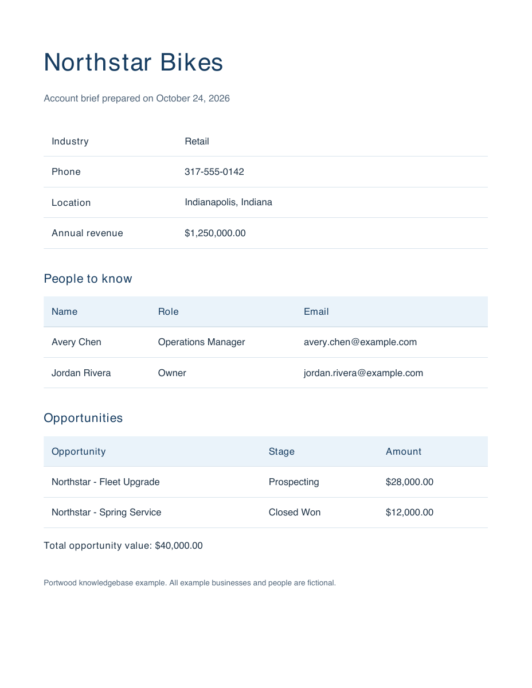

**Try next:** Remove one optional value, add another Contact, change a heading, then regenerate. The corresponding values and row count should change without redesigning the table.

#### Opportunity summary

**Makes:** A one-page deal summary with a parent Account, formatted amount/date, and a conditional closing message.

**Base object:** Opportunity. **Type:** HTML. **Output:** PDF.

[Open the Opportunity Summary template](https://github.com/Portwood-Global-Solutions/Portwood/blob/main/docs/knowledgebase/examples/opportunity-summary.html).

Include Name, Account.Name, Amount, StageName, CloseDate, and IsWon. Generate once for a won Opportunity and once for an open one; the final message should change.

#### Signing practice

**Makes:** A fictional practice document with a Customer signature and signing date.

**Base object:** Account. **Type:** HTML. **Data:** Name.

[Open the Signing Practice template](https://github.com/Portwood-Global-Solutions/Portwood/blob/main/docs/knowledgebase/examples/signing-practice.html). Use the signer role **Customer** to match its tags.

Use it in a test org before sending real agreements. It demonstrates signature placement; it is not a business contract.

#### More advanced examples

The repository's [demo template library](https://github.com/Portwood-Global-Solutions/Portwood/tree/main/DEMO%20TEMPLATES) includes additional layouts. Read each example's field and object requirements before importing it; some require the demo schema or a developer-supplied provider.

#### Advanced layout lab

Use [Repeat table headers](#repeat-table-headers) for the 90-row, four-page HTML lab and [rich page footers](#running-headers-footers) for its two-line Page X of Y footer. The downloadable body/footer and scratch-only verification script make the recipe repeatable for later releases. For subscriber code, use the [custom provider](#apex-data-provider) and [Queueable generation example](#apex-generation).

_Template builders · 7 min read · Reviewed for 3.60.0_

**Next:** [Make your first document](#first-document) · [Make a table that grows](#repeating-tables) · [Send a template for signature](#sign-template)

---

<a id="troubleshooting"></a>
<a id="1321-error-logs"></a>
<a id="15-troubleshooting"></a>
<a id="151-generation-fails-with-error-generating-document"></a>
<a id="152-raw-css-appears-at-the-top-of-generated-pdfs"></a>
<a id="153-heap-size-too-large"></a>
<a id="154-merge-tags-render-as-literal-text-eg-name-appears-in-the-output"></a>
<a id="156-pdf-image-is-broken--doesnt-render"></a>
<a id="156-pdf-image-is-broken-doesnt-render"></a>
<a id="1511-long-text-breaks-out-of-a-table-cell"></a>
<a id="1513-still-stuck"></a>

### Find and fix a problem

Start with what you can see. Make one change, then try the same record again.

| What happened?                                          | Start here                                                 |
| ------------------------------------------------------- | ---------------------------------------------------------- |
| Portwood or the Generate tool is missing                | [Access and record-page setup](#manage-access)             |
| A template is missing from the list                     | [Organize and limit template choices](#organize-templates) |
| Blank values, visible tags, odd tables, or a broken PDF | [Fix a document](#fix-document)                            |
| A signing link, PDF preview, or email does not work     | [Fix a signing problem](#fix-signing)                      |
| A large job failed or stopped moving                    | [Read job status](#job-history)                            |
| Canvas, HTML, or Excel is missing from Type             | [Upgrade checklist and picklist repair](#upgrade-portwood) |
| A font looks wrong                                      | [Use custom PDF fonts](#custom-fonts)                      |

#### Check these first

1. **The record:** Is it the one you intended, and does it have the missing values?
2. **The template:** Is the intended template and version active?
3. **The entry point:** Did the failure happen in a sample preview, the runner, bulk, a button, or Flow?
4. **The error:** Copy the displayed message before closing it.

An administrator can check **Portwood Error Logs** in the app navigation. For bulk work, also open the job. For Flow, inspect both the returned Error Message and any faulted interview.

#### Ask for useful help

Include:

- Installed Portwood version.
- Template name and API Name.
- The entry point and steps that failed.
- The record or job ID through your approved support channel.
- The exact error and approximate time.
- Expected result versus actual result, with a sanitized screenshot when useful.

Do not post signing tokens, live invitation links, passwords, or sensitive customer documents in a public issue. Use a fictional or sanitized example when sharing publicly.

Use [Portwood support](https://portwood.dev/support) for help with your org or [the community](https://portwood.dev/community) for general usage questions.

_Everyone · 4 min read · Reviewed for 3.60.0_

**Next:** [Fix a document](#fix-document) · [Fix a signing problem](#fix-signing) · [Read job status and recover failures](#job-history)

---

<a id="fix-document"></a>

### Fix a document

Use the symptom that matches your output, then regenerate the same test record.

#### A value is blank or a tag still appears

1. Open the source record and check its value.
2. Confirm the field is selected in the template's **Data/Query** configuration.
3. Copy the tag from the field chooser instead of retyping it. Field spelling and relationship paths matter.
4. For a table, check that opening and closing loop names match and both belong in the data row.
5. Save the document as a new version and confirm that version is active.
6. Test with the affected user's field and record access.

An unknown or unavailable field can resolve to blank. A missing closing brace or section can fail generation. Plain prose wrapped in `{braces}` can be treated as a tag too.

#### My uploaded changes do not appear

Upload the replacement file and click **Save as New Version**. A details-only save does not activate a staged file. In Canvas, use **Save**. Reopen the active version and regenerate.

#### The PDF shows raw CSS

Ask the administrator to check the **Blob.toPdf() Visualforce PDF Rendering Service** release update. Also confirm the package version: an older bug could strip CSS declarations from a style block in the body; that was fixed in v3.55.

For a current package, save and test a small copy of the affected template and include the actual output in the support investigation.

#### A picture is missing

Check whether it is a shared asset, a template image, or an image inside a Salesforce rich-text field. Verify the source exists, the running user can access it, and the template was saved after upload.

Test rich-text images through the actual record runner as well as the authoring preview; the paths can differ. For important fixed artwork, use a shared asset or a sized image tag rather than relying on an oversized pasted photograph.

#### Text runs through a table border

First check for long strings with no spaces, such as URLs, identifiers, or codes. The PDF renderer does not honor every browser word-wrap rule.

Give the value more width, put it on a separate full-width row, or use a display-specific field with sensible break points. Do not insert visible spaces or hyphens into a value someone must copy exactly. For authored static HTML, `<wbr />` can mark intentional break points.

For Word tables that should align, use consistent fixed widths and avoid mixing incompatible AutoFit settings. See the [layout reference](https://github.com/Portwood-Global-Solutions/Portwood/blob/main/docs/reference/template-layout.md).

#### The document is too large

Compress source images, limit unnecessary related rows, and test the appropriate runner or background path. For bulk, reduce Batch Size to 1 and consider Individual Files. A background route still has Salesforce limits; it is not unlimited.

If you see a heap, timeout, or upload error, keep its exact text. Use [file and format limits](#limits) and job history to choose the next attempt.

_Template builders · 6 min read · Reviewed for 3.60.0_

**Next:** [Choose the information in a document](#choose-data) · [File and format limits](#limits) · [Find and fix a problem](#troubleshooting)

---

<a id="fix-signing"></a>
<a id="155-signature-emails-dont-arrive"></a>
<a id="159-signing-preview-is-blank--document-unavailable-on-an-experience-cloud-site"></a>
<a id="159-signing-preview-is-blank-document-unavailable-on-an-experience-cloud-site"></a>
<a id="1510-signing-link-opens-to-invalid-page-on-an-experience-cloud-site"></a>

### Fix a signing problem

Check the request and delivery state before resending.

#### The invitation or code email did not arrive

1. Check the recipient's address and spam folder.
2. Check **Email Status** on the signature request.
3. Confirm this is not an internal **Preview signing in Salesforce** request; that delivery intentionally suppresses invitations, reminders, and completion emails.
4. Ask the administrator to check Salesforce Deliverability, the verified Organization-Wide Email Address, profile availability, sending-domain authentication, and email limits.

On a sequential request, later signers may not be invited until the preceding signer completes.

Changing DNS or email security policy requires your email administrator. Use the actual delivery error to decide what to change.

#### The public link says Invalid page

Ask the administrator to check **Signature Site URL**. An Experience Cloud base URL should not end with `/s`. Confirm the signing Visualforce pages are enabled on the site currently serving the links, and that its own guest user has **Portwood Guest Signature**.

After correcting setup, test a fresh request. Moving to another site does not transfer the old site's guest assignments automatically.

#### The page opens but the PDF says Document unavailable

For Experience Cloud, check **Administration → Preferences → Let guest users view asset files, library files, and CMS content available to the site**. Then confirm guest permissions and test again outside a signed-in Salesforce session.

Classic Salesforce Sites do not use that particular Experience Cloud preference.

#### The link expired or was already used

Open the request's status. A resend replaces unsigned signers' old links; a revoke invalidates them; a completed signer cannot sign again. Send the person the newest valid link through the intended workflow rather than copying an old invitation.

#### Continue or Review request is disabled

For uploaded PDFs, check:

- Every recipient has a name and valid email.
- Every recipient has at least one Signature field.
- Fields stay within page boundaries.
- The PDF is unlocked, unsigned, no larger than 2 MB, and no more than 50 pages.
- The request is within the 10-recipient and 100-field limits.

For template requests, also check signer roles against the template's signature tags.

#### The signed file is missing

Check whether **all** required signers finished, refresh requests, and open Files on the related record. Look at the request's completion state and Portwood Error Logs before sending a duplicate request.

_Senders and administrators · 6 min read · Reviewed for 3.60.0_

**Next:** [Set up external signing](#setup-signatures) · [Track, resend, or stop a request](#manage-signatures)

---

<a id="glossary"></a>

### Plain-language glossary

| Word                                | What it means here                                                             |
| ----------------------------------- | ------------------------------------------------------------------------------ |
| **Active template**                 | A template offered for use, subject to its visibility rules                    |
| **Active version**                  | The saved document body used for generation                                    |
| **API Name**                        | A stable template key for buttons and automations, such as `Account_Brief`     |
| **Asset**                           | A reusable image or approved font managed in Portwood                          |
| **Base object**                     | The type of record a template starts from                                      |
| **Brand**                           | A reusable company identity for signing, including sender, logo, and color     |
| **Bulk job**                        | A run that makes documents for many records                                    |
| **Canvas**                          | The visual page editor where you position blocks                               |
| **Child / related list**            | Several records linked to the current record, such as an Account's Contacts    |
| **Field-level security**            | Salesforce access rules controlling which fields a user may read or change     |
| **Flow**                            | Salesforce's visual automation builder                                         |
| **Giant query**                     | Portwood's background approach for some very large document datasets           |
| **Merge tag**                       | A marker replaced with a value, for example `{Name}`                           |
| **Native format**                   | The template's editable Office format, such as Word or Excel                   |
| **Org**                             | A Salesforce environment, such as production, a sandbox, or a scratch org      |
| **Organization-Wide Email Address** | A Salesforce-configured sender address; often abbreviated OWA                  |
| **Packet**                          | Several documents collected into one generation or signing workflow            |
| **Parent lookup**                   | A link to one related record, such as an Opportunity's Account                 |
| **Permission set**                  | A bundle of Salesforce access assigned to a user                               |
| **PIN / email code**                | A one-time code sent to verify a signer's email                                |
| **Query**                           | The instructions selecting which fields and related records a template can use |
| **Record**                          | One Salesforce item, such as one Account                                       |
| **Sample record / Test Record**     | A selected record used to preview a template                                   |
| **SOQL condition**                  | A Salesforce data filter, such as `StageName = 'Closed Won'`                   |
| **Template**                        | A reusable document design and its data/settings                               |
| **Version**                         | A saved template snapshot you can activate or return to                        |

_Everyone · 4 min read · Reviewed for 3.60.0_

**Next:** [Welcome to Portwood](#welcome)

---

<a id="developer-reference"></a>
<a id="119-recipe-custom-signing-ui-advanced-legacy-requests-only"></a>
<a id="119-recipe--custom-signing-ui-advanced-legacy-requests-only"></a>
<a id="1191-compatibility--which-tokens-these-actions-accept"></a>
<a id="1191-compatibility-which-tokens-these-actions-accept"></a>
<a id="1192-not-supported--injecting-a-captured-signature-image-into-a-v3-signer"></a>
<a id="1192-not-supported-injecting-a-captured-signature-image-into-a-v3-signer"></a>
<a id="1193-legacy-custom-screen-flow"></a>
<a id="122-docgencontroller-lwc-aura-endpoints"></a>
<a id="122-docgencontroller--lwc--aura-endpoints"></a>
<a id="123-docgenbulkcontroller-bulk-generation"></a>
<a id="123-docgenbulkcontroller--bulk-generation"></a>
<a id="126-namespace-prefix"></a>

### Developer and advanced references

Start with [Find the right merge tag](#merge-tags), [Apex generation](#apex-generation), [custom providers](#apex-data-provider), or [all global declarations](#apex-surface). For layout recipes, use [repeating table headers](#repeat-table-headers) and [rich page footers](#running-headers-footers). These articles are searchable here in the guide.

Use these references when your task needs precise syntax or custom code. The beginner lessons remain the best place to learn the normal workflows.

| Reference                                                                                                                             | What you will find                                                                                                                          |
| ------------------------------------------------------------------------------------------------------------------------------------- | ------------------------------------------------------------------------------------------------------------------------------------------- |
| [Merge tag reference](https://github.com/Portwood-Global-Solutions/Portwood/blob/main/docs/reference/merge-tags.md)                   | Field formats, nested loops, grouping, conditions, totals, charts, images, barcodes, signatures, running-user fields, and Classic Approvals |
| [Query and data-provider reference](https://github.com/Portwood-Global-Solutions/Portwood/blob/main/docs/reference/query-config.md)   | Legacy query formats, V3 trees, parent/child paths, V4 providers, JSON data                                                                 |
| [HTML and Word layout reference](https://github.com/Portwood-Global-Solutions/Portwood/blob/main/docs/reference/template-layout.md)   | PDF styling support, HTML authoring prompt, headers/footers, Word widths and AutoFit                                                        |
| [Apex and Flow API reference](https://github.com/Portwood-Global-Solutions/Portwood/blob/main/docs/reference/apex-api.md)             | Service methods, invocable signatures, namespace usage                                                                                      |
| [Advanced automation and compatibility](https://github.com/Portwood-Global-Solutions/Portwood/blob/main/docs/reference/automation.md) | Legacy signing actions, signer-input writeback, JSON examples, asynchronous job polling, error handling                                     |
| [Documentation maintenance](https://github.com/Portwood-Global-Solutions/Portwood/blob/main/docs/knowledgebase/MAINTAINING.md)        | Article sources, generated outputs, release review, screenshots, validation                                                                 |

#### Use the managed-package namespace

In Apex outside the package, exported class references use the `portwoodglobal` namespace. Salesforce object and field API names use `portwoodglobal__`.

Prefer a template's stable API Name where an action supports it. Record IDs are specific to an org. Some actions still require a Template ID; check that action's inputs rather than assuming all actions accept the same key.

#### Treat output paths separately

Interactive generation has a browser available. Flow, batch, and Apex generation run on the server and have different memory and rendering constraints. Test the entry point your users or automation will actually use.

The guide's reviews identify their source dependencies for maintainers. When source and a historical example disagree, check the current method contract and verify the behavior in a subscriber test org before shipping an integration.

For exact query JSON, use [Query configuration formats](#query-config). For jobs, use [asynchronous completion](#async-jobs). For signer-supplied values, use [Signer Inputs](#signer-inputs) and the [email-token directory](#email-tokens).

_Developers and advanced administrators · 4 min read · Reviewed for 3.60.0_

**Next:** [Use prepared or custom data](#custom-data) · [Make a document with Flow](#flow-generate)

---
